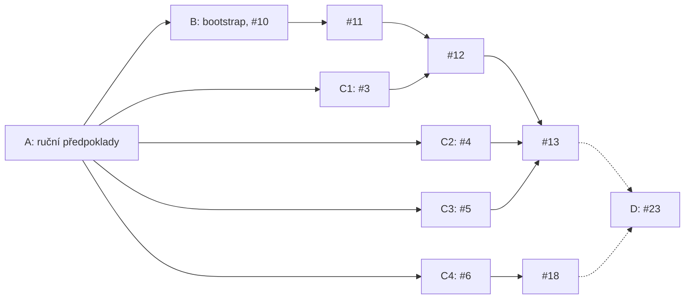

# Příprava a akceptace referenční instance

Začni průvodcem `tools/Start-InstanceSetup.ps1`. Bez přepínačů provede fázi A a krok B1. Ověří tenant Entra ID, Azure a enterprise na GHE.com. Změny, které mají API, provede po tvém potvrzení. Kroky bez API popíše cestou v UI. Přepínač `-GitHubAcceptance` naváže na ověřené vstupy z #10 a provede [akceptaci GitHub části bootstrapu](#akceptace-github-části-bootstrapu-11). Fáze D je akceptace přírůstku 1 po implementaci zbylých issues.

Postup provádí člen Platform team (platformní tým) na Reference instance (referenční instanci). Kroky mají tyto části:

- **Proč** vysvětluje, co by bez kroku selhalo.
- **Průvodce** ve fázi A popisuje, co průvodce ověří a změní.
- **Tvoje akce** ve fázi A popisuje kroky bez API, které provedeš v UI.
- **Postup** ve fázích B–D uvádí příkazy nebo cestu v UI.
- **Ověření** popisuje výsledek, který musíš vidět, než budeš pokračovat.

## Proč postup vyžaduje člověka

- Offline testy Pester ověřují nástroje proti náhradám cloudových API. Neprokazují, že skutečné API Azure, Microsoft Graph a GHE.com přijme stejná volání a oprávnění.
- Platforma nevytváří tenant, enterprise, OIDC SSO, SCIM provisioning, subscriptions ani licence. Tyto položky jsou Manual prerequisites (ruční předpoklady). Průvodce a bootstrap část z nich ověří přes API. Zbytek potvrdí člověk. Průvodce potvrzení zapíše jako příznak v `manualPrerequisites`.
- Některé kroky nemají API: zapnutí OIDC SSO, konfigurace SCIM, registrace a instalace GitHub App, část enterprise politik a kontrola licencí GitHubu. Průvodce u nich ukáže cestu v UI a vyžádá potvrzení.
- Issues #3–#6 ověřují chování API, na kterém stojí návrh modulů `emu-identity`, `organizations` a `enterprise-baseline`. Agent tyto moduly implementuje až podle výsledků.
- Kroky vyžadují role, které agent nemá: Global Administrator, Privileged Role Administrator a enterprise owner.

## Přehled fází

| Fáze | Obsah | Uzavře | Odblokuje |
|---|---|---|---|
| A | Ruční předpoklady tenantu, Azure a enterprise přes průvodce | – | B a C |
| B | Bootstrap na referenční instanci | #10 | #11 |
| C | Ověření 73–76 | #3, #4, #5 a #6 | #12, #13 a #18 |
| D | Akceptace přírůstku 1 | #23 | – |

Fáze B a C mohou běžet souběžně. Ověření C1–C4 na sobě nezávisí. C2 a C4 sdílejí App z kroku A9.



Plné šipky ukazují blokace, které uvolní tvoje kroky. Čárkované šipky vedou k akceptaci. #23 blokují přímo #18, #20, #21 a #22. Úplné blokace uvádí každé issue.

## Role a oprávnění

Role může mít jeden člověk, nebo kroky provede několik administrátorů. Bootstrap ale spouští jeden člověk, který má současně roli Owner, Management Group Reader, přímé přiřazení Enterprise Owner a roli enterprise owner v GitHubu.

| Role | Rozsah | Proč ji potřebuješ | Kroky |
|---|---|---|---|
| Global Administrator | Entra ID | Souhlas s aplikací OIDC. Dočasná elevace pro přiřazení rolí Owner a Management Group Reader. | A3, A4 |
| Application Administrator nebo Cloud Application Administrator | Entra ID | Konfigurace SCIM, přiřazení app rolí a čtení synchronization jobs přes Graph. | A5, B, C1, C2 |
| Privileged Role Administrator | Entra ID | Vytvoření a přiřazení vlastní role Entra. | C1 |
| User Administrator | Entra ID | Testovací uživatel a skupiny. | C1, C2 |
| Owner | Všechny subscriptions instance | Bootstrap zapisuje role assignments. Contributor má v `NotActions` `Microsoft.Authorization/*/Write`. | A3, B |
| Management Group Reader | Tenant root group | Bootstrap čte hierarchii management groups a role assignments na všech předcích subscriptions. | A3, B |
| Enterprise owner | Enterprise na GHE.com | Enterprise politiky, organizace a enterprise-owned Apps. Bootstrap tuto roli ověřuje. | A6–A9, C |
| Setup user `<shortcode>_admin` | Enterprise na GHE.com | Konfigurace OIDC a SCIM. Před zapnutím OIDC jiný účet neexistuje. | A4, A5 |

## Repozitář instance a konfigurace instance

Instance repository (repozitář instance) je repozitář v organizaci platformy na GHE.com. Nové nasazení má organizaci platformy `<name>-<deployment>-platform`; `<deployment>` je Deployment identifier (identifikátor nasazení) z bootstrap inventory. Instance, jejíž inventory vzniklo před zavedením identifikátoru, zachová `<name>-platform` bez migrace ([runbook bootstrapu](bootstrap.md#příprava-registrace-apps)). Obsahuje:

- `platform/`: vendorovaný release zdrojového repozitáře,
- `instance.yaml`: Instance configuration (konfiguraci instance),
- workflow nasazení a `CODEOWNERS`.

Šablona repozitáře instance je v `templates/instance/`. Po vzniku repozitáře instance mění platformní tým instanci jen přes PR.

Repozitář instance vytvoří GitHub část bootstrapu v #11. #11 čeká na #10, které uzavře fáze B. Během fází A a B proto repozitář instance neexistuje a konfigurace instance leží v `$work`:

| Období | Umístění `instance.yaml` | Původ obsahu |
|---|---|---|
| Fáze A a B (#10) | `$work\instance.yaml` | Průvodce soubor vygeneruje v kroku B1 z ověřených výsledků. Hodnoty a jejich důvody uvádí tabulka v kroku B1. |
| Po #11 | Kořen repozitáře instance | Hodnoty převezmeš z `$work\instance.yaml`. |

Zdrojový repozitář nesmí obsahovat konfiguraci s daty instance (ADR 0012). `templates/instance/instance.yaml` je jen šablona s nulovými identifikátory. Formát všech položek popisuje [README](../README.md#instance-configuration-konfigurace-instance).

## Průvodce

Spusť průvodce v PowerShell 7.4+ v kořeni checkoutu zdrojového repozitáře:

```powershell
.\tools\Start-InstanceSetup.ps1
```

| Parametr | Výchozí hodnota | Význam |
|---|---|---|
| `-WorkPath` | `$HOME\platform-reference` | Adresář `$work` pro data instance. Průvodce odmítne adresář uvnitř checkoutu (ADR 0012). |
| `-ModulesPath` | `tools\tests\fixtures\runner-modules` | Manifesty modulů pro validaci konfigurace a preflight. |
| `-Reconfirm` | vypnuto | Průvodce znovu vyžádá uložená potvrzení kroků bez API a zopakuje testy GitHub Apps z kroku A9. |
| `-PassThru` | vypnuto | Skript vrátí výsledky dílčích kroků, příznaky `manualPrerequisites` a cestu k `instance.yaml`. |

Průvodce dělí kroky A1–A9 a B1 na dílčí kroky. Každý krok uvádí své dílčí kroky. Pro každý dílčí krok platí:

- Průvodce nejdřív přečte aktuální stav přes API Azure, Microsoft Graph nebo GHE.com. Splněnou podmínku jen ohlásí.
- Změnu provede až po tvém potvrzení.
- Krok bez API popíše cestou v UI, podle potřeby otevře stránku v prohlížeči a vyžádá potvrzení.
- Dílčí krok, jehož předpoklad neprošel, průvodce přeskočí se stavem `Skipped`.

Pokud dílčí krok selže, průvodce vypíše příčinu a opravu a nabídne volby:

| Volba | Význam |
|---|---|
| `[r]` | Zopakuje dílčí krok. |
| `[l]` | Znovu přihlásí Azure CLI nebo GitHub CLI a zopakuje dílčí krok. Použij ji po aktivaci role v PIM. |
| `[s]` | Přeskočí dílčí krok. Průvodce přeskočí i dílčí kroky, které na něm závisí. |
| `[q]` | Ukončí průvodce. |

Volba `[l]` pro Azure CLI nejdřív odhlásí tvůj účet příkazem `az logout --username <upn>` a potom spustí `az login --tenant <tenantId>`. Důvod: `az login` vydá nový access token jen pro `https://management.core.windows.net/`. Tokeny pro Azure Resource Manager a Microsoft Graph Azure CLI vrací z cache až do jejich vypršení, tedy bez role nově aktivované v PIM. Odhlášení odebere z profilu Azure CLI i subscriptions tohoto účtu v ostatních tenantech. Obnoví je `az login` do daného tenantu. Pokud průvodce tvůj účet ještě nezná, spustí jen `az login`.

Chyba HTTP 403 z Azure uvede čas vydání tokenu Azure (claim `iat`) a to, zda claim `wids` obsahuje roli Global Administrator. Samotný token průvodce nevypíše. Token vydaný před aktivací role v PIM roli neobsahuje. V tom případě zvol `[l]`.

Souhrn na konci uvádí stav každého dílčího kroku a první dílčí krok, který musíš opravit. Krok je splněný, když všechny jeho dílčí kroky mají stav `Ok`.

Průvodce můžeš kdykoli ukončit a spustit znovu. Nový běh znovu ověří všechny dílčí kroky přes API. Vstupy nabídne z `$work\session.ps1` a `$work\instance.yaml`. Potvrzení kroků bez API a výsledky testů GitHub Apps z kroku A9 drží `$work\setup-state.json`. Průvodce soubor zapisuje se seřazenými klíči. Pokud se stav nezměnil, soubor nepřepíše. Příznak s hodnotou `true` v existujícím `instance.yaml` průvodce převezme jako potvrzení kroku bez API.

Průvodce přidá do přihlášení `gh` scope, až když ho dílčí krok potřebuje. Scopes `admin:enterprise`, `admin:org` a `repo` jsou dočasné. Na konci průvodce nabídne jejich odebrání. Scope `read:enterprise` zůstane, protože ho potřebuje bootstrap.

Průvodce zapíše do `$work` tyto soubory:

| Soubor | Obsah |
|---|---|
| `instance.yaml` | Konfigurace instance z kroku B1. Předchozí verzi průvodce uloží jako `instance.yaml.bak`. |
| `session.ps1` | Proměnné relace pro příkazy fází B–D. |
| `setup-state.json` | Potvrzení kroků bez API a výsledky testů z kroku A9. |
| `keys\probe-admin.pem` | Privátní klíč App B z kroku A9 pro fázi C. |

## Konvence relace

- Příkazy fází B–D spouštěj v relaci PowerShell 7.4+ v kořeni checkoutu zdrojového repozitáře. Na začátku každé relace načti proměnné, které zapsal průvodce. Pokud jsi průvodce spustil s `-WorkPath`, použij tuto cestu.

  ```powershell
  . (Join-Path $HOME 'platform-reference\session.ps1')
  ```

  `session.ps1` definuje `$name`, `$region`, `$tenantId`, `$mgmtSub`, `$subscriptionIds`, `$enterprise`, `$githubHost`, `$api`, `$upn`, `$spId`, `$userRole`, `$login`, `$probeOrg`, `$adminApp`, `$repo`, `$work`, `$cfg` a `$modulesPath`. Proměnná chybí, pokud její dílčí krok neprošel. Kroky fází B–D používají také proměnné a funkce z předchozích kroků. Po restartu relace spusť znovu jejich přiřazení a definice.
- Data instance patří jen do adresáře `$work` mimo checkout: identifikátory, konfigurace, privátní klíče a výstupy. Zdrojový repozitář je nesmí obsahovat (ADR 0012).
- Komentáře v issues nesmí obsahovat ID tenantu, subscriptions a objektů ani název enterprise.
- `az` je na Windows dávka `az.cmd`. cmd rozdělí argument bez mezery, který obsahuje `&` nebo `|`. Neměň proto mezery kolem `|` a `&&` v `--query`. Parametry URL předávej přes `--url-parameters`.
- Cesty v UI GitHubu vycházejí z dokumentace GitHub Enterprise Cloud. Na GHE.com nejsou ověřené. Pokud se cesta liší, zapiš skutečnou cestu do komentáře issue.

## Preflight (předběžná kontrola)

`tools/Test-BootstrapPrerequisites.ps1` spustí kontroly bootstrapu a nic nezmění. Na rozdíl od bootstrapu se nezastaví na první chybě. Pro každou kontrolu vrátí řádek se sloupci `Area`, `Check`, `Status` a `Detail`. Kroky v UI ani příznaky `manualPrerequisites` neověří.

Průvodce spustí preflight jako poslední dílčí krok kroku B1. Ručně ho spusť před bootstrapem a po každé změně v cloudu:

```powershell
.\tools\Test-BootstrapPrerequisites.ps1 -InstancePath $cfg -ModulesPath $modulesPath | Format-Table -Wrap
```

| `Status` | Význam |
|---|---|
| `Pass` | API potvrdilo podmínku. |
| `Fail` | Bootstrap by se zastavil. `Detail` uvádí příčinu. |
| `Skip` | Kontrola neproběhla, protože selhala kontrola, na které závisí. |
| `Manual` | API podmínku neověří. U příznaku `manualPrerequisites` znamená, že příznak není `true`. |
| `Confirmed` | Příznak `manualPrerequisites` je `true`. |

Bootstrap spusť, až platí všechny podmínky:

- Žádný řádek nemá `Status` `Fail` ani `Skip`.
- Všechny příznaky mají `Confirmed`.
- Každý jiný řádek `Manual` jsi ověřil ručně. Například `EMU OIDC enterprise application` má `Manual`, když Graph nevrátí režim SSO. OIDC v tom případě ověří přihlášení přes Entra ID v kroku A6.

Preflight nekontroluje ABAC podmínky, deny assignments ani provider `Microsoft.ContainerInstance` pro krok B8. `Detail` může obsahovat ID subscriptions a scope. Výstup proto nevkládej do issue bez úpravy (ADR 0012). Příčinu řádku `Fail` zjistíš novým během průvodce: dílčí krok vypíše příčinu a opravu.

## Fáze A: ruční předpoklady

Kroky A1–A9 připraví vše, co bootstrap kontroluje. Provede je průvodce. Každý krok uvádí příznak `manualPrerequisites`, který potvrzuje. Průvodce nastaví příznak na `true` v kroku B1, až když všechny dílčí kroky, na kterých příznak závisí, mají stav `Ok`.

### A1: Pracovní adresář, nástroje a vstupy

Dílčí kroky: `Command-line tools`, `Instance inputs`.

**Proč:** Bootstrap potřebuje PowerShell 7.4+, parser YAML, Azure CLI a GitHub CLI. Adresář `$work` drží data instance mimo repozitář.

**Průvodce:**

- Ověří `az` a `gh`. Chybějící nástroj ohlásí s příkazem `winget install`.
- Ověří a načte přibalený modul `powershell-yaml` z `tools/vendor/`. Nestahuje ho z PSGallery ani neinstaluje pro aktuálního uživatele.
- Vytvoří `$work\keys` a přečte existující `$work\instance.yaml`.
- Vyžádá vstupy a ověří jejich formát:

  | Vstup | Položka konfigurace | Pravidlo |
  |---|---|---|
  | Název instance | `instance.name` | `^[a-z][a-z0-9]*$`, 2–8 znaků. |
  | Region Azure | `regions.primary` | Region dostupný v management subscription, například `westeurope`. Dostupnost ověří krok A3. |
  | ID tenantu Entra ID | `bootstrap.tenantId` | GUID. |
  | ID management subscription | `bootstrap.managementSubscriptionId` | GUID. |
  | Slug enterprise | `bootstrap.enterprise` | `<slug>` z `https://<slug>.ghe.com`. Průvodce ověří, že DNS přeloží `api.<slug>.ghe.com`. |
  | Další subscriptions | `bootstrap.subscriptionIds` | GUID oddělené čárkou, nebo `-`. Management subscription průvodce přidá sám. |

Název instance se stane hodnotou `instance.name`. Bootstrap z ní odvodí názvy `rg-<name>-bootstrap`, `st<name>tfstate` a `id-<name>-<module>-plan|apply`. Dostupnost názvu storage account ověří krok A3.

**Tvoje akce:** Pokud chybí `az` nebo `gh`, nainstaluj je vypsaným příkazem `winget install`. Otevři nové okno PowerShellu a spusť průvodce znovu.

### A2: Tenant a licence Entra ID

Příznaky: `tenant`, část `licenses`. Dílčí kroky: `Azure sign-in`, `Entra ID P1 or P2 license`.

**Proč:**

- Bootstrap odmítne token z jiného tenantu, než uvádí `bootstrap.tenantId`.
- Přiřazení app role skupině a vlastní role Entra vyžadují Entra ID P1 nebo P2. Bez licence nefunguje provisioning skupin ani ověření #3. Bootstrap licenci kontroluje přes `subscribedSkus`.

**Průvodce:**

- Pokud Azure CLI nemá token pro tenant `bootstrap.tenantId`, nabídne `az login`.
- Odmítne účet, který není členem tenantu, například účet typu Guest.
- Vypíše tvoje aktivní role Entra ID. Role přes PIM se počítají až po aktivaci.
- Přes `subscribedSkus` ověří aspoň jednu licenci se stavem `Enabled`, počtem jednotek větším než 0 a plánem `AAD_PREMIUM` nebo `AAD_PREMIUM_P2` ve stavu `Success`.

**Tvoje akce:** Pokud licence chybí, kup ji nebo spusť zkušební verzi: Microsoft 365 admin center → Billing → Purchase services.

**Ověření:** Preflight: řádky `Azure CLI login` a `Entra ID P1 or P2 license` mají `Pass`.

### A3: Subscriptions, resource providers a oprávnění Azure

Příznak: `subscriptions`. Dílčí kroky: `Subscriptions and region`, `Owner role on the subscriptions`, `Resource providers`, `State backend names`, `Management group read access`.

**Proč:**

- Bootstrap vytvoří state backend a identity v management subscription a přiřadí identitám role. Zápis role assignments vyžaduje Owner. Contributor nestačí, protože má v `NotActions` `Microsoft.Authorization/*/Write`.
- Bootstrap před první změnou kontroluje, že identity modulů nemají oprávnění navíc. Čte proto hierarchii management groups a role assignments na všech předcích subscription včetně tenant root group. Tato čtení pokryje role Management Group Reader na tenant root group.
- Bootstrap neregistruje resource providers. Bez `Microsoft.Storage` a `Microsoft.ManagedIdentity` selže vytvoření backendu a identit. `Microsoft.ContainerInstance` potřebuje kontrola izolace v kroku B8.
- Na tenant root group nemá bez elevace nikdo oprávnění přiřazovat role. Elevace ale dává plný přístup ke všem subscriptions v tenantu a nesmí zůstat zapnutá.

**Průvodce:**

- Ověří, že každá subscription z `bootstrap.subscriptionIds` patří do tenantu a má stav `Enabled`. Ověří, že region je v management subscription dostupný. Nedostupný region nabídne zadat znovu.
- V každé subscription ověří akce, které bootstrap potřebuje: zápis resource group, storage account, kontejnerů, locků, identit a role assignments. Pokud akce chybí, přiřadí ti roli Owner.
- Po potvrzení zaregistruje `Microsoft.Storage`, `Microsoft.ManagedIdentity` a `Microsoft.ContainerInstance` ve všech subscriptions. Na stav `Registered` čeká nejdéle 10 minut.
- Ověří, že `rg-<name>-bootstrap` a `st<name>tfstate` jsou volné, nebo patří instanci `<name>` podle tagů bootstrapu. Pokud je název storage account obsazený, nabídne jiný název instance.
- Ověří řetězec management groups od každé subscription k tenant root group a čtení role assignments na každém předkovi. Pokud tenant management groups ještě nepoužívá, po potvrzení vytvoří tenant root group a čeká nejdéle 15 minut. Pokud čtení chybí, přiřadí ti roli Management Group Reader na tenant root group.

Role Owner a Management Group Reader průvodce přiřazuje přes elevaci Global Administratora:

1. Ověří aktivní roli Global Administrator. Bez ní vypíše příkaz `az role assignment create`, který spustí jiný Global Administrator.
2. Pokud elevace už existuje, nezapíná ji znovu. Jinak po potvrzení zapne elevaci. Elevace dá roli User Access Administrator na kořeni `/`.
   - Pokud Azure elevaci odmítne s HTTP 403, elevace nevznikla. Průvodce nic neodebírá a vypíše chybu s údaji o tokenu Azure.
   - Pokud požadavek na elevaci skončí jinou chybou nebo ho přerušíš (Ctrl+C), výsledek není jasný. Průvodce odebere každou elevaci, kterou najde, a vypíše chybu.
3. Přiřadí roli a elevaci hned odebere, i když přiřazení selže. Elevaci, která existovala před spuštěním průvodce, odebere po potvrzení. Na to se průvodce ptá jen tehdy, když elevaci před zapnutím našel.
4. Na účinnost role čeká nejdéle 10 minut.

Pokud průvodce elevaci k odebrání nenajde, vypíše varování. Azure může nové přiřazení ukázat se zpožděním. Zkontroluj v Entra admin center → Identity → Overview → Properties, že **Access management for Azure resources** má hodnotu **No**.

**Tvoje akce:** Pokud nemáš roli Global Administrator, aktivuj ji v PIM a zvol `[l]`. Jinak předej vypsaný příkaz Global Administratorovi.

**Ověření:** Preflight: řádky `Subscriptions in the bootstrap tenant`, `Resource providers in the management subscription`, `Bootstrap user permissions in the management subscription`, `Management-group ancestry`, `Role assignment audit` a `State backend names` mají `Pass`. Provider `Microsoft.ContainerInstance` preflight nekontroluje.

### A4: OIDC SSO a enterprise aplikace

Příznak: `enterpriseOidc`. Dílčí krok: `OIDC SSO enterprise application`.

**Proč:**

- Uživatelé EMU se přihlašují přes Entra ID. Bez OIDC SSO nevznikne tvůj účet EMU a bootstrap neověří roli owner.
- Bootstrap potřebuje object ID service principal aplikace GitHub Enterprise Managed User (OIDC). Podle něj čte app role, přiřazení a SCIM job.
- Graph může u platné aplikace OIDC vrátit `preferredSingleSignOnMode` jako `null`. Bootstrap potom jen varuje, vrátí `OidcModeVerified: false` a spoléhá na příznak `enterpriseOidc`. OIDC proto musí ověřit člověk.

**Průvodce:**

- Najde service principal aplikace GitHub Enterprise Managed User (OIDC). Pokud tenant obsahuje víc takových aplikací, zeptá se, která patří k enterprise. Do konfigurace zapíše object ID, ne `appId`.
- Odmítne aplikaci s jiným režimem SSO než `oidc` nebo `null`.
- Ověří, že aplikace má právě jednu povolenou app roli Enterprise Owner pro uživatele. ID app role User zapíše do `session.ps1` jako `$userRole` pro C1 a C2.
- Ověří souhlas za celý tenant. Pokud tvoje role souhlas nepřečte, jen varuje. Přihlášení pak nepřímo ověří kroky A5 a A6.
- Příznak `enterpriseOidc` nastaví, když Graph vrátí režim `oidc`. Při režimu `null` ho nastaví až po přihlášení přes Entra ID v kroku A6.

**Tvoje akce:** Pokud aplikace v tenantu neexistuje, zapni OIDC SSO:

1. Přihlas se do `https://<enterprise>.ghe.com` jako setup user `<shortcode>_admin`. Stáhni recovery codes a ulož je mimo `$work`. Setup user je jediný účet mimo IdP. Recovery codes obnoví přístup, pokud konfigurace OIDC selže.
2. Your enterprise → Identity provider → Single sign-on configuration → OIDC single sign-on → **Require OIDC single sign-on** → Save.
3. GitHub přesměruje na Entra ID. Global Administrator udělí aplikaci souhlas za celý tenant.

**Ověření:** Preflight: řádek `EMU OIDC enterprise application` má `Pass`, nebo `Manual`, když Graph nevrátí režim SSO.

### A5: SCIM a přímé přiřazení Enterprise Owner

Příznaky: `enterpriseScim`, `enterpriseOwner`. Dílčí kroky: `SCIM provisioning`, `Direct Enterprise Owner assignment`.

**Proč:**

- SCIM vytváří uživatele EMU a enterprise týmy ze skupin Entra ID. Bez provisioningu nemáš účet EMU pro krok A6.
- Bootstrap vyžaduje aktivní SCIM job. Job v quarantine nesynchronizuje změny z Entra ID.
- Bootstrap přijme jen přímé přiřazení app role Enterprise Owner uživateli. Přiřazení přes skupinu nestačí. Po prvním nasazení `emu-identity` platformní tým přímé přiřazení odebere a roli pak dává skupina platformního týmu.

**Průvodce:**

- Přečte SCIM job aplikace. Job v quarantine ohlásí s důvodem. Neaktivní job po potvrzení spustí a na stav `Active` čeká nejdéle 2 minuty.
- Ověří přímé přiřazení app role Enterprise Owner tvému uživateli. Chybějící přiřazení po potvrzení vytvoří.
- Po novém přiřazení nabídne Provision on demand. Plánovaný cyklus SCIM běží každých 40 minut. Provision on demand založí účet hned. Průvodce použije první povolené pravidlo pro uživatele ze SCIM schématu. Úspěch ohlásí jen u záznamu pro tvůj uživatelský objekt s cílovou identitou v GitHubu, nebo při výsledku `Skipped` s důvodem `RedundantExport`. Jiný nebo nečitelný výsledek ohlásí jako varování a odkáže na Provision on demand v portálu.
**Tvoje akce:** Pokud SCIM job chybí, nastav provisioning v UI:

1. Jako setup user vytvoř classic PAT se scope `scim:enterprise` a bez expirace. Entra ID token pro SCIM sám neobnoví. Expirace by zastavila provisioning.
2. Entra admin center → Enterprise applications → GitHub Enterprise Managed User (OIDC) → Provisioning:
   - Provisioning Mode: Automatic.
   - Tenant URL: `https://api.<enterprise>.ghe.com/scim/v2/enterprises/<enterprise>`.
   - Secret Token: PAT z kroku 1.
   - Test Connection → Save → Provisioning Status: On → Save.

Job v quarantine má obvykle chybný token nebo Tenant URL. Oprav je a zvol Provisioning → Restart provisioning.

Pokud Graph vrátí HTTP 403, aktivuj roli Application Administrator nebo Cloud Application Administrator a zvol `[l]`. Pokud 403 trvá, token Azure CLI pravděpodobně nemá potřebný scope. Bootstrap by selhal stejně. Zapiš zjištění do #10 a nepokračuj.

**Ověření:** Preflight: řádky `Direct Enterprise Owner assignment` a `SCIM provisioning job` mají `Pass`.

### A6: Přihlášení GitHub CLI

Příznak: část `enterpriseOwner`. Dílčí kroky: `GitHub CLI sign-in`, `Enterprise owner`.

**Proč:**

- Bootstrap čte token přes `gh auth token --hostname` a přijme jen OAuth token `gho_`. Workflow instance používají GitHub App installation token (instalační token GitHub App) podle ADR 0016. Lokální bootstrap používá OAuth token člověka, ne PAT.
- Proměnné `GH_TOKEN`, `GITHUB_TOKEN`, `GH_ENTERPRISE_TOKEN` a `GITHUB_ENTERPRISE_TOKEN` by přebily uložený token. Bootstrap proto vyžaduje, aby byly prázdné.
- Bootstrap přes GraphQL ověří, že účet je owner enterprise.
- Přihlas se jako spravovaný uživatel EMU s rolí owner, ne jako setup user. Setup user je nouzový účet mimo IdP.

**Průvodce:**

- Vymaže proměnné tokenů v aktuální relaci. Proměnnou z uživatelského prostředí Windows po potvrzení odstraní. Proměnnou na úrovni počítače musí odstranit administrátor.
- Pokud `gh` není přihlášené k `<enterprise>.ghe.com`, nabídne `gh auth login --web` se scope `read:enterprise`.
- Odmítne setup usera `<shortcode>_admin` a nabídne jeho odhlášení.
- Přes GraphQL ověří, že účet je owner enterprise.

**Tvoje akce:** V prohlížeči se přihlas přes Entra ID jako spravovaný uživatel EMU. Pokud GitHub účet odmítne, dokonči krok A5.

**Ověření:** Preflight: řádky `gh OAuth login` a `Enterprise owner in GitHub` mají `Pass`.

### A7: Politiky enterprise

Příznaky: `privateInternalForksDisabled`, `repositoryManagementPoliciesEnforced`, `emuUserNamespacesRestricted`, `fineGrainedPatApprovalRequired`, `patMaxLifetime90Days`. Dílčí krok: `Enterprise policies`.

**Proč:** Moduly platformy spravují GitHub jen instalačními tokeny App. Enterprise kontroly, které App-only automatizace nepokrývá, jsou proto ruční předpoklady (ADR 0016). Bez nich může člen enterprise obejít Controls (kontroly) organizací. Může například zkopírovat kód do forku nebo do repozitáře mimo organizace platformy.

Požadované politiky:

| Příznak | Cesta v UI | Nastavení | Proč |
|---|---|---|---|
| `privateInternalForksDisabled` | Your enterprise → Policies → Member privileges → Repository forking | Zakaž forky private a internal repozitářů. | Fork přenese kód mimo kontroly původní organizace. |
| `repositoryManagementPoliciesEnforced` | Your enterprise → Policies → Member privileges → Repository creation, Repository visibility change, Repository deletion and transfer | Zakaž členům zakládat repozitáře, měnit jejich viditelnost a mazat nebo přenášet repozitáře. | Repozitáře zakládá jen platforma. API organizace změnu viditelnosti a mazání nenastaví, proto je vynucuje enterprise. |
| `emuUserNamespacesRestricted` | Your enterprise → Policies → Member privileges → Repository creation | Zapni **Block the creation of user namespace repositories**. | Repozitář v user namespace leží mimo organizace platformy a jejich rulesety. |
| `fineGrainedPatApprovalRequired` | Your enterprise → Policies → Personal access tokens → Fine-grained tokens | Zapni **Require organizations to use the approval flow**. | Členové organizací musí získat schválení fine-grained PAT pro přístup k organizacím enterprise. Administrátoři organizací nesmí schvalování vypnout. |
| `patMaxLifetime90Days` | Your enterprise → Policies → Personal access tokens → záložky Fine-grained tokens a Tokens (classic) | Na obou záložkách zapni **Set maximum lifetimes for personal access tokens** s hodnotou 90 dní. | Krátká platnost zkrátí dobu, po kterou lze zneužít odcizený PAT. |

U maximální platnosti PAT zapni **Exempt administrators**. Dokumentace GitHubu tuto výjimku doporučuje, pokud enterprise používá SCIM provisioning. Token SCIM z kroku A5 je classic PAT setup usera bez expirace.

Omezení classic PAT nenastavuj. O něm zatím není rozhodnuto.

Modul `enterprise-baseline` vyžaduje příznaky této sekce před každým plan a apply. Plan ani detekce driftu enterprise politiky nečtou.

**Průvodce:**

- Přes GraphQL přečte politiky forků, zakládání, změny viditelnosti a mazání repozitářů. Politiku, která nemá hodnotu `DISABLED`, po potvrzení nastaví na `DISABLED`. Pro čtení a změnu dočasně přidá scope `admin:enterprise`.
- Příznaky `privateInternalForksDisabled` a `repositoryManagementPoliciesEnforced` nastaví, když všechny 4 politiky mají hodnotu `DISABLED`. Pokud změnu odmítneš, oba příznaky zůstanou `false`.
- Politiky PAT a omezení user namespace nemají API. Průvodce pro každý příznak ukáže cestu v UI a vyžádá potvrzení.

Výstup `AUTOMATIC` označuje kontrolu nebo změnu přes API. Po ověření průvodce vypíše všechny 4 politiky jako `DISABLED`; v UI je nemusíš nastavovat znovu. Výstup `USER ACTION` označuje ruční kontrolu, kterou musíš provést před potvrzením. Zákaz repozitářů v user namespace je samostatný checkbox, nikoli jedna ze 4 politik nastavených přes API. Najdeš ho v **Member privileges**, ne v editoru **Repositories → Policies → New policy**. Ostatní nastavení neměň.

**Tvoje akce:** Nastav v UI politiky příznaků `emuUserNamespacesRestricted`, `fineGrainedPatApprovalRequired` a `patMaxLifetime90Days` podle tabulky.

**Ověření:** Každá politika ukazuje hodnotu vynucenou na úrovni enterprise. Organizace ji nemohou změnit.

### A8: Licence GitHubu

Příznak: část `licenses`. Dílčí krok: `GitHub licenses`.

**Proč:**

- Modul `enterprise-baseline` zapíná v code security configuration secret scanning s push protection, Dependabot a CodeQL default setup. GitHub tyto funkce v private a internal repozitářích nezapne bez licencí GitHub Secret Protection a GitHub Code Security.
- Modul `emu-identity` mapuje skupinu uživatelů Copilotu na licenci Copilot. Pokud instance používá Copilot, potřebuje licenci Copilot Business nebo Copilot Enterprise.

**Průvodce:** Ukáže cestu v UI a vyžádá potvrzení. Příznak `licenses` nastaví, až když prošla i licence Entra ID z kroku A2.

**Tvoje akce:** Your enterprise → Settings → Billing and licensing → Licensing. Ověř GitHub Enterprise, GitHub Secret Protection a GitHub Code Security. Podle potřeby ověř Copilot.

**Ověření:** Licence pokrývají uživatele, kteří budou commitovat do private a internal repozitářů.

### A9: Dostupnost enterprise-owned GitHub Apps

Příznak: `githubAppAvailabilityVerified`. Dílčí kroky: `Probe organization`, `Probe App A: authorization token`, `Probe App B: organization administration`.

**Proč:**

- Workflow instance volají GitHub API jen přes instalační tokeny enterprise-owned Apps (ADR 0016). Veřejná dokumentace není důkazem dostupnosti na konkrétní instanci GHE.com.
- Test ověří tři části:
  - autorizační token, kterým workflow kontroluje autora PR,
  - čtení organizačních politik tokenem `read`,
  - čtení rulesetů včetně bypass aktérů tokenem `write`.
- Pokud některá část selže, příznak zůstane `false`. Zapiš zjištění do #10. Nepřecházej na PAT a nerozšiřuj oprávnění.

**Průvodce: organizace pro test**

- Po potvrzení vytvoří organizaci `probe-<yyyymmdd>` s tebou jako owner, private repozitář `instance-probe`, tým `platform-probe` a tvoje členství v týmu. Dočasně přidá scopes `admin:enterprise`, `admin:org` a `repo`.
- Název organizace uloží do `setup-state.json`. Další běh použije stejnou organizaci.
- Pokud uložená organizace už neexistuje, průvodce vyžádá nový název. GitHub blokuje název smazané organizace (ADR 0008). Průvodce proto starý název odmítne.

- Po vytvoření organizace vyžádá nové přihlášení GitHub CLI, ještě před vytvořením repozitáře a týmu. Otevři organizaci v prohlížeči, dokonči případné SSO a přihlas CLI jako stejný spravovaný uživatel. OAuth token musí získat přístup k nové organizaci. Průvodce po přihlášení znovu ověří účet a potřebné scopes.

- Pokud nové přihlášení nedokončíš nebo následný přístup k organizaci selže, průvodce ponechá požadavek v `setup-state.json`. Při opakování kroku vyžádá přihlášení před čtením organizace, repozitáře a týmu. Organizaci nevytvoří znovu. Po úspěšném dokončení tohoto kroku už další běh nové přihlášení kvůli vytvoření organizace nevyžaduje.

Pokud API vrátí HTTP 403 s textem `Resource protected by organization SAML enforcement`, OAuth token nemá SSO autorizaci pro organizaci. Otevři organizaci v prohlížeči, dokonči SSO a zvol `[l]`. Samotné `[r]` zopakuje požadavek se stejným tokenem. Tato chyba nevyžaduje změnu rolí Azure ani přechod na PAT.

**Průvodce: App A (autorizační token)**

- Otevře předvyplněný formulář registrace enterprise-owned App: název `<name>-probe-authorization`, neaktivní webhook a oprávnění Members: Read-only. Registrace App nemá API.
- Najde privátní klíč v `$work\keys` nebo mezi soubory `*.private-key.pem` staženými do `Downloads` za posledních 24 hodin. Klíč přesune do `$work\keys\probe-authorization.pem`.
- Ověří, že App vlastní enterprise a má přesně požadovaná oprávnění. Otevře stránku instalace do probe organizace. Obě Apps mají jen organizační oprávnění; instalační UI proto ukazuje **No repositories — This App does not require access to your repositories**. Repozitáře nevybírej a oprávnění nerozšiřuj.
- Spustí `tools/New-PlatformGitHubToken.ps1 -Authorization` stejně jako workflow `deploy.yml`.
- Nástroj ověří instalaci jen v probe organizaci, přesná oprávnění a prázdný seznam repozitářů dostupných autorizačnímu tokenu.

- Tokenem přečte tvoje členství v `platform-probe`. Workflow tak ověřuje, že autor PR patří do platformního týmu, než předá přihlašovací údaje.
- Token odvolá nástrojem `tools/Remove-PlatformGitHubToken.ps1` a ověří, že odvolaný token vrátí HTTP 401.
- Otevře stránku pro smazání App A a čeká na tvoje potvrzení. Potom ověří smazání: `GET /app` s privátním klíčem App A musí vrátit HTTP 401 nebo 404. Teprve potom smaže klíč App A a App ID ze `setup-state.json`. Pokud GitHub klíč stále přijímá, dílčí krok skončí stavem `Missing`. Pokud klíč chybí, průvodce smazání neověří a spolehne se na tvoje potvrzení.

Enterprise-owned znamená vlastnictví registrace, nikoli zapnutí oprávnění v sekci Enterprise permissions. Registraci otevři přes **Your enterprise → Settings → GitHub Apps → New GitHub App**. Průvodce i vydávání tokenů ověřují ve výsledku `GET /app` vlastníka (`owner`). Dokumentace ([Get the authenticated app](https://docs.github.com/en/enterprise-cloud@latest/rest/apps/apps#get-the-authenticated-app), API `2026-03-10`) definuje `owner` jako one-of a kontrola přijme obě varianty:

- Simple User: `owner.type` je `enterprise` bez ohledu na velikost písmen a `owner.login` odpovídá enterprise bez ohledu na velikost písmen. Tuto variantu vrací GHE.com živě. Stejný `login` u vlastníka typu `User` nebo `Organization` nestačí.
- Enterprise: `owner` nemá `type` a `owner.slug` přesně odpovídá enterprise.

V obou variantách musí být `owner.id` kladné celé číslo a `owner.node_id` neprázdný řetězec. Jiný tvar, chybějící identifikátor nebo hodnota jiného typu než podle schématu kontrolou neprojde.

Vyhledání privátní enterprise-owned App přes `GET /apps/{slug}` s OAuth tokenem může vrátit HTTP 404 i pro existující App. Průvodce proto nejdřív vyžádá kontrolu registrace v enterprise UI. Pokud App existuje, zadej její App ID a nevytvářej další. Průvodce identitu, očekávaný slug, vlastníka a oprávnění ověří privátním klíčem přes `GET /app`. Pokud slug neodpovídá očekávané App, průvodce odstraní uložené App ID a vyžádá opravu.

**Průvodce: App B (organizační API)**

- Otevře předvyplněný formulář registrace App `<name>-probe-admin` s oprávněními Administration: Read and write, Members: Read and write a Custom organization roles: Read-only. Klíč uloží jako `$work\keys\probe-admin.pem`. Ověří instalaci bez přístupu k repozitářům.
- Tokenem `organization_administration: read` přečte politiku akcí a code security configurations. Plan modulu `enterprise-baseline` je čte se stejným oprávněním.
- Zaznamená výsledek seznamu rulesetů s tokenem `read` do `setup-state.json` jako `probe.adminReadRulesets`. ADR 0016 počítá s tím, že rulesety vyžadují `write`.
- Tokenem `write` vytvoří vypnutý ruleset `instance-setup-probe` s bypass aktérem Organization admin. Ověří, že detail rulesetu vrátí bypass aktéra `OrganizationAdmin`. Ruleset potom smaže.
- Tokeny odvolá. App ID a installation ID zapíše do `session.ps1` jako `$adminApp`.

Výsledky testů App A a App B průvodce uloží. Další běh testy neopakuje a organizaci pro test nevyžaduje. Pokud smazání App A ještě není potvrzené, průvodce si ho vyžádá při dalším pokusu i v dalším běhu. Parametr `-Reconfirm` testy zopakuje. Nepotvrzené smazání App A průvodce nejdřív dokončí a teprve potom test App A zopakuje. Před opakováním smaže uložený výsledek testu App A. Pokud opakování selže, další běh test spustí i bez `-Reconfirm`. App A pro opakování musíš zaregistrovat znovu. Test, který prošel ve stejném běhu, průvodce při dalším pokusu neopakuje.

**Tvoje akce:**

1. V předvyplněném formuláři ponech ostatní oprávnění No access a zvol Create GitHub App.
2. App settings → General → Private keys → Generate a private key. Prohlížeč uloží klíč do `Downloads`.
3. Install App → organizace `probe-<yyyymmdd>`. Obě Apps instaluj bez přístupu k repozitářům (**No repositories**).
4. Po testu App A smaž App A: App settings → Advanced → Delete GitHub App. Smazání potvrď průvodci. Workflow instance dostanou vlastní Apps v #11.

App B a `$work\keys\probe-admin.pem` ponech pro C2 a C4. Smažeš je ve fázi D.

**Ověření:** Všechny 3 dílčí kroky mají stav `Ok`. Výsledek seznamu rulesetů s tokenem `read` zapiš do #10.

## Fáze B: bootstrap a uzavření #10

**Proč:** #10 uzavřeš až po ověření na referenční instanci. Na #10 čeká #11, které vytvoří organizaci platformy, Instance repository (repozitář instance) a environmenty. Moduly platformy zatím nemají `module.yaml`. Bootstrap proto použije fixture moduly z `tools\tests\fixtures\runner-modules`. Modul `application` má Prerequisite (předpoklad) `foundation`. Výběr `application` vytvoří 2 kontejnery a 4 identity. To stačí k ověření výběru předpokladů i izolace state mezi moduly.

### B1: Konfigurace instance, preflight a negativní test

Příznaky: všechny. Dílčí kroky: `Instance configuration`, `Bootstrap preflight`.

**Proč:**

- Bootstrap čte Instance configuration (konfiguraci instance). Repozitář instance vznikne až v #11, proto konfigurace leží v `$work`. Podrobnosti uvádí sekce Repozitář instance a konfigurace instance.
- Příznak `manualPrerequisites` smí mít `true` jen po ověření jeho kroku. Průvodce proto konfiguraci generuje jen z ověřených výsledků.
- Schéma vyžaduje v `teams.security` aspoň jeden účet. Pro ověření bootstrapu stačí tvůj účet.
- Preflight ověří kontroly bootstrapu bez změny v cloudu.
- Negativní test ověří kritérium #10: bootstrap zastaví nepotvrzený ruční předpoklad před první změnou.

**Průvodce:**

- Sestaví konfiguraci ze vstupů a výsledků dílčích kroků. Z existujícího `instance.yaml` zachová položky, které podle tabulky níže nepřepisuje.
- Před zápisem ověří konfiguraci schématem a manifesty modulů z `$modulesPath`.
- Vypíše rozdíly proti existujícímu souboru a příznaky, které zůstanou `false`. Po potvrzení zapíše `$work\instance.yaml` a `$work\session.ps1`.
- Spustí preflight. Dílčí krok `Bootstrap preflight` projde, když žádný řádek nemá `Fail` ani `Skip` a všechny příznaky mají `Confirmed`.

Průvodce zapíše do konfigurace tyto hodnoty:

| Položka | Hodnota | Důvod |
|---|---|---|
| `instance.name` | Název instance z A1 | Bootstrap z něj odvodí názvy resource group, storage account a identit. |
| `regions.primary` | Region z A1 | Bootstrap v tomto regionu vytvoří state backend a identity. |
| `teams.platform` | Členové z existující konfigurace a tvůj UPN z A2 | Bootstrap vyžaduje přihlášeného uživatele Azure v `teams.platform`. Průvodce vynechá zástupné účty `@example.test` ze šablony. |
| `teams.security` | Členové z existující konfigurace, nebo tvůj UPN z A2 | Schéma vyžaduje aspoň jeden účet. |
| `modules` | `application: {}`, pokud existující konfigurace nevybírá jiné moduly | Fixture modul z `$modulesPath`. Výběr přidá předpoklad `foundation`. Moduly platformy zatím nemají `module.yaml`. |
| `customPatterns`, `manualSteps` | Prázdné, nebo hodnoty z existující konfigurace | Bootstrap je nečte. `manualSteps` potvrzuje ruční kroky modulů po nasazení. `customPatterns` patří modulu `enterprise-baseline`. |
| `bootstrap.tenantId` | ID tenantu z A1 | Bootstrap odmítne token z jiného tenantu. |
| `bootstrap.managementSubscriptionId` | ID management subscription z A1 | Subscription pro state backend a identity. |
| `bootstrap.subscriptionIds` | Management subscription a další subscriptions z A1 | Seznam musí obsahovat všechny subscriptions instance včetně management subscription. Fixture moduly jiné subscriptions nepoužívají. |
| `bootstrap.enterpriseApplicationObjectId` | Object ID service principal z A4 | Object ID service principal aplikace EMU, ne `appId`. Bootstrap podle něj čte přiřazení Enterprise Owner a SCIM job. |
| `bootstrap.githubHost`, `bootstrap.enterprise` | `<enterprise>.ghe.com` a slug enterprise z A1 | Bootstrap podle nich ověří roli enterprise owner. |
| `manualPrerequisites` | `true` jen u příznaků, jejichž dílčí kroky mají stav `Ok` | Vazbu příznaku na dílčí kroky uvádí každý krok fáze A. |
| `githubApps`, `credentials` | Prázdné, nebo hodnoty z existující konfigurace | Apps a environmenty vytvoří #11. |
| `teardown.allowed` | `false`, nebo hodnota z existující konfigurace | Runner odmítne teardown. |

**Postup:** Načti proměnné relace podle sekce Konvence relace. Potom spusť negativní test. Resource group `rg-$name-bootstrap` může existovat z dřívějšího běhu C1. Test proto porovná seznam prostředků v resource group před bootstrapem a po něm.

```powershell
$negative = Join-Path $work 'instance-negative.yaml'
$bootstrapRg = "rg-$name-bootstrap"
(Get-Content -Raw $cfg) -replace 'patMaxLifetime90Days: true', 'patMaxLifetime90Days: false' | Set-Content -LiteralPath $negative -Encoding utf8NoBOM -NoNewline
if (-not (Select-String -LiteralPath $negative -Pattern 'patMaxLifetime90Days: false' -Quiet)) { throw 'The negative configuration does not contain patMaxLifetime90Days: false.' }
$before = if ((az group exists -n $bootstrapRg) -eq 'true') { az resource list -g $bootstrapRg --query '[].id' -o tsv | Sort-Object }
try {
    .\tools\Invoke-Bootstrap.ps1 -InstancePath $negative -ModulesPath $modulesPath
    'unexpected: bootstrap succeeded'
}
catch { $_.Exception.Message }
$after = if ((az group exists -n $bootstrapRg) -eq 'true') { az resource list -g $bootstrapRg --query '[].id' -o tsv | Sort-Object }
if (Compare-Object @($before) @($after)) { 'unexpected: resources changed' } else { 'state unchanged' }
Remove-Item $negative
```

**Ověření:**

- Dílčí kroky `Instance configuration` a `Bootstrap preflight` mají v souhrnu průvodce stav `Ok`.
- Negativní test vypíše `Bootstrap requires manual prerequisite confirmations: $.manualPrerequisites.patMaxLifetime90Days.`
- Negativní test vypíše `state unchanged`. Bootstrap kontroluje ruční předpoklady před první změnou v cloudu, proto se seznam prostředků nezmění.

### B2: Přihlášení před během

**Proč:** Bootstrap používá aktuální přihlášení `az` a `gh`. Čtení synchronization jobs vyžaduje aktivní roli Application Administrator nebo Cloud Application Administrator. Role aktivovaná přes PIM se projeví až v novém tokenu.

**Postup:** Pokud role získáváš přes PIM, aktivuj je. Potom spusť:

```powershell
az logout
az login --tenant $tenantId
az account set --subscription $mgmtSub
az account show --query "{tenant:tenantId, user:user.name}" -o table
Get-ChildItem Env:GH_TOKEN, Env:GITHUB_TOKEN, Env:GH_ENTERPRISE_TOKEN, Env:GITHUB_ENTERPRISE_TOKEN -ErrorAction SilentlyContinue
(gh auth token --hostname $githubHost).StartsWith('gho_')
.\tools\Test-BootstrapPrerequisites.ps1 -InstancePath $cfg -ModulesPath $modulesPath | Format-Table -Wrap
```

**Ověření:** `tenant` se rovná `$tenantId`. `Get-ChildItem` nic nevypíše. Příkaz `gh auth token` vrátí `True`. Preflight s novými tokeny splní podmínky ze sekce Preflight.

### B3: Přerušený běh

**Proč:** #10 vyžaduje, aby nový běh dokončil přerušený běh bez výměny identit. Nová identita by měla jiné `principalId`. Role assignments a budoucí federated credentials navázané na původní identitu by přestaly platit. Test přeruší bootstrap hned po vytvoření první identity.

**Postup:**

```powershell
$bootstrapPath = Join-Path $repo 'tools\Invoke-Bootstrap.ps1'
$job = Start-Job -ScriptBlock { & $using:bootstrapPath -InstancePath $using:cfg -ModulesPath $using:modulesPath }
while ($job.State -eq 'Running' -and -not (az identity list -g "rg-$name-bootstrap" --query '[0].name' -o tsv 2>$null)) { Start-Sleep -Seconds 2 }
Stop-Job $job
$job.State
```

Pokračuj podle stavu jobu:

- `Stopped`: přerušení proběhlo.
- `Completed`: bootstrap doběhl dřív, než ho smyčka zastavila. Simuluj přerušení odebráním role identitě `application.apply`:

  ```powershell
  $partial = Receive-Job $job
  $application = $partial.Modules | Where-Object Name -eq 'application'
  $containerId = "/subscriptions/$mgmtSub/resourceGroups/rg-$name-bootstrap/providers/Microsoft.Storage/storageAccounts/st${name}tfstate/blobServices/default/containers/$($application.ContainerName)"
  az role assignment delete --assignee-object-id $application.Apply.PrincipalId --role 'Storage Blob Data Contributor' --scope $containerId
  ```

- `Failed`: `Receive-Job $job` vypíše chybu. Oprav příčinu. Vytvořené prostředky ponech, krok B4 je dokončí.

Ulož identity před dokončením:

```powershell
Remove-Job $job -Force
az identity list -g "rg-$name-bootstrap" --query "[].{name:name, principalId:principalId}" -o json | Set-Content -LiteralPath (Join-Path $work 'identities-before.json')
```

**Ověření:** `identities-before.json` obsahuje 1–3 identity. Ve variantě `Completed` obsahuje 4 identity.

### B4: Dokončení přerušeného běhu

**Proč:** Krok ověří, že stejný příkaz po přerušení dokončí chybějící prostředky a existující identity převezme.

**Postup:**

```powershell
$bootstrap = .\tools\Invoke-Bootstrap.ps1 -InstancePath $cfg -ModulesPath $modulesPath
$bootstrap | ConvertTo-Json -Depth 10 | Set-Content -LiteralPath (Join-Path $work 'bootstrap-output.json')
$bootstrap.HasChanges
$bootstrap.OidcModeVerified
$before = Get-Content -Raw (Join-Path $work 'identities-before.json') | ConvertFrom-Json
$after = az identity list -g $bootstrap.ResourceGroupName --query "[].{name:name, principalId:principalId}" -o json | ConvertFrom-Json
Compare-Object $before $after -Property name, principalId -IncludeEqual
```

**Ověření:**

- `HasChanges` je `True`.
- Hodnotu `OidcModeVerified` zapiš do výsledku #10.
- `Compare-Object` nevypíše žádný řádek se `SideIndicator` `<=`. Každá identita z `identities-before.json` zůstala se stejným `principalId`.
- `$after` obsahuje 4 identity.

### B5: Opakovaný běh

**Proč:** Druhý běh při nezměněné konfiguraci nesmí provést žádný zápis. Platformní tým tak může bootstrap spustit znovu, například po přechodu na nový release, bez neplánovaných změn.

**Postup:**

```powershell
(.\tools\Invoke-Bootstrap.ps1 -InstancePath $cfg -ModulesPath $modulesPath).HasChanges
```

**Ověření:** Příkaz vrátí `False`.

### B6: State backend

**Proč:**

- Terraform state může obsahovat citlivé hodnoty. Přístup k němu musí řídit jen Entra ID a role na kontejneru. Vypnutý shared key a anonymní přístup k blobům proto nesmí nabídnout jinou cestu.
- GitHub-hosted runnery potřebují veřejný endpoint state backendu podle ADR 0011. Storage account proto musí mít `publicNetworkAccess: Enabled`; anonymní přístup k blobům zůstává vypnutý.
- Versioning a soft delete po 30 dní umožní obnovit state po chybném zápisu nebo smazání.
- Lock `CanNotDelete` brání smazání storage account.

**Postup:**

```powershell
$rg = $bootstrap.ResourceGroupName
$sa = $bootstrap.StorageAccountName
az storage account show -g $rg -n $sa --query "{kind:kind, sku:sku.name, https:enableHttpsTrafficOnly, tls:minimumTlsVersion, sharedKey:allowSharedKeyAccess, publicBlob:allowBlobPublicAccess, publicNetworkAccess:publicNetworkAccess, oauthDefault:defaultToOAuthAuthentication, hns:isHnsEnabled, sftp:isSftpEnabled, localUsers:isLocalUserEnabled, nfs:enableNfsV3}" -o json
az storage account blob-service-properties show -g $rg -n $sa --query "{versioning:isVersioningEnabled, blobRetention:deleteRetentionPolicy, containerRetention:containerDeleteRetentionPolicy}" -o json
az lock list -g $rg --query "[].{name:name, level:level}" -o table
az storage container-rm list --storage-account $sa -g $rg --query "[].name" -o tsv
```

**Ověření:**

| Vlastnost | Očekávaná hodnota |
|---|---|
| `$rg`, `$sa` | `rg-<name>-bootstrap`, `st<name>tfstate` |
| `kind`, `sku` | `StorageV2`, `Standard_LRS` |
| `https`, `oauthDefault` | `true` |
| `tls` | `TLS1_2` |
| `sharedKey`, `publicBlob` | `false` |
| `publicNetworkAccess` | `Enabled` podle ADR 0011 |
| `hns`, `sftp`, `localUsers`, `nfs` | `false` nebo `null` |
| `versioning` | `true` |
| `blobRetention`, `containerRetention` | `enabled: true`, `days: 30` |
| Lock | `lock-state`, `CanNotDelete` |
| Kontejnery | `application` a `foundation` |

Bootstrap po dokončení provisioningu ověří skutečnou hodnotu `publicNetworkAccess`. Pokud Azure Policy vynucuje `Disabled`, bootstrap skončí chybou. Správce musí konflikt vyřešit schválenou výjimkou z policy nebo schválenou změnou architektury; bootstrap policy neobchází. Do vyřešení zůstává B8 **BLOKOVANÉ policy**. Síťové odmítnutí vlastních i cizích blob operací neprokazuje izolaci oprávnění mezi moduly.

### B7: Identity a jejich oprávnění

**Proč:** ADR 0015 vyžaduje pro každý modul a fázi vlastní identitu s nejmenším oprávněním. Fixture moduly nedeklarují žádná oprávnění. Každá identita proto smí mít jen `Storage Blob Data Contributor` na kontejneru svého modulu a žádné application permissions v Graph. Plan potřebuje stejnou roli kvůli lease state.

**Postup:**

```powershell
az identity list -g $rg --query "[].name" -o tsv
foreach ($module in $bootstrap.Modules) {
    foreach ($phase in 'Plan', 'Apply') {
        $identity = $module.$phase
        "== $($module.Name).$phase"
        az role assignment list --assignee-object-id $identity.PrincipalId --all --include-inherited --query "[].{role:roleDefinitionName, scope:scope}" -o table
        az rest --url "https://graph.microsoft.com/v1.0/servicePrincipals/$($identity.PrincipalId)/appRoleAssignments" --query "length(value)"
    }
}
```

**Ověření:**

- Identity se jmenují `id-<name>-application-plan`, `id-<name>-application-apply`, `id-<name>-foundation-plan` a `id-<name>-foundation-apply`.
- Každá identita má jeden řádek: `Storage Blob Data Contributor` se scope, který končí `/containers/<module>`.
- Graph u každé identity vrátí `0`.

### B8: Izolace state mezi moduly

**Proč:** Role na kontejneru musí zajistit, že identita jednoho modulu nepřečte ani nezmění state jiného modulu. User-assigned managed identity lze použít jen z prostředku Azure. Test proto běží v Azure Container Instances. Lease ověří, že identita zamkne state stejně jako Terraform. Dva běhy pokryjí fázi plan i apply a oba směry mezi moduly.

**Postup:**

```powershell
$probeRg = "rg-$name-probe"
az group create -n $probeRg -l $region -o none
$probeScript = @'
set -u
az login --identity --client-id "$CLIENT_ID" --allow-no-subscriptions -o none
echo probe > /tmp/probe.txt
common="--account-name $ACCOUNT --auth-mode login"
run() {
  label=$1; expected=$2; shift 2
  if out=$("$@" 2>&1); then
    if [ "$expected" = ok ]; then echo "$label ok"; else echo "$label UNEXPECTED-SUCCESS"; fi
  elif echo "$out" | grep -q AuthorizationPermissionMismatch; then
    if [ "$expected" = denied ]; then echo "$label denied-403"; else echo "$label UNEXPECTED-403"; fi
  else
    echo "$label ERROR: $out"
  fi
}
run OWN_WRITE ok az storage blob upload $common -c "$OWN" -n probe.txt -f /tmp/probe.txt --overwrite
run OWN_READ ok az storage blob download $common -c "$OWN" -n probe.txt -f /tmp/read.txt
if lease=$(az storage blob lease acquire $common -c "$OWN" -b probe.txt --lease-duration 15 -o tsv 2>&1); then
  echo "OWN_LEASE ok"
  run OWN_RELEASE ok az storage blob lease release $common -c "$OWN" -b probe.txt --lease-id "$lease"
else
  echo "OWN_LEASE ERROR: $lease"
fi
run OTHER_READ denied az storage blob list $common -c "$OTHER"
run OTHER_WRITE denied az storage blob upload $common -c "$OTHER" -n probe.txt -f /tmp/probe.txt --overwrite
'@
$encoded = [Convert]::ToBase64String([Text.Encoding]::UTF8.GetBytes(($probeScript -replace "`r`n", "`n")))

function Invoke-StateProbe {
    param([Parameter(Mandatory)] $Identity, [Parameter(Mandatory)][string] $Own, [Parameter(Mandatory)][string] $Other, [Parameter(Mandatory)][string] $Label)
    $container = "ci-$name-$Label"
    az container create -g $probeRg -n $container --image mcr.microsoft.com/azure-cli --os-type Linux --cpu 1 --memory 1.5 --restart-policy Never `
        --assign-identity $Identity.ResourceId --environment-variables "CLIENT_ID=$($Identity.ClientId)" "ACCOUNT=$sa" "OWN=$Own" "OTHER=$Other" `
        --command-line "/bin/bash -c 'echo $encoded | base64 -d | bash'" -o none
    $deadline = (Get-Date).AddMinutes(15)
    do {
        Start-Sleep -Seconds 10
        $state = az container show -g $probeRg -n $container --query 'containers[0].instanceView.currentState.state' -o tsv
    } while ($state -ne 'Terminated' -and (Get-Date) -lt $deadline)
    az container logs -g $probeRg -n $container
    az container delete -g $probeRg -n $container --yes -o none
}

$application = $bootstrap.Modules | Where-Object Name -eq 'application'
$foundation = $bootstrap.Modules | Where-Object Name -eq 'foundation'
Invoke-StateProbe -Identity $application.Plan -Own $application.ContainerName -Other $foundation.ContainerName -Label 'probe1'
Invoke-StateProbe -Identity $foundation.Apply -Own $foundation.ContainerName -Other $application.ContainerName -Label 'probe2'
```

Stažení image a běh kontejneru trvají několik minut.

**Ověření:** Oba běhy vypíšou:

```text
OWN_WRITE ok
OWN_READ ok
OWN_LEASE ok
OWN_RELEASE ok
OTHER_READ denied-403
OTHER_WRITE denied-403
```

- `UNEXPECTED-403` u řádku `OWN_*` znamená, že se role ještě nepropagovala. Počkej 10 minut a běh zopakuj.
- `UNEXPECTED-SUCCESS` u řádku `OTHER_*` znamená porušenou izolaci. Nepokračuj a zapiš zjištění do #10.
- Prázdný výstup znamená, že kontejner do 15 minut neskončil. Zkontroluj `az container show -g $probeRg -n ci-$name-probe1`.

### B9: Úklid

**Proč:** Fixture moduly nejsou moduly platformy. Bootstrap v #11 vytvoří kontejnery a identity podle skutečných manifestů. Fixture identity by zůstaly jako nepoužívané identity s přístupem ke state. Odstranění locku je tu přípustné, protože backend obsahuje jen data fixture modulů.

**Postup:**

```powershell
az group delete -n $probeRg --yes
az lock delete --ids (az lock list -g $rg --query "[0].id" -o tsv)
az group delete -n $rg --yes
Remove-Item (Join-Path $work 'bootstrap-output.json'), (Join-Path $work 'identities-before.json')
```

Ponech:

- `$cfg`: hodnoty z ní převezmeš do `instance.yaml` v repozitáři instance (#11).
- Roli Management Group Reader: bootstrap ji potřebuje při každém běhu.

Ověř, že elevace je vypnutá: Microsoft Entra admin center → Identity → Overview → Properties → **Access management for Azure resources** má hodnotu No. Průvodce elevaci odebírá hned po přiřazení role.

**Ověření:** `az group exists -n $rg` a `az group exists -n $probeRg` vrátí `false`.

### B10: Výsledek do #10

**Proč:** Issue je záznam akceptace. #11 je blokované #10. Uzavření #10 předá další práci agentovi.

**Postup:**

1. Ověř přihlášení `gh` na github.com: `gh auth status --hostname github.com`. Pokud nejsi přihlášený, spusť `gh auth login --hostname github.com --web`.
2. Zjisti commit zdrojového repozitáře: `git rev-parse --short HEAD`.
3. Ulož komentář do `$work\issue-10.md` podle šablony níže. Šablona nesmí po vyplnění obsahovat ID ani název enterprise.
4. Odešli komentář:

   ```powershell
   gh issue comment 10 --repo msucharda/devsecops-platform --body-file (Join-Path $work 'issue-10.md')
   ```

5. V issue odškrtni splněná kritéria. Pokud jsou splněná všechna, zavři issue:

   ```powershell
   gh issue close 10 --repo msucharda/devsecops-platform --reason completed
   ```

Šablona komentáře:

```markdown
## Ověření na referenční instanci

- Datum: <yyyy-mm-dd>
- Commit zdrojového repozitáře: <short-sha>
- Moduly: fixture `application` a `foundation` z `tools/tests/fixtures/runner-modules`

| Kritérium | Výsledek |
|---|---|
| Bootstrap použil OAuth token z `gh`, bez PAT. | |
| Nepotvrzený ruční předpoklad zastavil bootstrap před první změnou. | |
| Storage má versioning, soft delete 30 dní, lock a vypnutý shared key. Přístup jde jen přes Entra ID. | |
| Každý modul má vlastní kontejner. | |
| Každý modul má identitu plan a apply jen s rolí na vlastním kontejneru a bez oprávnění Graph. | |
| Identita zapíše, přečte a zamkne vlastní state. | |
| Identita dostane HTTP 403 pro state jiného modulu. | |
| Názvy odpovídají CAF a ADR 0008. | |
| Nový běh dokončil přerušený běh bez výměny identit. | |
| Opakovaný běh vrátil `HasChanges: false`. | |
| `OidcModeVerified` | |
| Dostupnost GitHub Apps (A9) | |
| Enterprise politika zakládání, viditelnosti a mazání repozitářů | |

## Zjištění

<rozdíly v cestách UI, chyby, opakované pokusy>

## Úklid

<odstraněné prostředky a ponechaná role Management Group Reader>
```

## Fáze C: ověření 73–76

Ověření C1–C4 mohou běžet souběžně s fází B. Každé ověření rozhoduje o návrhu jednoho modulu. Výsledek zapiš do komentáře příslušného issue bez ID a názvu enterprise. Potom issue zavři přes `gh issue close <number> --repo msucharda/devsecops-platform --reason completed`.

C2 a C4 volají API instalačními tokeny App B z kroku A9. Na začátku relace načti proměnné relace podle sekce Konvence relace a definuj pomocné funkce. Funkce vydají instalační token se zvolenými oprávněními. Tokeny drží jako `SecureString`, aby se nevypsaly do konzole.

```powershell
$headers = @{ Accept = 'application/vnd.github+json'; 'X-GitHub-Api-Version' = '2026-03-10' }

function ConvertTo-Base64Url([byte[]] $Bytes) {
    [Convert]::ToBase64String($Bytes).TrimEnd('=').Replace('+', '-').Replace('/', '_')
}

function New-ProbeToken {
    param(
        [Parameter(Mandatory)][string] $AppId,
        [Parameter(Mandatory)][string] $InstallationId,
        [Parameter(Mandatory)][string] $KeyPath,
        [Parameter(Mandatory)][hashtable] $Permissions
    )
    $now = [DateTimeOffset]::UtcNow.ToUnixTimeSeconds()
    $header = ConvertTo-Base64Url ([Text.Encoding]::UTF8.GetBytes('{"alg":"RS256","typ":"JWT"}'))
    $payload = ConvertTo-Base64Url ([Text.Encoding]::UTF8.GetBytes((@{ iat = $now - 60; exp = $now + 540; iss = $AppId } | ConvertTo-Json -Compress)))
    $rsa = [Security.Cryptography.RSA]::Create()
    try {
        $rsa.ImportFromPem((Get-Content -Raw -LiteralPath $KeyPath))
        $signature = $rsa.SignData([Text.Encoding]::UTF8.GetBytes("$header.$payload"),
            [Security.Cryptography.HashAlgorithmName]::SHA256, [Security.Cryptography.RSASignaturePadding]::Pkcs1)
    }
    finally { $rsa.Dispose() }
    $jwt = ConvertTo-SecureString "$header.$payload.$(ConvertTo-Base64Url $signature)" -AsPlainText -Force
    $response = Invoke-RestMethod -Method Post -Uri "$api/app/installations/$InstallationId/access_tokens" -Headers $headers `
        -Authentication Bearer -Token $jwt -ContentType 'application/json' -Body (@{ permissions = $Permissions } | ConvertTo-Json -Compress)
    ConvertTo-SecureString $response.token -AsPlainText -Force
}

function Invoke-ProbeApi {
    param(
        [Parameter(Mandatory)][string] $Path,
        [Parameter(Mandatory)][securestring] $Token,
        [string] $Method = 'Get',
        [object] $Body
    )
    $request = @{ Method = $Method; Uri = "$api$Path"; Headers = $headers; Authentication = 'Bearer'; Token = $Token }
    if ($null -ne $Body) {
        $request.Body = $Body | ConvertTo-Json -Depth 10 -Compress
        $request.ContentType = 'application/json'
    }
    Invoke-RestMethod @request
}
```

### C1: Vlastní role Entra pro app-only token (#3)

**Co ověřuješ:** Microsoft Graph uzná vlastní roli Entra se třemi akcemi pro app-only token: `microsoft.directory/servicePrincipals/appRoleAssignedTo/update`, `microsoft.directory/servicePrincipals/appRoleAssignedTo/read` a `microsoft.directory/servicePrincipals/standard/read`. Role se scope na service principal aplikace GHE musí dovolit přiřadit app roli jen v této aplikaci.

**Proč:** Modul `emu-identity` přiřazuje skupiny Entra k app rolím v aplikaci GHE. Alternativní oprávnění `AppRoleAssignment.ReadWrite.All` platí pro všechny aplikace v tenantu, včetně Microsoft Graph. Identita s ním by si mohla přidělit libovolné application permission. První běh C1 se samotnou update akcí selhal. Opakování s oběma read akcemi vrátilo očekávané HTTP 201 v GHE a HTTP 403 v jiné aplikaci při nulových Graph application permissions. Podrobnosti jsou v [ADR 0015](adr/0015-least-privilege-identity-per-module.md).

**Potřebuješ:** A2 (licence P1), A4 (`$spId` a `$userRole`), aktivní roli Privileged Role Administrator a právo vytvořit testovací aplikace a bezpečnostní skupinu. Pokud je tenant dovoluje členům, nepotřebuješ další admin role. Token operátora získáš přes `$mgmtSub` z již přihlášeného účtu v cílovém tenantu. Všechny Graph operace níže používají explicitní token; nemění výchozí účet Azure CLI.

**Postup:**

1. Vytvoř skupinu, identitu pro test a druhou aplikaci s platnou app rolí pro negativní test. Každý běh má vlastní názvy a pracovní adresář:

   ```powershell
   $c1Name = "probe3-$([guid]::NewGuid().ToString('N'))"
   $c1Work = Join-Path $work "c1\$c1Name"
   $null = New-Item -ItemType Directory -Path $c1Work
   $operatorAccess = az account get-access-token --subscription $mgmtSub --resource https://graph.microsoft.com/ -o json --only-show-errors | ConvertFrom-Json
   if ($LASTEXITCODE -ne 0 -or $operatorAccess.tenant -ne $tenantId) { throw 'Cannot acquire a Graph token for the configured tenant.' }
   $operatorToken = ConvertTo-SecureString $operatorAccess.accessToken -AsPlainText -Force
   $operatorAccess = $null
   $graph = 'https://graph.microsoft.com/v1.0'
   $operatorRequest = @{ Authentication = 'Bearer'; Token = $operatorToken; ContentType = 'application/json'; MaximumRedirection = 0; TimeoutSec = 60 }
   $group3 = (Invoke-RestMethod @operatorRequest -Method Post -Uri "$graph/groups" -Body (@{
       displayName = "$c1Name-group"; mailNickname = "$c1Name-group"; mailEnabled = $false; securityEnabled = $true; groupTypes = @()
   } | ConvertTo-Json)).id
   $probeApplication = Invoke-RestMethod @operatorRequest -Method Post -Uri "$graph/applications" -Body (@{
       displayName = "$c1Name-identity"; signInAudience = 'AzureADMyOrg'; requiredResourceAccess = @()
   } | ConvertTo-Json)
   $probeApp = $probeApplication.appId
   $probeAppObjectId = $probeApplication.id
   $probeSp = (Invoke-RestMethod @operatorRequest -Method Post -Uri "$graph/servicePrincipals" -Body (@{ appId = $probeApp } | ConvertTo-Json)).id
   $otherRoleId = [guid]::NewGuid().ToString()
   $otherApplication = Invoke-RestMethod @operatorRequest -Method Post -Uri "$graph/applications" -Body (@{
       displayName = "$c1Name-other"; signInAudience = 'AzureADMyOrg'; requiredResourceAccess = @()
       appRoles = @(@{
           id = $otherRoleId; allowedMemberTypes = @('User'); displayName = 'Probe User'
           description = 'Temporary C1 negative target.'; isEnabled = $true; value = 'Probe.User'
       })
   } | ConvertTo-Json -Depth 5)
   $otherAppObjectId = $otherApplication.id
   $otherSpId = (Invoke-RestMethod @operatorRequest -Method Post -Uri "$graph/servicePrincipals" -Body (@{ appId = $otherApplication.appId } | ConvertTo-Json)).id
   ```

2. Vytvoř vlastní roli a přiřaď ji identitě se scope na aplikaci GHE:

   ```powershell
   $roleBody = @{
       displayName = "$c1Name-app-role-assignment"
       description = 'Verification 73: assign app roles in one enterprise application.'
       isEnabled = $true
       rolePermissions = @(@{ allowedResourceActions = @(
           'microsoft.directory/servicePrincipals/appRoleAssignedTo/update'
           'microsoft.directory/servicePrincipals/appRoleAssignedTo/read'
           'microsoft.directory/servicePrincipals/standard/read'
       ) })
   }
   $roleDefinitionId = (Invoke-RestMethod @operatorRequest -Method Post -Uri "$graph/roleManagement/directory/roleDefinitions" -Body ($roleBody | ConvertTo-Json -Depth 5)).id
   $roleAssignmentId = (Invoke-RestMethod @operatorRequest -Method Post -Uri "$graph/roleManagement/directory/roleAssignments" -Body (@{
       principalId = $probeSp; roleDefinitionId = $roleDefinitionId; directoryScopeId = "/$spId"
   } | ConvertTo-Json)).id
   @{
       groupId = $group3; applicationId = $probeAppObjectId; principalId = $probeSp
       otherApplicationId = $otherAppObjectId; otherPrincipalId = $otherSpId
       roleDefinitionId = $roleDefinitionId; roleAssignmentId = $roleAssignmentId
   } | ConvertTo-Json | Set-Content -LiteralPath (Join-Path $c1Work 'inventory.json') -Encoding utf8NoBOM
   $permissionsBefore = Invoke-RestMethod @operatorRequest -Method Get -Uri "$graph/servicePrincipals/$probeSp/appRoleAssignments"
   if (@($permissionsBefore.value).Count -ne 0 -or $permissionsBefore.'@odata.nextLink') { throw 'The test identity must have no application permissions.' }
   ```

3. Přidej secret identity s platností 1 den. Použij `addPassword`, ne reset všech credentials. Secret ani tokeny nevypisuj a neukládej na disk:

   ```powershell
   $credential = Invoke-RestMethod @operatorRequest -Method Post -Uri "$graph/applications/$probeAppObjectId/addPassword" `
       -Body (@{ passwordCredential = @{ displayName = 'Temporary C1 credential'; endDateTime = [DateTimeOffset]::UtcNow.AddDays(1).ToString('o') } } | ConvertTo-Json -Depth 5)
   $secret = $credential.secretText
   $credential = $null
   Start-Sleep -Seconds 600
   ```

4. Získej app-only Graph token přes HTTPS. Secret tak nepředáš v argumentech procesu `az login`. Přihlášení Azure CLI ani `AZURE_CONFIG_DIR` se nezmění:

   ```powershell
   $appAccess = Invoke-RestMethod -Method Post -Uri "https://login.microsoftonline.com/$tenantId/oauth2/v2.0/token" `
       -ContentType 'application/x-www-form-urlencoded' -MaximumRedirection 0 -Body @{
           client_id = $probeApp; client_secret = $secret
           grant_type = 'client_credentials'; scope = 'https://graph.microsoft.com/.default'
       }
   $c1GraphToken = ConvertTo-SecureString $appAccess.access_token -AsPlainText -Force
   $appAccess = $null
   $secret = $null
   ```

5. Pozitivní test: identita přiřadí skupině roli User v aplikaci GHE. Zachyť HTTP stav i při chybě:

   ```powershell
   $positive = Invoke-WebRequest -Method Post -Uri "https://graph.microsoft.com/v1.0/servicePrincipals/$spId/appRoleAssignedTo" `
       -Authentication Bearer -Token $c1GraphToken -ContentType 'application/json' -SkipHttpErrorCheck -MaximumRedirection 0 `
       -Body (@{ principalId = $group3; resourceId = $spId; appRoleId = $userRole } | ConvertTo-Json)
   $positiveBody = $positive.Content | ConvertFrom-Json -AsHashtable
   $appRoleAssignmentId = if ($positive.StatusCode -eq 201) { $positiveBody['id'] } else { $null }
   ```

6. Negativní test: stejný app-only token nesmí přiřadit platnou roli v jiné aplikaci. Neplatná role by nerozlišila odmítnutí autorizace od chyby vstupu:

   ```powershell
   $negative = Invoke-WebRequest -Method Post -Uri "https://graph.microsoft.com/v1.0/servicePrincipals/$otherSpId/appRoleAssignedTo" `
       -Authentication Bearer -Token $c1GraphToken -ContentType 'application/json' -SkipHttpErrorCheck -MaximumRedirection 0 `
       -Body (@{ principalId = $group3; resourceId = $otherSpId; appRoleId = $otherRoleId } | ConvertTo-Json)
   $negativeBody = $negative.Content | ConvertFrom-Json -AsHashtable
   $otherAssignmentId = if ($negative.StatusCode -eq 201) { $negativeBody['id'] } else { $null }
   $c1Result = [ordered]@{
       PositiveStatus = [int] $positive.StatusCode
       PositiveErrorCode = if ($positiveBody['error']) { $positiveBody['error']['code'] } else { $null }
       NegativeStatus = [int] $negative.StatusCode
       NegativeErrorCode = if ($negativeBody['error']) { $negativeBody['error']['code'] } else { $null }
   }
   ```

7. Odstraň app-only token z relace a ověř pod přihlášením operátora, že testovací identita stále nemá žádné application permissions. Ulož výsledek bez tokenů a ID:

   ```powershell
   Remove-Variable c1GraphToken, secret
   $permissions = Invoke-RestMethod @operatorRequest -Method Get -Uri "$graph/servicePrincipals/$probeSp/appRoleAssignments"
   $c1Result.ApplicationPermissionCount = @($permissions.value).Count
   $c1Result.AcceptancePassed = $c1Result.PositiveStatus -eq 201 -and $c1Result.NegativeStatus -eq 403 -and
       $c1Result.NegativeErrorCode -ceq 'Authorization_RequestDenied' -and
       $c1Result.ApplicationPermissionCount -eq 0 -and -not $permissions.'@odata.nextLink'
   $c1Result | ConvertTo-Json | Set-Content -LiteralPath (Join-Path $c1Work 'result.json') -Encoding utf8NoBOM
   [pscustomobject] $c1Result
   ```

Pokud operace Graph pro vlastní roli selžou, vytvoř roli v UI: Entra admin center → Roles & admins → New custom role. Zahrň všechny tři akce a přiřaď ji testovací identitě v Enterprise applications → GitHub Enterprise Managed User (OIDC) → Roles and administrators.

**Ověření:**

- Pozitivní test vrátí HTTP 201.
- Negativní test skončí HTTP 403 `Authorization_RequestDenied`.
- Identita má `0` application permissions. Úspěch tedy pochází z vlastní role.

**Kam patří výsledek:** komentář v #3 s výsledky obou testů a HTTP stavy. Výsledek zaznamenej také v ADR 0015 prostřednictvím PR. Pokud pozitivní test selže, nepřecházej na `AppRoleAssignment.ReadWrite.All`. O náhradním řešení rozhoduje autor.

**Odblokuje:** #12 spolu s #11.

**Úklid:**

```powershell
if ($appRoleAssignmentId) {
    Invoke-RestMethod @operatorRequest -Method Delete -Uri "$graph/servicePrincipals/$spId/appRoleAssignedTo/$appRoleAssignmentId"
}
if ($otherAssignmentId) {
    Invoke-RestMethod @operatorRequest -Method Delete -Uri "$graph/servicePrincipals/$otherSpId/appRoleAssignedTo/$otherAssignmentId"
}
Invoke-RestMethod @operatorRequest -Method Delete -Uri "$graph/roleManagement/directory/roleAssignments/$roleAssignmentId"
Invoke-RestMethod @operatorRequest -Method Delete -Uri "$graph/servicePrincipals/$probeSp"
Invoke-RestMethod @operatorRequest -Method Delete -Uri "$graph/servicePrincipals/$otherSpId"
Invoke-RestMethod @operatorRequest -Method Delete -Uri "$graph/applications/$probeAppObjectId"
Invoke-RestMethod @operatorRequest -Method Delete -Uri "$graph/applications/$otherAppObjectId"
Invoke-RestMethod @operatorRequest -Method Delete -Uri "$graph/roleManagement/directory/roleDefinitions/$roleDefinitionId"
Invoke-RestMethod @operatorRequest -Method Delete -Uri "$graph/groups/$group3"
$operatorRequest = $null
Remove-Variable operatorToken
if (-not $c1Result.AcceptancePassed) { throw 'C1 failed; retain result.json and do not grant broader permissions.' }
```

Úklid proveď i po neúspěšném testu a ověř, že testovací aplikace, service principals, role, přiřazení a skupina už neexistují. Při přerušení uchovej potvrzené identifikátory v `$c1Work` mimo checkout; nikdy podle nich nemaž původní aplikaci GHE. Výsledek a HTTP stavy zachovej jako evidence (důkazní záznam).

### C2: Role security manager pro enterprise tým (#4)

**Co ověřuješ:** Instalační token GitHub App přiřadí organizační roli security manager enterprise týmu, který SCIM vytvořil ze skupiny Entra. Člen týmu získá práva security manageru, ale ne roli owner.

**Proč:** Požadavek #13 vyžaduje roli security manager pro Security team (security tým) ve všech organizacích instance. Enterprise tým ze skupiny Entra drží členství na jednom místě. Nestačí, že REST API přijme přiřazení: musíš potvrdit i dědění role na členovi týmu. Pokus určuje, zda lze použít enterprise tým, nebo je nutný tým organizace propojený se stejnou skupinou Entra ID.

**Aktuální implementace (#105):** roli spravuje samostatný modul [organization-roles](../modules/organization-roles/README.md), nikoli `organizations`. Používá tým organizace; jeho vytvoření a SCIM link jsou ruční kroky. Následující C2 zachovává postup referenčního pokusu, nikoli provozní postup modulu.

**Potřebuješ:** A4 (`$spId` a `$userRole`), A9 (`$probeOrg` a `$adminApp`), pomocné funkce z úvodu fáze C a aktivní role User Administrator a Application Administrator nebo Cloud Application Administrator. Výslovně aktivovaný Global Administrator je také dostačující. Pro Graph používej token z účtu v cílovém tenantu přes `$mgmtSub`, ne výchozí účet Azure CLI.

**Rozdíl rolí:** `member` je základní členství v organizaci a musí zůstat zachované. `security_manager` je další organizační role. Člen týmu nemusí být maintainer ani organization owner.

**Postup:**

1. Vytvoř testovacího uživatele a skupinu a přiřaď skupině roli User v aplikaci GHE. Heslo nikdo nepotřebuje, proto ho hned zahodíš.

   ```powershell
   $c2Name = "probe4-$([guid]::NewGuid().ToString('N').Substring(0,12))"
   $c2Work = Join-Path $work "c2\$c2Name"
   $null = New-Item -ItemType Directory -Path $c2Work
   $c2InventoryPath = Join-Path $c2Work 'inventory.json'
   $c2Inventory = @{ name = $c2Name; groupName = "$c2Name-group"; userName = "$c2Name-user" }
   $c2Inventory | ConvertTo-Json | Set-Content -LiteralPath $c2InventoryPath -Encoding utf8NoBOM
   $c2Access = az account get-access-token --subscription $mgmtSub --resource https://graph.microsoft.com/ -o json --only-show-errors | ConvertFrom-Json
   if ($LASTEXITCODE -ne 0 -or $c2Access.tenant -ne $tenantId) { throw 'Cannot acquire a Graph token for the configured tenant.' }
   $c2OperatorToken = ConvertTo-SecureString $c2Access.accessToken -AsPlainText -Force
   $c2Access = $null
   $graph = 'https://graph.microsoft.com/v1.0'
   $c2OperatorRequest = @{ Authentication = 'Bearer'; Token = $c2OperatorToken; ContentType = 'application/json'; MaximumRedirection = 0; TimeoutSec = 120 }
   $initialDomains = @((Invoke-RestMethod @c2OperatorRequest -Uri "$graph/domains").value | Where-Object { $_.isInitial -and $_.isVerified })
   if ($initialDomains.Count -ne 1) { throw 'A unique verified initial tenant domain is required.' }
   $probeUserPrincipalName = "$c2Name-user@$($initialDomains[0].id)"
   $password = 'Aa1!' + [Convert]::ToBase64String([Security.Cryptography.RandomNumberGenerator]::GetBytes(32))
   try {
       $userId = (Invoke-RestMethod @c2OperatorRequest -Method Post -Uri "$graph/users" -Body (@{
           accountEnabled = $true; displayName = "$c2Name-user"; mailNickname = "$c2Name-user"
           userPrincipalName = $probeUserPrincipalName
           passwordProfile = @{ forceChangePasswordNextSignIn = $true; password = $password }
       } | ConvertTo-Json -Depth 5)).id
   }
   finally { $password = $null }
   $c2Inventory.userId = $userId
   $c2Inventory | ConvertTo-Json | Set-Content -LiteralPath $c2InventoryPath -Encoding utf8NoBOM
   $group4 = (Invoke-RestMethod @c2OperatorRequest -Method Post -Uri "$graph/groups" -Body (@{
       displayName = "$c2Name-group"; mailNickname = "$c2Name-group"; mailEnabled = $false
       securityEnabled = $true; groupTypes = @()
   } | ConvertTo-Json)).id
   $c2Inventory.groupId = $group4
   $c2Inventory | ConvertTo-Json | Set-Content -LiteralPath $c2InventoryPath -Encoding utf8NoBOM
   $null = Invoke-RestMethod @c2OperatorRequest -Method Post -Uri "$graph/groups/$group4/members/`$ref" -Body (@{
       '@odata.id' = "$graph/directoryObjects/$userId"
   } | ConvertTo-Json)
   $group4AssignmentId = (Invoke-RestMethod @c2OperatorRequest -Method Post -Uri "$graph/servicePrincipals/$spId/appRoleAssignedTo" -Body (@{
       principalId = $group4; resourceId = $spId; appRoleId = $userRole
   } | ConvertTo-Json)).id
   $c2Inventory.assignmentId = $group4AssignmentId
   $c2Inventory | ConvertTo-Json | Set-Content -LiteralPath $c2InventoryPath -Encoding utf8NoBOM
   ```

   Heslo předáváš jen v HTTPS těle, ne v argumentech procesu. Při přerušení nejprve obnov inventář potvrzených ID a ověř prostředky podle unikátních názvů; neopakuj slepě vytváření.

2. Entra admin center → Enterprise applications → GitHub Enterprise Managed User (OIDC) → Provisioning → Provision on demand → skupina `$c2Name-group` → uživatel `$c2Name-user`.

   Terminál může použít `POST /servicePrincipals/{spId}/synchronization/jobs/{jobId}/provisionOnDemand` s předmětem `Group` a odkazem `links.members` na testovací `User`. Použij jediný aktivní job a odpovídající rule ze schématu. V živém běhu pole `key` obsahovalo název .NET typu, ne JSON výsledku; pole `value` obsahovalo JSON pole záznamů provisioningu. Ověř `sourceIdentity.id`, úspěšný export a `targetIdentity.id` pro oba vlastní objekty. Samotné HTTP 200 ani jeden úspěšný záznam nestačí.
3. Your enterprise → People → Enterprise teams → New enterprise team:
   - název `$c2Name`,
   - Identity provider group: `$c2Name-group`.

   Přidej enterprise tým pouze do organizace `$probeOrg` jako member, ne owner. Ruční přidání uživatele bez propojení skupiny není důkaz SCIM členství. Tým vytváříš v UI, protože API enterprise týmů přijímá jen classic PAT. Čtení propojení enterprise týmu přes organizační endpoint `/teams/{team_slug}/external-groups` v živém testu vrátilo HTTP 422; propojení proto potvrď v UI.
4. Přiřaď roli tokenem App B a ověř výsledek:

   ```powershell
   $rolesToken = New-ProbeToken @adminApp -Permissions @{ members = 'write'; organization_custom_org_roles = 'read' }
   $securityManager = (Invoke-ProbeApi -Path "/orgs/$probeOrg/organization-roles" -Token $rolesToken).roles | Where-Object name -eq 'security_manager'
   $teamSlug = "ent:$c2Name"
   $assigned = Invoke-WebRequest -Uri "$api/orgs/$probeOrg/organization-roles/teams/$teamSlug/$($securityManager.id)" `
       -Method Put -Headers $headers -Authentication Bearer -Token $rolesToken -MaximumRedirection 0 -TimeoutSec 60
   if ($assigned.StatusCode -ne 204) { throw 'Role assignment did not return HTTP 204.' }
   $roleTeams = Invoke-ProbeApi -Path "/orgs/$probeOrg/organization-roles/$($securityManager.id)/teams?per_page=100" -Token $rolesToken
   $roleUsers = Invoke-ProbeApi -Path "/orgs/$probeOrg/organization-roles/$($securityManager.id)/users?per_page=100" -Token $rolesToken
   $probeLogin = '<login correlated to the sole member of the provisioned external group>'
   $probeMembership = Invoke-ProbeApi -Path "/orgs/$probeOrg/memberships/$probeLogin" -Token $rolesToken
   ```

**Ověření:**

- `PUT` vrátí přesně HTTP 204.
- Seznam týmů role obsahuje přesně vlastní tým s `type: enterprise` a slugem `ent:$c2Name`. Prefix `ent:` v cestě ponech doslova; jeho percent-encoded tvar `ent%3A` v živém čtení týmu vrátil HTTP 404.
- Seznam uživatelů role obsahuje správného testovacího uživatele s `assignment: indirect` a vlastním týmem v `inherited_from`. Koreluj ID a e-mail člena provisionované skupiny, ne odhad normalizovaného loginu.
- Členství v organizaci vrátí `member`, ne `admin`, před přiřazením i po něm.
- Při prodlevě opakuj čtení nejdéle 60 sekund a vyřeš pagination. Prázdný seznam uživatelů nesmíš vykázat jako úspěšné dědění.

**Pozorovaný výsledek 13. 10. 2026:** Token s `members: write` a `organization_custom_org_roles: read` přiřadil roli enterprise týmu s HTTP 204. Seznam přiřazených týmů obsahoval správné ID, slug i `type: enterprise`, ale seznam uživatelů role zůstal prázdný i po opakovaném čtení po dobu 60 sekund. Dědění práv enterprise týmu proto zůstalo nepotvrzené; tento výsledek sám o sobě nedokazuje absenci efektivních práv.

Srovnávací test se stejnou SCIM skupinou, stejným uživatelem a stejnými oprávněními tokenu prošel pro tým organizace. API potvrdilo propojení skupiny, přiřazení HTTP 204, `assignment: indirect`, správný tým v `inherited_from` a členství `member` po přiřazení. Po odebrání role uživatel ze seznamu role zmizel. Toto je ověřená fallback varianta pro `organizations`; úspěšné HTTP 204 pro enterprise tým ji samo nenahrazuje.

**Pozorovaný úklid 13. 10. 2026:** Oba testovací týmy po odstranění vrátily HTTP 404. On-demand provisioning potvrdil `Success` a akci `Disable` pro správného cílového uživatele. Po odebrání zdrojového členství API potvrdilo nulový počet členů cílové SCIM skupiny. Čtení přiřazení GHE User, skupiny a uživatele v Entra po odstranění vrátilo HTTP 404; původní aplikace GHE zůstala dostupná s HTTP 200. Cílový organizační záznam SCIM skupiny nejprve zůstal prázdný s HTTP 200. Po následujícím standardním SCIM cyklu vrátil HTTP 404; závěrečné čtení proběhlo ve 12:22 CEST. Všechny vydané instalační tokeny včetně tokenu závěrečné kontroly byly odvolané s HTTP 204. Znepřístupněný managed-user záznam není fyzické smazání účtu.

**Kam patří výsledek:** komentář v #4 s oprávněními tokenu, HTTP stavy, důkazem dědění a stavem úklidu. Výsledek a inventář uchovej mimo zdrojový checkout, bez hesel, klíčů a tokenů. Dokud nepotvrdíš úklid a nezapíšeš komentář, akceptace issue není dokončená.

**Odblokuje:** #13 spolu s #5 a #12.

**Úklid:**

```powershell
Invoke-ProbeApi -Path "/orgs/$probeOrg/organization-roles/teams/$teamSlug/$($securityManager.id)" -Token $rolesToken -Method Delete
Invoke-ProbeApi -Path '/installation/token' -Token $rolesToken -Method Delete
```

Odeber testovací přiřazení a odvolej každý vydaný token i po neúspěšném ověření. Srovnávací tým organizace odstraň jeho organizačním API a ověř HTTP 404; původní SCIM skupinu tím nesmaž.

Smaž enterprise tým v UI: Your enterprise → People → Enterprise teams → `$c2Name` → Delete. Potom zakaž testovacího uživatele v Entra a proveď jeho on-demand deprovisioning; ověř úspěšné znepřístupnění v cíli.

Před smazáním zdrojové skupiny odeber testovacího uživatele z jejího členství a proveď on-demand export skupiny s `links.members = @()`. Organizační API `/external-group/{group_id}` musí potvrdit správnou cílovou skupinu s nulovým počtem členů. Potom odstraň pouze potvrzené vlastní objekty explicitním tokenem:

```powershell
Invoke-RestMethod @c2OperatorRequest -Method Delete -Uri "$graph/servicePrincipals/$spId/appRoleAssignedTo/$group4AssignmentId"
Invoke-RestMethod @c2OperatorRequest -Method Delete -Uri "$graph/groups/$group4"
Invoke-RestMethod @c2OperatorRequest -Method Delete -Uri "$graph/users/$userId"
$c2OperatorRequest = $null
Remove-Variable c2OperatorToken
```

Ověř odstranění přiřazení, skupiny a uživatele z aktivního adresáře. Odděleně zaznamenej stav cílové SCIM skupiny po odstranění zdroje; prázdná skupina neznamená smazanou skupinu. Pokud cílový záznam zůstane prázdný, počkej na následující standardní SCIM cyklus a ověř HTTP 404. Ověřený job měl interval 40 minut. Cílený on-demand export již smazané zdrojové skupiny skončil `Failure`; není náhradou za potvrzené odstranění a nesmíš kvůli němu obnovit zdrojové objekty ani restartovat celou synchronizaci. SCIM deprovisioning může účet GitHubu ponechat jako znepřístupněný záznam; nevydávej ho za fyzické smazání. App B, její klíč, probe organizaci a původní aplikaci GHE zachovej pro další ověření.

### C3: Nové použití názvu smazané organizace (#5)

**Co ověřuješ:** GitHub po smazání organizace dovolí ihned vytvořit organizaci se stejným názvem.

**Výsledek (20. 10. 2026):** GHE.com název smazané organizace neuvolnil okamžitě ani po 7 dnech. ADR 0008 proto určuje, že názvy organizací instance obsahují Deployment identifier (identifikátor nasazení). Implementaci sledují #44 a #13. Test není potřeba opakovat.

**Rozšíření C3 pro #13:** [Organizace přes enterprise installation token](runbooks/organizations-c3.md) ověří issuer, minimální oprávnění pro vytvoření organizace, vlastníka, instalaci App a smazání. Tento běh zatím neproběhl. Provede ho člověk a výsledek zapíše do runbooku; dosavadní důkaz blokace názvu tím nemění.

**Proč:** Teardown (odstranění instance) smaže organizace akcí a workloadů, lokální odstranění bootstrapu smaže organizaci platformy. Nové nasazení je vytvoří znovu. Pokud GitHub název blokuje, nové nasazení se stejným názvem selže. Na github.com GitHub blokuje název smazané organizace 90 dní.

**Postup:**

1. Your enterprise → Organizations → New organization. Název: `probe5-<yyyymmdd>`.
2. Organization settings → General → Danger zone → Delete this organization. Organizaci před smazáním nepřejmenovávej. Přejmenování by uvolnilo název jinou cestou a test by neověřil chování teardownu.
3. Ihned vytvoř organizaci se stejným názvem.
4. Pokud GitHub název odmítne, zapiš chybovou zprávu a pokus zopakuj po 24 hodinách.

**Ověření:** Zaznamenej, zda GitHub název přijal ihned, po 24 hodinách, nebo vůbec.

**Kam patří výsledek:** komentář v #5 a ADR 0008.

**Odblokuje:** #13 spolu s #4 a #12.

**Úklid:** Organizaci `probe5-<yyyymmdd>` smažeš ve fázi D.

### C4: Akce, které potřebuje Dependabot (#6)

**Rozhodnutí:** Modul `enterprise-baseline` nesmí kvůli Dependabotu povolit žádnou externí akci. Dependabot version updates i security updates běží v dynamických workflow, která obcházejí kontroly Actions policy (politiky akcí) na úrovni repozitáře a organizace. Toto chování popisuje dokumentace [Dependabot on GitHub Actions runners](https://docs.github.com/en/code-security/concepts/supply-chain-security/dependabot-on-actions).

**Rozsah ověření:** Dependabot používal `Standard GitHub runner`. Ověření pokrylo interní workflow `dynamic/dependabot/dependabot-updates`. Pull request Dependabotu může spustit CI workflow repozitáře. Toto workflow politice akcí nadále podléhá.

**Metoda:** Každá varianta použila nový privátní repozitář vytvořený až po změně politiky. Security updates a version updates se ověřily odděleně:

1. Hodnota [`open-pull-requests-limit: 0`](https://docs.github.com/en/code-security/reference/supply-chain-security/dependabot-options-reference#open-pull-requests-limit) vypnula version updates. Security updates tento limit nepoužívají.
2. Security fáze musela vytvořit security PR a její dynamické workflow muselo skončit `success`.
3. Po změně limitu na `5` musel vzniknout samostatný version PR a jeho dynamické workflow muselo skončit `success`.

| Varianta | Actions policy | Security update | Version update | Výsledek |
| --- | --- | --- | --- | --- |
| A | `allowed_actions = local_only` | Security PR vznikl při limitu `0`; dynamické workflow skončilo `success`. | Po změně limitu na `5` vznikl samostatný version PR; dynamické workflow skončilo `success`. | Dependabot nepotřebuje GitHub-owned ani externí akce v allowlistu. |
| B | Původní zděděná politika `selected`, která povoluje GitHub-owned actions | Vznikly dva security PR a dvě dynamická workflow skončila `success`. | Vznikl samostatný version PR; dynamické workflow skončilo `success`. | Kontrolní varianta potvrdila výsledek A. |
| C | `selected` s jediným explicitním patternem | Neprovedeno. | Neprovedeno. | Varianta A je přísnější a již prokázala nulový externí allowlist. |

**Pozorování:** Log dynamického workflow obsahoval `github/dependabot-action@*`. Tento pattern popisuje interní implementaci jobu; není požadavkem pro Actions allowlist. Pokusy změnit zděděnou konfiguraci `selected-actions` skončily HTTP 409 s tokenem App i s osobním OAuth tokenem. Konflikt neovlivňuje rozhodnutí, protože varianta A prošla s přísnější politikou `local_only`.

**Ověření úklidu:**

- Skript obnovil původní organizační Actions policy.
- Kontrola potvrdila nezměněnou zděděnou konfiguraci `selected-actions`.
- Skript odvolal všechny vydané installation tokeny App.
- API po odstranění obou testovacích repozitářů vrací HTTP 404.
- `gh auth status` po odstranění repozitářů potvrdil odebrání dočasného OAuth scope `delete_repo`.
- Privátní evidence zůstává mimo zdrojový repozitář.

**Odblokuje:** #18.

## Akceptace GitHub části bootstrapu (#11)

Akceptaci #11 proveď odděleně od nasazení produkčních modulů. Na #11 čeká #12, proto dokončený produkční `enterprise-baseline` nesmí být předpokladem akceptace bootstrapu. Průvodce použije schválený zdrojový kód a manifesty z `tools\acceptance\github\modules`: `bootstrap-probe` ověřuje izolaci state, `enterprise-baseline` deklaruje oddělené App credentials. Tyto manifesty neimplementují produkční moduly.

Před spuštěním dokonči #10 a ukliď fixture prostředky podle fáze B a testovací organizace a Apps podle fáze C. Zachovej ověřený `$work\instance.yaml`. Přihlas se svým enterprise owner účtem přes `gh` a do správného tenantu přes `az`; PIM, MFA a rozšíření scopes potvrzuje člověk.

```powershell
.\tools\Start-InstanceSetup.ps1 -GitHubAcceptance `
    -WorkPath $work `
    -ReleasePath '<schvaleny-cisty-checkout-nebo-export>' `
    -ReleaseVersion '0.0.0-bootstrap.11' -PassThru
```

Průvodce musí běžet ze stejné verze zdrojového kódu jako `-ReleasePath`. Git checkout musí být čistý. U exportu předem ověř původ; verze ani SHA-256 samy původ nedokazují. Schvaluješ verzi kandidáta i SHA-256 zdroje. Kandidát není produkční Release (release). Průvodce jeho obsah zafixuje, při obnovení zkontroluje každý soubor a změnu kandidáta odmítne před provisioningem.

Průvodce nemění původní konfiguraci z #10. Samostatně vygeneruje `$work\github-acceptance\instance.yaml`, spustí Azure bootstrap pro oba probe moduly a připraví GitHub prostředky s vypnutými Actions. Čtyři enterprise-owned Apps založíš v UI: `authorization` s `members: read`, `reader` s `organization_administration: read`, `writer` a `rulesets` s `organization_administration: write`. Všechny mají jen organizační oprávnění, oddělené identity, instalaci bez přístupu k repozitářům a instalaci pouze v organizaci platformy. Průvodce ověří vlastnictví, skutečná oprávnění a instalace.

Klíče ponecháš v externím pracovním adresáři. U každého klíče zadáš skutečné datum vytvoření včetně časové zóny; průvodce nastaví rotaci nejpozději za 90 dní. Po souhlasu zveřejní kandidáta a konfiguraci, zapojí environment credentials a ověří opakovaný bootstrap s `HasChanges: false`.

Při `AcceptanceOnly` průvodce ověří registraci všech publikovaných template workflow a **před** zapnutím Actions deaktivuje všechna aktivní workflow kromě `bootstrap-acceptance.yml`. Omezení zahrnuje `deploy.yml`, `vendor.yml`, budoucí template workflow i další již registrovaná workflow. Bootstrap jejich soubory neodstraňuje. Před deaktivací workflow vypne Actions i na inicializovaném repozitáři. Chybějící registrace, neznámý stav nebo nepotvrzená deaktivace musí běh zastavit bez zapnutí Actions. Při chybě kontroly na již inicializovaném repozitáři bootstrap vypne Actions. Pokud API odmítne i toto ochranné vypnutí, bootstrap vykáže původní i ochrannou chybu; nesmí tvrdit, že workflow izoloval. Nezměněný opakovaný běh nezapisuje žádné změny. Běžný režim tato omezení nezavádí.

### Řízené opakování bez reconcile

`WorkPath` veřejného průvodce označuje kořen ověřených vstupů #10. Průvodce čte přímo `$work\instance.yaml` a vlastní evidence #11 ukládá pod `$work\github-acceptance`. Adresář staršího kandidáta není náhradní vstup #10. Pokud se změnil schválený kandidát nebo skončil jednorázový execution guard, nepoužívej retry, nekopíruj acceptance konfiguraci za vstup #10 a nemaž původní guard. Obnova vyžaduje nový kandidát, chráněnou publikaci a samostatné schválení konkrétního běhu.

Oba veřejné entrypointy `Invoke-Bootstrap.ps1` a `Invoke-GitHubBootstrap.ps1` podporují `-NoChanges`. Přepínač spouští skutečný bootstrap, nikoli `-Preflight`, a před odesláním každého reconcile requestu vyhodí chybu. Azure povolí pouze GET, přesný read-only GraphQL dotaz na enterprise owners a čtení předků subscriptions přes `getEntities`. GitHub povolí pouze GET a přesný read-only GraphQL dotaz na organizace enterprise. Drift nesmí způsobit PUT, PATCH, mutační POST ani ochranné vypnutí Actions uvnitř bootstrapu. Kontrolu požadovaného stavu Actions musí předem zajistit spouštějící člověk nebo samostatný controller. `-NoChanges` nemění lokální bootstrap inventory a při chybě HTTP neopakuje Azure request. Bez přepínače zůstává běžný provisioning zachovaný.

GitHub `-NoChanges` vyžaduje existující inventory s dokončenou inicializací (`initializationPending=false`). Povoluje stejnou verzi nebo jediný podporovaný pár inventory `0.1.0-rc.5` → spuštěný release `0.1.0-rc.10`. Ostatní historické, prázdné a chybějící verze odmítne před prvním GitHub API požadavkem; chybějící inventory nesmí nahradit novou historií. Před vydáním validačního App tokenu musí existovat `main`. Její `.platform-bootstrap.json` musí přesně odpovídat aktuálnímu schválenému release včetně úplné mapy SHA-256. Její `instance.yaml` musí odpovídat místní konfiguraci. Oba soubory bootstrap čte z jednoho commit SHA. Ověří požadovanou ochranu `main` a před validačními tokeny znovu ověří, že se `main` neposunula. Chybějící soubor, drift nebo nedokončená inicializace běh zastaví před tokeny. Bootstrap nepřepisuje historickou verzi, App identity, otisky klíčů, termíny rotace ani historii v inventory.

Samotné `-NoChanges` verzi inventory nemění. Podporovaný přechod musí po review PR s vendoringem a přesným markerem spustit člověk výslovně přes `-UpgradeInventory`, nikoli současně s `-NoChanges`. [Postup upgradu](bootstrap.md#upgrade-github-bootstrapu) zachová původní App parametry a změní verzi až po úspěšném provisioningu. Bez `-UpgradeInventory` běžný provisioning nadále odmítne jinou verzi inventory před prvním API requestem. Tento popis není souhlas s živým během.

Tato možnost nepublikuje nový release ani neaktualizuje repozitář instance. Pokud chráněná `main` obsahuje starší kód, nejprve projdi samostatně schválenou publikací a lidským review a merge nového kandidáta. Neupravuj verzi inventory, neměň již zafixovaný kandidát a nevynechávej kontrolu markeru.

### Ruční G7–G9 bez privátního controlleru

Použij běžnou lidskou konzoli, původní identity a původní inventory. Pokud veřejný průvodce při změně kandidáta vyžaduje G3–G6, neobcházej jeho `sourceApproval`; následující veřejné entrypointy ho nemění. Před spuštěním člověk samostatně schválí konkrétní G7–G9 okno, nejvýše čtyři existující validační App tokeny a jeden G9 dispatch bez rerunu.

```powershell
$azure = & (Join-Path $release 'tools\Invoke-Bootstrap.ps1') `
    -InstancePath $cfg -ModulesPath (Join-Path $release 'modules') -NoChanges
if ($azure.HasChanges) { throw 'G7 Azure did not prove no changes.' }
$github = & (Join-Path $release 'tools\Invoke-GitHubBootstrap.ps1') `
    -InstancePath $cfg -AzureBootstrap $azure -ReleasePath $release -ReleaseVersion $version `
    -InventoryPath $inventory -AppKeysPath $keys -AuthorizationApp authorization `
    -AcceptanceOnly -NoChanges -VerifyTokenRevocation
if ($github.HasChanges -or -not $github.CredentialsConfigured) {
    throw 'G7 GitHub did not prove unchanged configured credentials.'
}
```

Proměnné označují ověřený aktuální kandidát a externí soubory původní instance. Tyto příkazy jsou jen G7, nikoli souhlas s jejich spuštěním. Před GitHub G7 musí člověk ověřit původní Azure identitu skutečným Graph `/me`, GitHub actor, schválený merge commit, ochrany, environment reviewery a main-only policy. Azure profil nastaví jen procesovým `AZURE_CONFIG_DIR` v `try/finally`, bez změny globálního defaultu a bez automatického loginu.

Actions zapni jen v samostatně schváleném acceptance okně mimo noční schedule. Předem musí být nulový počet neukončených běhů a všechna workflow kromě `bootstrap-acceptance.yml` vypnutá. Po zapnutí přečti skutečné repository i organization selected-actions policy a ověř povolení všech tří pinů použitých v acceptance workflow. Při odmítnutí nebo nejasném výsledku Actions vypni, policy neměň. GitHub G7 očekává zapnuté Actions; při vypnutých Actions jeho `NoChanges` správně odmítne PUT.

G8 pouze přečte existující vypnutý `bootstrap-acceptance-probe` ruleset a jeho úplný lokální bypass detail. Chybějící probe nevytvářej. Ruleset probe používá acceptance modul `organization-rulesets`, environment `organization-rulesets-ruleset-plan` a jeho vlastní state container. Cílem acceptance probe zůstává organizace platformy z ověřeného inventory G4, nikoli produkční organizace akcí. G9 spustí právě jeden `mode=apply` dispatch na schválené `main` s novým `evidence_id`. Skutečný platformní člověk schválí `approve-apply`, potom security člověk `enterprise-baseline-apply`. Ověř run attempt 1, přesnou revizi, obě schválení a čtyři výsledky artefaktů; zelený status nestačí. `mode=apply` ověřuje apply identitu čtením, nenasazuje moduly.

Po úspěchu i chybě člověk vypne Actions a ověří nulový počet neukončených běhů a nezměněné ochrany. Při chybě nejprve zruší pouze svůj přesně identifikovaný aktivní běh. Připrav druhou konzoli pro cleanup při pádu první; žádný privátní helper není potřeba. Nejasné vydání nebo odvolání tokenu, neúspěšný readback či HTTP 409 znamenají STOP bez automatického opakování. `-VerifyTokenRevocation` musí potvrdit DELETE 204 a následný GET 401.

Pro #11 zbývají G7–G9. Skutečný noční běh G10 a zbývající lidské důkazy G11 včetně praktické rotace klíče přebírá #42. Konfigurace nočních environmentů a pravidla rotace zůstávají v #11. Přesun kontrol neznamená jejich splnění; veřejný průvodce nadále může vracet `AcceptancePassed=false`.

### Automatizovaný dohled nad veřejnými entrypointy

Controller může oběma entrypointům předat `-RequestPolicy`. Callback před každým API requestem dostane `Uri`, `Method`, `Body` a `Kind`, nikdy authorization header. Musí vrátit právě jednu boolean hodnotu `true`; jiný výstup nebo výjimka request zastaví. Callback nesmí obejít zákaz reconcile v `-NoChanges`. Musí sám vynutit přesné cíle, schválený deadline, rozpočty a stav nezávislého watchdogu. Neznámý nebo nejasný výsledek mutace není důvod k opakování.

Validační installation tokeny nejsou reconcile. GitHub bootstrap předává stejnou `RequestPolicy` i do issueru; jejich operace mají `Kind` `TokenIssue` a `TokenRevoke`. Pro dohled nad existujícími Apps controller předá `-TokenLifecycle` a `-VerifyTokenRevocation`. Issuer před prvním použitím vydaného tokenu vyžádá potvrzení události `Issued`. Před jedním odvoláním vyžádá `Revoking`, po něm `Revoked`. Událost drží token pouze v paměti a obsahuje jeho SHA-256, App ID, API URL a příznak `RevocationProofRequired`. Callback musí vrátit právě `true`; nesmí token ani argumenty callbacku logovat. Controller musí při `Issued` před potvrzením předat token nezávislému watchdogu a při `Revoking` koordinovat společný cleanup intent. Callback není sám watchdog.

`-VerifyTokenRevocation` vyžaduje HTTP 204 pro DELETE a následné HTTP 401 při čtení repozitářů odvolaným tokenem. Bez obou odpovědí issuer nevrátí úspěšnou validaci. Odvolání se v jednom procesu pokusí nejvýše jednou pro každý token, včetně chybové cesty; timeout ani chyba callbacku nesmí spustit blind retry. Neobdrženou odpověď na issuance nelze zrekonstruovat z lokálního tokenu. Controller musí takovou nejasnost vykázat a zastavit další práci.

Tyto parametry samy nezapínají Actions, neautorizují G7–G9 a nenahrazují chráněný controller. Ten musí před aktivací znovu ověřit původní identitu přes Graph `/me`, konkrétní source/candidate/publication pin, úplné prostředky a původní ochrany. Privátní Azure CLI profil nastaví pouze procesovým `AZURE_CONFIG_DIR` uvnitř `try/finally`; původně chybějící proměnnou ve `finally` odstraní, původně přítomnou obnoví přesně. Nesmí měnit globální Azure default. G9 nadále vyžaduje nový jednorázový budget, skutečná schválení platformního a security týmu, existující selected-actions policy pro přesné action pins a nezávislý cleanup při ukončení owner procesu.

Kontrola přístupu týmu k repozitáři používá pro `GET /orgs/{org}/teams/{team_slug}/repos/{owner}/{repo}` [media type `application/vnd.github.v3.repository+json`](https://docs.github.com/en/rest/teams/teams#check-team-permissions-for-a-repository). Bootstrap musí získat HTTP 200 s objektem `permissions` a boolean hodnotou `permissions.push`. HTTP 204 potvrzuje pouze přístup bez úrovně oprávnění; bootstrap jej nesmí považovat za důkaz `push` ani za důvod k zápisu. Prázdný nebo neúplný detail běh zastaví. Při `push: true` bootstrap oprávnění nemění. Při HTTP 404 nebo doloženém `push: false` běžný provisioning nastaví `push` a ověří nové oprávnění stejným GET; úspěšný PUT sám nestačí. Při schválení G6 bez reconcile oprávnění musí jeho scope guard tento PUT zablokovat. Chybějící `push` vyžaduje samostatné schválení provisioningu. Ostatní endpointy zachovávají původní hlavičky.

Validace ruleset App v G6 načte seznam včetně zděděných enterprise rulesetů. Úplný detail a `bypass_actors` ověří jen u lokálních rulesetů, jejichž `source_type` je `Organization` a `source` odpovídá organizaci platformy. Zděděný ruleset musí mít `source_type: Enterprise` a `source` odpovídající deklarovanému enterprise. Průvodce uvede počet zděděných rulesetů bez ověřeného detailu; tento počet není důkazem jejich bypass konfigurace. Chybějící, neznámý nebo neshodný `source_type` či `source` G6 zastaví.

Před G9 porovnej živé federated credentials se skutečným OIDC subject kontraktem repozitáře podle [bootstrapu](bootstrap.md#environmenty-noční-plan-a-teardown). V immutable režimu musí subject obsahovat přesné owner a repository IDs; název organizace a repozitáře nestačí. Pro acceptance konfiguraci musí vzniknout jedenáct vazeb: `bootstrap-probe` plan, plan-drift a apply; `enterprise-baseline` plan, plan-drift a apply; `organization-rulesets` plan, plan-drift, ruleset-plan, ruleset-plan-drift a apply. Šest Azure identit zachovává oddělení modulů a plan/apply. Plan a ruleset-plan jednoho modulu sdílejí jeho plan identitu; každá identita má přístup jen k vlastnímu state containeru. Acceptance plan/apply nového modulu používají existující reader/writer Apps bez nových App oprávnění nebo secrets. Gate environmenty nemají federated credentials; wrongSubject musí dál selhat výslovně jako `AADSTS700213`.

Probe přijme pouze HTTP `400` nebo `401` s OAuth chybou `invalid_client` a jediným číselným kódem `700213`. Samotný HTTP status není důkazem izolace. Microsoft rozlišuje [neshodný subject `700213`](https://login.microsoftonline.com/error?code=700213), [neshodnou audience `700212`](https://login.microsoftonline.com/error?code=700212) a [nenalezenou federation vazbu `70021`](https://login.microsoftonline.com/error?code=70021), která může znamenat také nesprávný issuer. Poslední dva kódy ani obecnou login chybu probe nepřijme.

Po token requestu probe zapíše do job logu a místního `evidence/result.federation.json` pouze HTTP status, číselné `error_codes`, známou OAuth chybu `error`, GUID `trace_id` a `correlation_id` a výsledek kontroly. Nezapíše assertion, access token, `error_description` ani raw response. Diagnostiku zachová i při selhání; transportní a neplatné JSON odpovědi skončí chybou bez raw výjimky. Při neúspěchu zkontroluj job log; úspěšný `result.json` nesmí vzniknout. Workflow kvůli diagnostice nepotřebuje změnu ani nové oprávnění.

Workflow předá wrongSubject pouze client ID a tenant ID z variables stávajícího plan environmentu, při `schedule` z plan-drift environmentu. Přenos zajistí samostatný job `wrong_subject_identity` bez `Azure/login`, checkoutu, App klíčů a token permissions. `Azure/login` totiž maskuje client ID; GitHub pak může jeho job output potlačit jako možný secret. Metadata se nekódují ani neodmaskovávají. Samotný `wrong_subject` zůstává bez environmentu, aby testoval nesprávný OIDC subject, nikoli povolenou plan vazbu. Chybějící metadata kontrolu zastaví; nejsou důkazem odmítnutého subjectu.

Při neshodě ponech Actions vypnuté a zachovej původní kandidát i neúspěšnou evidence. Lokální oprava vytvoří nový commit, kandidát a hash; nemění publikovaný kandidát ani živou důvěru. Samostatné schválení migrace musí určit osm starých a osm nových vazeb na stejných identitách, nový publication kandidát a nejvýše jeden nový G9 dispatch. Nesmí rozšířit issuer, audience, role, App permissions ani OAuth scopes. Změna subject mění i hashovaný název federated credential, proto samotné přepsání subject pod starým názvem veřejný bootstrap nepřijme. Migrace musí mít vlastní guard a readback; při nejasném zápisu nebo chybě musí zastavit bez automatického retry. G10 vyžaduje skutečný schedule nové schválené revize; G11 nadále vyžaduje lidské důkazy.

| Krok | Průvodce ověří nebo vyžádá |
|---|---|
| G1–G2 | Ověřené předpoklady #10, schválení a izolovanou kopii kandidáta. |
| G3–G4 | Souhlas s Azure a GitHub provisioningem; výstup odpovídá probe manifestům, nikoli fixture identitám z #10. |
| G5–G6 | Ruční registraci čtyř Apps a klíčů, ověření credentials a zdrojů rulesetů, publikaci a ochranu `main`. Detail zděděných enterprise rulesetů zůstává nepokrytý. |
| G7–G8 | Opakování obou bootstrapů beze změn a čtení skutečné bypass konfigurace vypnutého organizačního rulesetu. |
| G9 | Běh z konkrétní `main`: API čtení, OIDC identity a state izolaci, nesprávný subject odmítnutý jako `AADSTS700213`. Apply identita pouze čte; nejdřív schvaluje platformní tým, pak security tým. |
| G10 | Úspěšný skutečný `schedule` běh stejné revize v 02:17 UTC. Musí běžet plan a ruleset probe, nikoli apply. Ruční dispatch nestačí. |
| G11 | Tvoje důkazy o review, PR původu, odmítnuté jiné větvi, obnovení po přerušení a rotaci klíče. |

GitHub může scheduled run spustit později než v uvedený čas. Pokud G10 chybí, další kroky mohou získat důkazy, ale `AcceptancePassed` zůstane `false`. Průvodce stažené důkazy porovná s run ID, attempt, revizí a fingerprinty aktuálních klíčů. Každé stažení ukládá zvlášť; validované výsledky nahradí až po ověření všech požadovaných artefaktů. Chyba stažení ani vypršení sedmidenní retence nesmaže předchozí lokální důkazy, ale nedokončí nové ověření. Samotný zelený job nestačí.

Kontrola izolace state nejdřív ověří čtení vlastního kontejneru `enterprise-baseline`. U čtení cizího `bootstrap-probe` zachytí nativní exit status Azure CLI hned po příkazu. Exit status `0` znamená chybu izolace, nikoli úspěch akceptace. Při nenulovém statusu provede ještě jeden přímý [List Blobs GET](https://learn.microsoft.com/en-us/rest/api/storageservices/list-blobs) s již získaným Storage tokenem ověřené phase identity. Cíl tvoří jen validovaný název účtu a pevná doména `blob.core.windows.net`; požadavek nepovoluje redirect ani retry a vrací nejvýše jeden záznam. Za důkaz odmítnutí oprávnění přijme pouze HTTP `403` a přesnou hlavičku [`x-ms-error-code: AuthorizationPermissionMismatch`](https://learn.microsoft.com/en-us/rest/api/storageservices/status-and-error-codes2). HTTP úspěch, jiný kód, chybějící nebo neplatná odpověď i síťová chyba kontrolu zastaví. Obecný `AuthorizationFailure` nestačí: [Azure CLI jej může spojit s omezením sítě](https://github.com/Azure/azure-cli/blob/dev/src/azure-cli/azure/cli/command_modules/storage/__init__.py). Text stderr ani lidská zpráva nejsou důkazem oprávnění.

Každý zahájený negativní state probe zapíše `result.state-isolation.json` vedle `result.json` a stejný diagnostický JSON do logu. Záznam obsahuje jen verzi, fázi, klasifikaci výsledku, nativní exit status, HTTP status a známý strojový kód z pevného seznamu. Neznámé kódy nahradí `unrecognized`; neukládá stderr, response body, zprávy výjimek, tokeny ani klíče. Acceptance workflow nahraje pouze tyto dva deklarované soubory i při chybě a zachová sedmidenní retenci. Chyba před zahájením probe nemusí diagnostický soubor vytvořit. Samotná diagnostika nedokazuje úspěšnou fázi: `result.json` vznikne až po všech kontrolách a průvodce nadále vyžaduje skutečné důkazy všech požadovaných fází. Po úspěšné fázi script vrátí exit status `0`, aby očekávané nativní odmítnutí nezpůsobilo chybu celého `pwsh` kroku.

Pro test rotace nejdřív vytvoř nový klíč jedné acceptance App. Zachovej starý klíč a nahraď její PEM v `$work\github-acceptance\keys\probe-<alias>.pem`. Spusť stejný příkaz; průvodce vyžádá skutečné datum, nahraje nový klíč a ověří nový běh. **Teprve potom** odvolej starý klíč v enterprise App settings. G11 se ptá na odvolání každého konkrétního App ID a fingerprintu. Nezaznamená hromadné odvolání na základě obecného potvrzení.

Po přerušení spusť stejný příkaz se stejným `$work`, zdrojem a verzí. Průvodce znovu ověří prostředky a zachová rozpracovaný workflow run i pod `-Reconfirm`. Po nejasném výsledku dispatch requestu nejdřív hledá jeho unikátní identifikátor. Další dispatch vyžaduje potvrzení, že předchozí běh neexistuje. Neúspěšný běh oprav a znovu spusť v GitHubu jako další attempt. Po běhu průvodce nabídne odebrání scopes, které sám dočasně přidal.

| Soubor v `$work\github-acceptance` | Účel |
|---|---|
| `release\`, `instance.yaml`, `setup-state.json` | Zafixovaný kandidát, samostatná konfigurace a stav obnovení. Případné `release-preparing\` dokončí další běh. |
| `keys\`, `keys.json` | Privátní klíče, skutečná data vytvoření a termíny rotace. Nesmějí do zdrojového repozitáře ani do issue. |
| `azure-bootstrap.json`, `bootstrap-resources.json` | Výstupy a inventory včetně prostředků, Apps a historie klíčů pro pozdější odstranění. |
| `evidence\<runId>-<attempt>\`, `acceptance.json` | Stažené důkazy a lokální výsledek včetně ručních potvrzení; obsahují data instance. |
| `issue-11-summary.md` | Redigovaný návrh komentáře bez cloudových identifikátorů a credentials. Před zveřejněním ho zkontroluj. |

Průvodce nic nemaže, neposílá komentář a neuzavírá #11. Ponechá i vypnutý probe ruleset v inventory. `AcceptancePassed: true` vyžaduje `Ok` všech 11 kroků; přeskočení, odmítnutí, chyba nebo chybějící noční běh akceptaci nedokončí. Před produkčním nasazením musíš probe konfiguraci nahradit schváleným release přes PR a ověřit skutečné API operace, drift a nasazení produkčních modulů.

Před uzavřením #11 ověř na skutečné GHE.com instanci:

| Kontrola | Požadovaný výsledek |
|---|---|
| Příprava a opakování | `-ResourcesOnly` připraví organizaci, repozitář a týmy s vypnutými Actions. Přerušení další běh dokončí se stejným inventory. Druhý dokončený běh vrátí `HasChanges: false`. |
| Vendoring a review | Repozitář obsahuje zafixovaný schválený acceptance kandidát a jeho konfiguraci. Přímý push do `main` neprojde. PR měnící App oprávnění neprojde bez platformního CODEOWNER a security review. GHE.com skutečně vynucuje beta `required_reviewers`, ne jen vrací přijatý request. |
| Enterprise-owned Apps | Žádná ze čtyř Apps nemá přístup k repozitářům. Klíče běžného planu nemohou vydat write token. Běžný plan, apply a ruleset plan používají oddělené App identity a deklarované instalace. Zkušební tokeny po ověření již neplatí. |
| Rozsah API | #11 ověřuje credential kontrakty, token issuer a read-only probe API. Potvrzení produkčního `githubAppAvailabilityVerified` musí později vycházet ze skutečných operací produkčních modulů. Probe čtení nenahrazuje custom patterns ani vytváření a změny prostředků. |
| API rulesetů | Ruleset credential načte lokální organizační ruleset včetně kolekce `bypass_actors`; G8 použije vypnutý probe s neprázdnou bypass konfigurací. Nedostupný lokální detail zastaví bootstrap bez PAT nebo rozšíření oprávnění. Seznam zděděných enterprise rulesetů nedokazuje jejich detail ani bypass konfiguraci. |
| Environmenty | PR plan platformního autora nečeká na review. Výjimka: změna `githubApps` nebo `credentials` záměrně způsobí dva červené checky a plan proběhne až z `main` po merge; reviewer ověří úspěšnou validaci a konkrétní chybu podle [postupu pro chráněné vazby](bootstrap.md#pr-se-změnou-githubapps-nebo-credentials). `approve-apply` vyžaduje platformní tým a apply `enterprise-baseline` ještě security tým. Noční běžný a ruleset plan používají odlišné environmenty bez reviewerů, jen z `main`. |
| Azure OIDC | Plan se přihlásí jen ze svých plan a drift environmentů. Apply se přihlásí jen ze svého apply environmentu. Jiný modul, fáze nebo gate environment nemá odpovídající subject. |
| Teardown | `approve-teardown-platform` a `teardown` nemají secrets, variables ani federated credentials. Workflow `teardown` spustí gate `teardown` až po úspěchu `approve-teardown-platform`; uvedení dvou reviewerů v jediném environmentu by obě schválení nevynutilo. |
| Rotace | Platformní tým eviduje termín nejvýše 90 dní po vytvoření klíče. Nový klíč funguje ve všech dotčených environment jobech před odvoláním starého. Inventory eviduje odvolání a odstranění ručně založených Apps. |

Výsledek včetně data a konkrétních neprovedených kontrol zapiš do #11. Neuváděj enterprise slug, identifikátory tenantu, subscriptions, Apps, instalací ani obsah credentials. Offline testy ani odkazy na veřejnou dokumentaci nenahrazují toto ověření.

## Fáze D: akceptace přírůstku 1

**Proč:** #23 ověří celý přírůstek 1 na referenční instanci: nasazení release candidate, noční plan bez driftu, teardown a nové nasazení. Kritérium #23 vyžaduje před nasazením enterprise bez organizací a Apps z ověřování.

**Postup:**

1. Agent implementuje #11 a další issues podle blokací. Ty kontroluješ PR a provádíš Manual steps (ruční kroky), které issues a manifesty modulů uvedou.
2. Před akceptací ukliď enterprise:
   - Smaž organizace `probe-<yyyymmdd>` a `probe5-<yyyymmdd>`, pokud existuje.
   - Smaž App `<name>-probe-admin` a App `<name>-probe-authorization`, pokud existuje: App settings → Advanced → Delete GitHub App.
   - Smaž `$work\keys\probe-admin.pem`.
   - Ověř, že v Entra ID nezůstaly žádné testovací Apps, service principals, skupiny, uživatelé ani vlastní role ani přiřazení role:

     ```powershell
     $probe3Apps = @(az ad app list --filter "startsWith(displayName,'probe3-')" --query '[].displayName' -o tsv)
     $probe3ServicePrincipals = @(az ad sp list --filter "startsWith(displayName,'probe3-')" --query '[].displayName' -o tsv)
     $probe3Groups = @(az ad group list --filter "startsWith(displayName,'probe3-')" --query '[].displayName' -o tsv)
     $probe4Groups = @(az ad group list --filter "startsWith(displayName,'probe4-')" --query '[].displayName' -o tsv)
     $probe4Users = @(az ad user list --filter "startsWith(displayName,'probe4-')" --query '[].displayName' -o tsv)
     $probe3Roles = @()
     $nextRoleDefinitions = 'https://graph.microsoft.com/v1.0/roleManagement/directory/roleDefinitions?$select=id,displayName'
     do {
         $roleDefinitionPage = az rest --url $nextRoleDefinitions -o json | ConvertFrom-Json
         $probe3Roles += @($roleDefinitionPage.value | Where-Object displayName -like 'probe3-*')
         $nextRoleDefinitions = $roleDefinitionPage.'@odata.nextLink'
     } while ($nextRoleDefinitions)
     $probe3RoleIds = @($probe3Roles | ForEach-Object id)
     $probe3RoleAssignments = @()
     if ($probe3RoleIds.Count -gt 0) {
         $allRoleAssignments = @()
         $nextRoleAssignments = 'https://graph.microsoft.com/v1.0/roleManagement/directory/roleAssignments?$select=id,roleDefinitionId'
         do {
             $roleAssignmentPage = az rest --url $nextRoleAssignments -o json | ConvertFrom-Json
             $allRoleAssignments += @($roleAssignmentPage.value)
             $nextRoleAssignments = $roleAssignmentPage.'@odata.nextLink'
         } while ($nextRoleAssignments)
         $probe3RoleAssignments = @($allRoleAssignments | Where-Object roleDefinitionId -in $probe3RoleIds)
     }
     'probe3 Apps:'; $probe3Apps
     'probe3 service principals:'; $probe3ServicePrincipals
     'probe3 groups:'; $probe3Groups
     'probe4 groups:'; $probe4Groups
     'probe4 users:'; $probe4Users
     'probe3 custom roles:'; $probe3Roles
     'probe3 role assignments:'; $probe3RoleAssignments
     if (($probe3Apps.Count + $probe3ServicePrincipals.Count + $probe3Groups.Count + $probe4Groups.Count + $probe4Users.Count + $probe3Roles.Count + $probe3RoleAssignments.Count) -gt 0) {
         throw 'Test objects remain in Entra ID; do not begin acceptance.'
     }
     ```

     Každá kategorie musí mít prázdný výstup. Pokud dotaz nebo úklid selže, akceptaci nezačínej.
3. Ponech roli Management Group Reader, OIDC, SCIM, enterprise politiky a licence. Teardown je také zachová.
4. Kritéria akceptace uvádí #23. Příkazy pro fázi D zatím neexistují, protože workflow instance vzniknou až v #11–#22.

**Ověření:** Your enterprise → Organizations neobsahuje žádnou organizaci z ověřování. Your enterprise → Settings → GitHub Apps neobsahuje žádnou App z ověřování.

## Zdroje

- [Lokální bootstrap Azure](bootstrap.md), [ADR 0008](adr/0008-deployment-identifier-in-retained-names.md), [ADR 0015](adr/0015-least-privilege-identity-per-module.md) a [ADR 0016](adr/0016-github-app-installation-tokens-for-instance-workflows.md).
- GitHub: [OIDC pro EMU](https://docs.github.com/en/enterprise-cloud@latest/admin/managing-iam/configuring-authentication-for-enterprise-managed-users/configuring-oidc-for-enterprise-managed-users), [SCIM provisioning](https://docs.github.com/en/enterprise-cloud@latest/admin/managing-iam/provisioning-user-accounts-with-scim/configuring-scim-provisioning-for-users), [repository policies](https://docs.github.com/en/enterprise-cloud@latest/admin/enforcing-policies/enforcing-policies-for-your-enterprise/enforcing-repository-management-policies-in-your-enterprise), [PAT policies](https://docs.github.com/en/enterprise-cloud@latest/admin/enforcing-policies/enforcing-policies-for-your-enterprise/enforcing-policies-for-personal-access-tokens-in-your-enterprise), [enterprise-owned Apps](https://docs.github.com/en/enterprise-cloud@latest/admin/managing-github-apps-for-your-enterprise/creating-github-apps-for-your-enterprise), [organizační role](https://docs.github.com/en/enterprise-cloud@latest/rest/orgs/organization-roles), [Dependabot on GitHub Actions runners](https://docs.github.com/en/enterprise-cloud@latest/code-security/concepts/supply-chain-security/dependabot-on-actions), [smazání organizace](https://docs.github.com/en/enterprise-cloud@latest/organizations/managing-organization-settings/deleting-an-organization-account) a [GHE.com](https://docs.github.com/en/enterprise-cloud@latest/admin/data-residency/about-github-enterprise-cloud-with-data-residency).
- Microsoft: [EMU OIDC provisioning](https://learn.microsoft.com/en-us/entra/identity/saas-apps/github-enterprise-managed-user-oidc-provisioning-tutorial), [vlastní role pro enterprise aplikace](https://learn.microsoft.com/en-us/entra/identity/role-based-access-control/custom-enterprise-apps), [přehled vlastních rolí](https://learn.microsoft.com/en-us/entra/identity/role-based-access-control/custom-overview), [elevace Global Administratora](https://learn.microsoft.com/en-us/azure/role-based-access-control/elevate-access-global-admin), [management groups](https://learn.microsoft.com/en-us/azure/governance/management-groups/overview), [managed identity v ACI](https://learn.microsoft.com/en-us/azure/container-instances/container-instances-managed-identity), [appRoleAssignedTo](https://learn.microsoft.com/en-us/graph/api/serviceprincipal-post-approleassignedto) a [roleDefinitions](https://learn.microsoft.com/en-us/graph/api/rbacapplication-post-roledefinitions).
