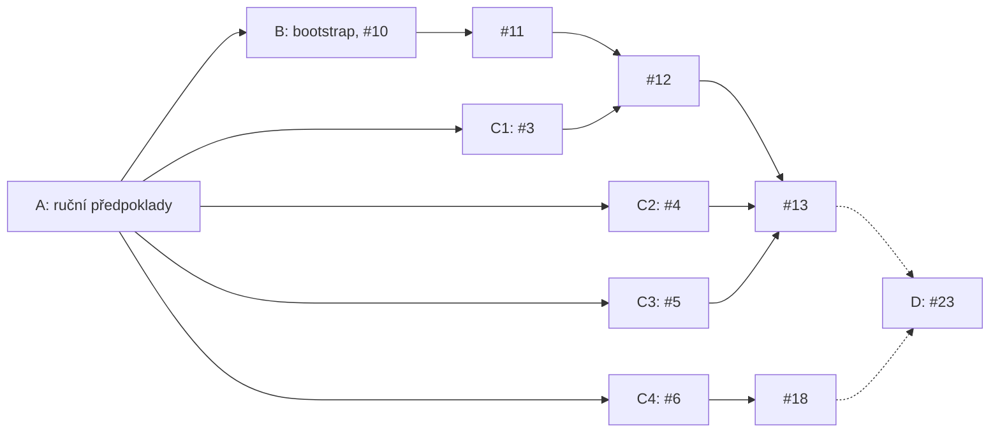

# Příprava a akceptace referenční instance

Začni průvodcem `tools/Start-InstanceSetup.ps1`. Průvodce provede fázi A a krok B1. Ověří tenant Entra ID, Azure a enterprise na GHE.com. Změny, které mají API, provede po tvém potvrzení. Kroky bez API popíše cestou v UI. Na výsledku fáze A stojí bootstrap ve fázi B i ověření chování API ve fázi C. Fáze D je akceptace přírůstku 1 po implementaci zbylých issues.

Postup provádí člen Platform team (platformní tým) na Reference instance (referenční instanci). Kroky mají tyto části:

- **Proč** vysvětluje, co by bez kroku selhalo.
- **Průvodce** ve fázi A popisuje, co průvodce ověří a změní.
- **Tvoje akce** ve fázi A popisuje kroky bez API, které provedeš v UI.
- **Postup** ve fázích B–D uvádí příkazy nebo cestu v UI.
- **Ověření** popisuje výsledek, který musíš vidět, než budeš pokračovat.

## Proč postup vyžaduje člověka

- Offline testy Pester ověřují nástroje proti náhradám cloudových API. Neprokazují, že skutečné API Azure, Microsoft Graph a GHE.com přijme stejná volání a oprávnění.
- Platforma nevytváří tenant, enterprise, OIDC SSO, SCIM provisioning, subscriptions ani licence. Tyto položky jsou Manual prerequisites (ruční předpoklady). Průvodce a bootstrap část z nich ověří přes API. Zbytek potvrdí člověk. Průvodce potvrzení zapíše jako příznak v `manualPrerequisites`.
- Některé kroky nemají API: zapnutí OIDC SSO, konfigurace SCIM, registrace a instalace GitHub App, část enterprise politik a kontrola licencí GitHubu. Průvodce u nich ukáže cestu v UI a vyžádá potvrzení.
- Issues #3–#6 ověřují chování API, na kterém stojí návrh modulů `emu-identity`, `organizations` a `enterprise-baseline`. Agent tyto moduly implementuje až podle výsledků.
- Kroky vyžadují role, které agent nemá: Global Administrator, Privileged Role Administrator a enterprise owner.

## Přehled fází

| Fáze | Obsah | Uzavře | Odblokuje |
|---|---|---|---|
| A | Ruční předpoklady tenantu, Azure a enterprise přes průvodce | – | B a C |
| B | Bootstrap na referenční instanci | #10 | #11 |
| C | Ověření 73–76 | #3, #4, #5 a #6 | #12, #13 a #18 |
| D | Akceptace přírůstku 1 | #23 | – |

Fáze B a C mohou běžet souběžně. Ověření C1–C4 na sobě nezávisí. C2 a C4 sdílejí App z kroku A9.



Plné šipky ukazují blokace, které uvolní tvoje kroky. Čárkované šipky vedou k akceptaci. #23 blokují přímo #18, #20, #21 a #22. Úplné blokace uvádí každé issue.

## Role a oprávnění

Role může mít jeden člověk, nebo kroky provede několik administrátorů. Bootstrap ale spouští jeden člověk, který má současně roli Owner, Management Group Reader, přímé přiřazení Enterprise Owner a roli enterprise owner v GitHubu.

| Role | Rozsah | Proč ji potřebuješ | Kroky |
|---|---|---|---|
| Global Administrator | Entra ID | Souhlas s aplikací OIDC. Dočasná elevace pro přiřazení rolí Owner a Management Group Reader. | A3, A4 |
| Application Administrator nebo Cloud Application Administrator | Entra ID | Konfigurace SCIM, přiřazení app rolí a čtení synchronization jobs přes Graph. | A5, B, C1, C2 |
| Privileged Role Administrator | Entra ID | Vytvoření a přiřazení vlastní role Entra. | C1 |
| User Administrator | Entra ID | Testovací uživatel a skupiny. | C1, C2 |
| Owner | Všechny subscriptions instance | Bootstrap zapisuje role assignments. Contributor má v `NotActions` `Microsoft.Authorization/*/Write`. | A3, B |
| Management Group Reader | Tenant root group | Bootstrap čte hierarchii management groups a role assignments na všech předcích subscriptions. | A3, B |
| Enterprise owner | Enterprise na GHE.com | Enterprise politiky, organizace a enterprise-owned Apps. Bootstrap tuto roli ověřuje. | A6–A9, C |
| Setup user `<shortcode>_admin` | Enterprise na GHE.com | Konfigurace OIDC a SCIM. Před zapnutím OIDC jiný účet neexistuje. | A4, A5 |

## Repozitář instance a konfigurace instance

Instance repository (repozitář instance) je repozitář v organizaci platformy `<name>-platform` na GHE.com. Obsahuje:

- `platform/`: vendorovaný release zdrojového repozitáře,
- `instance.yaml`: Instance configuration (konfiguraci instance),
- workflow nasazení a `CODEOWNERS`.

Šablona repozitáře instance je v `templates/instance/`. Po vzniku repozitáře instance mění platformní tým instanci jen přes PR.

Repozitář instance vytvoří GitHub část bootstrapu v #11. #11 čeká na #10, které uzavře fáze B. Během fází A a B proto repozitář instance neexistuje a konfigurace instance leží v `$work`:

| Období | Umístění `instance.yaml` | Původ obsahu |
|---|---|---|
| Fáze A a B (#10) | `$work\instance.yaml` | Průvodce soubor vygeneruje v kroku B1 z ověřených výsledků. Hodnoty a jejich důvody uvádí tabulka v kroku B1. |
| Po #11 | Kořen repozitáře instance | Hodnoty převezmeš z `$work\instance.yaml`. |

Zdrojový repozitář nesmí obsahovat konfiguraci s daty instance (ADR 0012). `templates/instance/instance.yaml` je jen šablona s nulovými identifikátory. Formát všech položek popisuje [README](../README.md#instance-configuration-konfigurace-instance).

## Průvodce

Spusť průvodce v PowerShell 7.4+ v kořeni checkoutu zdrojového repozitáře:

```powershell
.\tools\Start-InstanceSetup.ps1
```

| Parametr | Výchozí hodnota | Význam |
|---|---|---|
| `-WorkPath` | `$HOME\platform-reference` | Adresář `$work` pro data instance. Průvodce odmítne adresář uvnitř checkoutu (ADR 0012). |
| `-ModulesPath` | `tools\tests\fixtures\runner-modules` | Manifesty modulů pro validaci konfigurace a preflight. |
| `-Reconfirm` | vypnuto | Průvodce znovu vyžádá uložená potvrzení kroků bez API a zopakuje testy GitHub Apps z kroku A9. |
| `-PassThru` | vypnuto | Skript vrátí výsledky dílčích kroků, příznaky `manualPrerequisites` a cestu k `instance.yaml`. |

Průvodce dělí kroky A1–A9 a B1 na dílčí kroky. Každý krok uvádí své dílčí kroky. Pro každý dílčí krok platí:

- Průvodce nejdřív přečte aktuální stav přes API Azure, Microsoft Graph nebo GHE.com. Splněnou podmínku jen ohlásí.
- Změnu provede až po tvém potvrzení.
- Krok bez API popíše cestou v UI, podle potřeby otevře stránku v prohlížeči a vyžádá potvrzení.
- Dílčí krok, jehož předpoklad neprošel, průvodce přeskočí se stavem `Skipped`.

Pokud dílčí krok selže, průvodce vypíše příčinu a opravu a nabídne volby:

| Volba | Význam |
|---|---|
| `[r]` | Zopakuje dílčí krok. |
| `[l]` | Znovu přihlásí Azure CLI nebo GitHub CLI a zopakuje dílčí krok. Použij ji po aktivaci role v PIM. |
| `[s]` | Přeskočí dílčí krok. Průvodce přeskočí i dílčí kroky, které na něm závisí. |
| `[q]` | Ukončí průvodce. |

Souhrn na konci uvádí stav každého dílčího kroku a první dílčí krok, který musíš opravit. Krok je splněný, když všechny jeho dílčí kroky mají stav `Ok`.

Průvodce můžeš kdykoli ukončit a spustit znovu. Nový běh znovu ověří všechny dílčí kroky přes API. Vstupy nabídne z `$work\session.ps1` a `$work\instance.yaml`. Potvrzení kroků bez API a výsledky testů GitHub Apps z kroku A9 drží `$work\setup-state.json`. Příznak s hodnotou `true` v existujícím `instance.yaml` průvodce převezme jako potvrzení kroku bez API.

Průvodce přidá do přihlášení `gh` scope, až když ho dílčí krok potřebuje. Scopes `admin:enterprise`, `admin:org` a `repo` jsou dočasné. Na konci průvodce nabídne jejich odebrání. Scope `read:enterprise` zůstane, protože ho potřebuje bootstrap.

Průvodce zapíše do `$work` tyto soubory:

| Soubor | Obsah |
|---|---|
| `instance.yaml` | Konfigurace instance z kroku B1. Předchozí verzi průvodce uloží jako `instance.yaml.bak`. |
| `session.ps1` | Proměnné relace pro příkazy fází B–D. |
| `setup-state.json` | Potvrzení kroků bez API a výsledky testů z kroku A9. |
| `keys\probe-admin.pem` | Privátní klíč App B z kroku A9 pro fázi C. |

## Konvence relace

- Příkazy fází B–D spouštěj v relaci PowerShell 7.4+ v kořeni checkoutu zdrojového repozitáře. Na začátku každé relace načti proměnné, které zapsal průvodce. Pokud jsi průvodce spustil s `-WorkPath`, použij tuto cestu.

  ```powershell
  . (Join-Path $HOME 'platform-reference\session.ps1')
  ```

  `session.ps1` definuje `$name`, `$region`, `$tenantId`, `$mgmtSub`, `$subscriptionIds`, `$enterprise`, `$githubHost`, `$api`, `$upn`, `$spId`, `$userRole`, `$login`, `$probeOrg`, `$adminApp`, `$repo`, `$work`, `$cfg` a `$modulesPath`. Proměnná chybí, pokud její dílčí krok neprošel. Kroky fází B–D používají také proměnné a funkce z předchozích kroků. Po restartu relace spusť znovu jejich přiřazení a definice.
- Data instance patří jen do adresáře `$work` mimo checkout: identifikátory, konfigurace, privátní klíče a výstupy. Zdrojový repozitář je nesmí obsahovat (ADR 0012).
- Komentáře v issues nesmí obsahovat ID tenantu, subscriptions a objektů ani název enterprise.
- `az` je na Windows dávka `az.cmd`. cmd rozdělí argument bez mezery, který obsahuje `&` nebo `|`. Neměň proto mezery kolem `|` a `&&` v `--query`. Parametry URL předávej přes `--url-parameters`.
- Cesty v UI GitHubu vycházejí z dokumentace GitHub Enterprise Cloud. Na GHE.com nejsou ověřené. Pokud se cesta liší, zapiš skutečnou cestu do komentáře issue.

## Preflight (předběžná kontrola)

`tools/Test-BootstrapPrerequisites.ps1` spustí kontroly bootstrapu a nic nezmění. Na rozdíl od bootstrapu se nezastaví na první chybě. Pro každou kontrolu vrátí řádek se sloupci `Area`, `Check`, `Status` a `Detail`. Kroky v UI ani příznaky `manualPrerequisites` neověří.

Průvodce spustí preflight jako poslední dílčí krok kroku B1. Ručně ho spusť před bootstrapem a po každé změně v cloudu:

```powershell
.\tools\Test-BootstrapPrerequisites.ps1 -InstancePath $cfg -ModulesPath $modulesPath | Format-Table -Wrap
```

| `Status` | Význam |
|---|---|
| `Pass` | API potvrdilo podmínku. |
| `Fail` | Bootstrap by se zastavil. `Detail` uvádí příčinu. |
| `Skip` | Kontrola neproběhla, protože selhala kontrola, na které závisí. |
| `Manual` | API podmínku neověří. U příznaku `manualPrerequisites` znamená, že příznak není `true`. |
| `Confirmed` | Příznak `manualPrerequisites` je `true`. |

Bootstrap spusť, až platí všechny podmínky:

- Žádný řádek nemá `Status` `Fail` ani `Skip`.
- Všechny příznaky mají `Confirmed`.
- Každý jiný řádek `Manual` jsi ověřil ručně. Například `EMU OIDC enterprise application` má `Manual`, když Graph nevrátí režim SSO. OIDC v tom případě ověří přihlášení přes Entra ID v kroku A6.

Preflight nekontroluje ABAC podmínky, deny assignments ani provider `Microsoft.ContainerInstance` pro krok B8. `Detail` může obsahovat ID subscriptions a scope. Výstup proto nevkládej do issue bez úpravy (ADR 0012). Příčinu řádku `Fail` zjistíš novým během průvodce: dílčí krok vypíše příčinu a opravu.

## Fáze A: ruční předpoklady

Kroky A1–A9 připraví vše, co bootstrap kontroluje. Provede je průvodce. Každý krok uvádí příznak `manualPrerequisites`, který potvrzuje. Průvodce nastaví příznak na `true` v kroku B1, až když všechny dílčí kroky, na kterých příznak závisí, mají stav `Ok`.

### A1: Pracovní adresář, nástroje a vstupy

Dílčí kroky: `Command-line tools`, `Instance inputs`.

**Proč:** Bootstrap potřebuje PowerShell 7.4+, parser YAML, Azure CLI a GitHub CLI. Adresář `$work` drží data instance mimo repozitář.

**Průvodce:**

- Ověří `az` a `gh`. Chybějící nástroj ohlásí s příkazem `winget install`.
- Po potvrzení nainstaluje modul `powershell-yaml` 0.4.12 pro aktuálního uživatele.
- Vytvoří `$work\keys` a přečte existující `$work\instance.yaml`.
- Vyžádá vstupy a ověří jejich formát:

  | Vstup | Položka konfigurace | Pravidlo |
  |---|---|---|
  | Název instance | `instance.name` | `^[a-z][a-z0-9]*$`, 2–8 znaků. |
  | Region Azure | `regions.primary` | Region dostupný v management subscription, například `westeurope`. Dostupnost ověří krok A3. |
  | ID tenantu Entra ID | `bootstrap.tenantId` | GUID. |
  | ID management subscription | `bootstrap.managementSubscriptionId` | GUID. |
  | Slug enterprise | `bootstrap.enterprise` | `<slug>` z `https://<slug>.ghe.com`. Průvodce ověří, že DNS přeloží `api.<slug>.ghe.com`. |
  | Další subscriptions | `bootstrap.subscriptionIds` | GUID oddělené čárkou, nebo `-`. Management subscription průvodce přidá sám. |

Název instance se stane hodnotou `instance.name`. Bootstrap z ní odvodí názvy `rg-<name>-bootstrap`, `st<name>tfstate` a `id-<name>-<module>-plan|apply`. Dostupnost názvu storage account ověří krok A3.

**Tvoje akce:** Pokud chybí `az` nebo `gh`, nainstaluj je vypsaným příkazem `winget install`. Otevři nové okno PowerShellu a spusť průvodce znovu.

### A2: Tenant a licence Entra ID

Příznaky: `tenant`, část `licenses`. Dílčí kroky: `Azure sign-in`, `Entra ID P1 or P2 license`.

**Proč:**

- Bootstrap odmítne token z jiného tenantu, než uvádí `bootstrap.tenantId`.
- Přiřazení app role skupině a vlastní role Entra vyžadují Entra ID P1 nebo P2. Bez licence nefunguje provisioning skupin ani ověření #3. Bootstrap licenci kontroluje přes `subscribedSkus`.

**Průvodce:**

- Pokud Azure CLI nemá token pro tenant `bootstrap.tenantId`, nabídne `az login`.
- Odmítne účet, který není členem tenantu, například účet typu Guest.
- Vypíše tvoje aktivní role Entra ID. Role přes PIM se počítají až po aktivaci.
- Přes `subscribedSkus` ověří aspoň jednu licenci se stavem `Enabled`, počtem jednotek větším než 0 a plánem `AAD_PREMIUM` nebo `AAD_PREMIUM_P2` ve stavu `Success`.

**Tvoje akce:** Pokud licence chybí, kup ji nebo spusť zkušební verzi: Microsoft 365 admin center → Billing → Purchase services.

**Ověření:** Preflight: řádky `Azure CLI login` a `Entra ID P1 or P2 license` mají `Pass`.

### A3: Subscriptions, resource providers a oprávnění Azure

Příznak: `subscriptions`. Dílčí kroky: `Subscriptions and region`, `Owner role on the subscriptions`, `Resource providers`, `State backend names`, `Management group read access`.

**Proč:**

- Bootstrap vytvoří state backend a identity v management subscription a přiřadí identitám role. Zápis role assignments vyžaduje Owner. Contributor nestačí, protože má v `NotActions` `Microsoft.Authorization/*/Write`.
- Bootstrap před první změnou kontroluje, že identity modulů nemají oprávnění navíc. Čte proto hierarchii management groups a role assignments na všech předcích subscription včetně tenant root group. Tato čtení pokryje role Management Group Reader na tenant root group.
- Bootstrap neregistruje resource providers. Bez `Microsoft.Storage` a `Microsoft.ManagedIdentity` selže vytvoření backendu a identit. `Microsoft.ContainerInstance` potřebuje kontrola izolace v kroku B8.
- Na tenant root group nemá bez elevace nikdo oprávnění přiřazovat role. Elevace ale dává plný přístup ke všem subscriptions v tenantu a nesmí zůstat zapnutá.

**Průvodce:**

- Ověří, že každá subscription z `bootstrap.subscriptionIds` patří do tenantu a má stav `Enabled`. Ověří, že region je v management subscription dostupný. Nedostupný region nabídne zadat znovu.
- V každé subscription ověří akce, které bootstrap potřebuje: zápis resource group, storage account, kontejnerů, locků, identit a role assignments. Pokud akce chybí, přiřadí ti roli Owner.
- Po potvrzení zaregistruje `Microsoft.Storage`, `Microsoft.ManagedIdentity` a `Microsoft.ContainerInstance` ve všech subscriptions. Na stav `Registered` čeká nejdéle 10 minut.
- Ověří, že `rg-<name>-bootstrap` a `st<name>tfstate` jsou volné, nebo patří instanci `<name>` podle tagů bootstrapu. Pokud je název storage account obsazený, nabídne jiný název instance.
- Ověří řetězec management groups od každé subscription k tenant root group a čtení role assignments na každém předkovi. Pokud tenant management groups ještě nepoužívá, po potvrzení vytvoří tenant root group a čeká nejdéle 15 minut. Pokud čtení chybí, přiřadí ti roli Management Group Reader na tenant root group.

Role Owner a Management Group Reader průvodce přiřazuje přes elevaci Global Administratora:

1. Ověří aktivní roli Global Administrator. Bez ní vypíše příkaz `az role assignment create`, který spustí jiný Global Administrator.
2. Po potvrzení zapne elevaci. Elevace dá roli User Access Administrator na kořeni `/`.
3. Přiřadí roli a elevaci hned odebere, i když přiřazení selže. Elevaci, která existovala před spuštěním průvodce, odebere po potvrzení.
4. Na účinnost role čeká nejdéle 5 minut u role Owner a 10 minut u role Management Group Reader.

**Tvoje akce:** Pokud nemáš roli Global Administrator, aktivuj ji v PIM a zvol `[l]`. Jinak předej vypsaný příkaz Global Administratorovi.

**Ověření:** Preflight: řádky `Subscriptions in the bootstrap tenant`, `Resource providers in the management subscription`, `Bootstrap user permissions in the management subscription`, `Management-group ancestry`, `Role assignment audit` a `State backend names` mají `Pass`. Provider `Microsoft.ContainerInstance` preflight nekontroluje.

### A4: OIDC SSO a enterprise aplikace

Příznak: `enterpriseOidc`. Dílčí krok: `OIDC SSO enterprise application`.

**Proč:**

- Uživatelé EMU se přihlašují přes Entra ID. Bez OIDC SSO nevznikne tvůj účet EMU a bootstrap neověří roli owner.
- Bootstrap potřebuje object ID service principal aplikace GitHub Enterprise Managed User (OIDC). Podle něj čte app role, přiřazení a SCIM job.
- Graph může u platné aplikace OIDC vrátit `preferredSingleSignOnMode` jako `null`. Bootstrap potom jen varuje, vrátí `OidcModeVerified: false` a spoléhá na příznak `enterpriseOidc`. OIDC proto musí ověřit člověk.

**Průvodce:**

- Najde service principal aplikace GitHub Enterprise Managed User (OIDC). Pokud tenant obsahuje víc takových aplikací, zeptá se, která patří k enterprise. Do konfigurace zapíše object ID, ne `appId`.
- Odmítne aplikaci s jiným režimem SSO než `oidc` nebo `null`.
- Ověří, že aplikace má právě jednu povolenou app roli Enterprise Owner pro uživatele. ID app role User zapíše do `session.ps1` jako `$userRole` pro C1 a C2.
- Ověří souhlas za celý tenant. Pokud tvoje role souhlas nepřečte, jen varuje. Přihlášení pak nepřímo ověří kroky A5 a A6.
- Příznak `enterpriseOidc` nastaví, když Graph vrátí režim `oidc`. Při režimu `null` ho nastaví až po přihlášení přes Entra ID v kroku A6.

**Tvoje akce:** Pokud aplikace v tenantu neexistuje, zapni OIDC SSO:

1. Přihlas se do `https://<enterprise>.ghe.com` jako setup user `<shortcode>_admin`. Stáhni recovery codes a ulož je mimo `$work`. Setup user je jediný účet mimo IdP. Recovery codes obnoví přístup, pokud konfigurace OIDC selže.
2. Your enterprise → Identity provider → Single sign-on configuration → OIDC single sign-on → **Require OIDC single sign-on** → Save.
3. GitHub přesměruje na Entra ID. Global Administrator udělí aplikaci souhlas za celý tenant.

**Ověření:** Preflight: řádek `EMU OIDC enterprise application` má `Pass`, nebo `Manual`, když Graph nevrátí režim SSO.

### A5: SCIM a přímé přiřazení Enterprise Owner

Příznaky: `enterpriseScim`, `enterpriseOwner`. Dílčí kroky: `SCIM provisioning`, `Direct Enterprise Owner assignment`.

**Proč:**

- SCIM vytváří uživatele EMU a enterprise týmy ze skupin Entra ID. Bez provisioningu nemáš účet EMU pro krok A6.
- Bootstrap vyžaduje aktivní SCIM job. Job v quarantine nesynchronizuje změny z Entra ID.
- Bootstrap přijme jen přímé přiřazení app role Enterprise Owner uživateli. Přiřazení přes skupinu nestačí. Po prvním nasazení `emu-identity` platformní tým přímé přiřazení odebere a roli pak dává skupina platformního týmu.

**Průvodce:**

- Přečte SCIM job aplikace. Job v quarantine ohlásí s důvodem. Neaktivní job po potvrzení spustí a na stav `Active` čeká nejdéle 2 minuty.
- Ověří přímé přiřazení app role Enterprise Owner tvému uživateli. Chybějící přiřazení po potvrzení vytvoří.
- Po novém přiřazení nabídne Provision on demand. Plánovaný cyklus SCIM běží každých 40 minut. Provision on demand založí účet hned.

**Tvoje akce:** Pokud SCIM job chybí, nastav provisioning v UI:

1. Jako setup user vytvoř classic PAT se scope `scim:enterprise` a bez expirace. Entra ID token pro SCIM sám neobnoví. Expirace by zastavila provisioning.
2. Entra admin center → Enterprise applications → GitHub Enterprise Managed User (OIDC) → Provisioning:
   - Provisioning Mode: Automatic.
   - Tenant URL: `https://api.<enterprise>.ghe.com/scim/v2/enterprises/<enterprise>`.
   - Secret Token: PAT z kroku 1.
   - Test Connection → Save → Provisioning Status: On → Save.

Job v quarantine má obvykle chybný token nebo Tenant URL. Oprav je a zvol Provisioning → Restart provisioning.

Pokud Graph vrátí HTTP 403, aktivuj roli Application Administrator nebo Cloud Application Administrator a zvol `[l]`. Pokud 403 trvá, token Azure CLI pravděpodobně nemá potřebný scope. Bootstrap by selhal stejně. Zapiš zjištění do #10 a nepokračuj.

**Ověření:** Preflight: řádky `Direct Enterprise Owner assignment` a `SCIM provisioning job` mají `Pass`.

### A6: Přihlášení GitHub CLI

Příznak: část `enterpriseOwner`. Dílčí kroky: `GitHub CLI sign-in`, `Enterprise owner`.

**Proč:**

- Bootstrap čte token přes `gh auth token --hostname` a přijme jen OAuth token `gho_`. Workflow instance používají GitHub App installation token (instalační token GitHub App) podle ADR 0016. Lokální bootstrap používá OAuth token člověka, ne PAT.
- Proměnné `GH_TOKEN`, `GITHUB_TOKEN`, `GH_ENTERPRISE_TOKEN` a `GITHUB_ENTERPRISE_TOKEN` by přebily uložený token. Bootstrap proto vyžaduje, aby byly prázdné.
- Bootstrap přes GraphQL ověří, že účet je owner enterprise.
- Přihlas se jako spravovaný uživatel EMU s rolí owner, ne jako setup user. Setup user je nouzový účet mimo IdP.

**Průvodce:**

- Vymaže proměnné tokenů v aktuální relaci. Proměnnou z uživatelského prostředí Windows po potvrzení odstraní. Proměnnou na úrovni počítače musí odstranit administrátor.
- Pokud `gh` není přihlášené k `<enterprise>.ghe.com`, nabídne `gh auth login --web` se scope `read:enterprise`.
- Odmítne setup usera `<shortcode>_admin` a nabídne jeho odhlášení.
- Přes GraphQL ověří, že účet je owner enterprise.

**Tvoje akce:** V prohlížeči se přihlas přes Entra ID jako spravovaný uživatel EMU. Pokud GitHub účet odmítne, dokonči krok A5.

**Ověření:** Preflight: řádky `gh OAuth login` a `Enterprise owner in GitHub` mají `Pass`.

### A7: Politiky enterprise

Příznaky: `privateInternalForksDisabled`, `emuUserNamespacesRestricted`, `fineGrainedPatApprovalRequired`, `patMaxLifetime90Days`. Dílčí krok: `Enterprise policies`.

**Proč:** Moduly platformy spravují GitHub jen instalačními tokeny App. Enterprise kontroly, které App-only automatizace nepokrývá, jsou proto ruční předpoklady (ADR 0016). Bez nich může člen enterprise obejít Controls (kontroly) organizací. Může například zkopírovat kód do forku nebo do repozitáře mimo organizace platformy.

Požadované politiky:

| Příznak | Cesta v UI | Nastavení | Proč |
|---|---|---|---|
| `privateInternalForksDisabled` | Your enterprise → Policies → Repositories → Repository forking | Zakaž forky private a internal repozitářů. | Fork přenese kód mimo kontroly původní organizace. |
| `emuUserNamespacesRestricted` | Your enterprise → Policies → Repositories → Repository creation | Zapni **Block the creation of user namespace repositories**. | Repozitář v user namespace leží mimo organizace platformy a jejich rulesety. |
| `fineGrainedPatApprovalRequired` | Your enterprise → Policies → Personal access tokens → Fine-grained tokens | Zapni **Require approval of fine-grained personal access tokens**. | Organization owner schválí každý fine-grained PAT dřív, než získá přístup k organizaci. |
| `patMaxLifetime90Days` | Your enterprise → Policies → Personal access tokens → záložky Fine-grained tokens a Tokens (classic) | Na obou záložkách zapni **Set maximum lifetimes for personal access tokens** s hodnotou 90 dní. | Krátká platnost zkrátí dobu, po kterou lze zneužít odcizený PAT. |

U maximální platnosti PAT zapni **Exempt administrators**. Dokumentace GitHubu tuto výjimku doporučuje, pokud enterprise používá SCIM provisioning. Token SCIM z kroku A5 je classic PAT setup usera bez expirace.

Omezení classic PAT nenastavuj. O něm zatím není rozhodnuto.

README `enterprise-baseline` vyžaduje ještě jednu enterprise kontrolu: členové nesmí zakládat repozitáře, měnit jejich viditelnost ani je mazat. Bootstrap pro ni nemá příznak. Politiky jsou ve stejné sekci Repositories:

- Repository creation: členové nesmí zakládat repozitáře.
- Repository visibility change: členové nesmí měnit viditelnost.
- Repository deletion and transfer: členové nesmí mazat ani přenášet repozitáře.

**Průvodce:**

- Přes GraphQL přečte politiky forků, zakládání, změny viditelnosti a mazání repozitářů. Politiku, která nemá hodnotu `DISABLED`, po potvrzení nastaví na `DISABLED`. Pro čtení a změnu dočasně přidá scope `admin:enterprise`.
- Příznak `privateInternalForksDisabled` nastaví, když všechny 4 politiky mají hodnotu `DISABLED`.
- Politiky PAT a omezení user namespace nemají API. Průvodce pro každý příznak ukáže cestu v UI a vyžádá potvrzení.

**Tvoje akce:** Nastav v UI politiky příznaků `emuUserNamespacesRestricted`, `fineGrainedPatApprovalRequired` a `patMaxLifetime90Days` podle tabulky. Výsledek politik zakládání, viditelnosti a mazání repozitářů zapiš do komentáře v #10.

**Ověření:** Každá politika ukazuje hodnotu vynucenou na úrovni enterprise. Organizace ji nemohou změnit.

### A8: Licence GitHubu

Příznak: část `licenses`. Dílčí krok: `GitHub licenses`.

**Proč:**

- Modul `enterprise-baseline` zapíná v code security configuration secret scanning s push protection, Dependabot a CodeQL default setup. GitHub tyto funkce v private a internal repozitářích nezapne bez licencí GitHub Secret Protection a GitHub Code Security.
- Modul `emu-identity` mapuje skupinu uživatelů Copilotu na licenci Copilot. Pokud instance používá Copilot, potřebuje licenci Copilot Business nebo Copilot Enterprise.

**Průvodce:** Ukáže cestu v UI a vyžádá potvrzení. Příznak `licenses` nastaví, až když prošla i licence Entra ID z kroku A2.

**Tvoje akce:** Your enterprise → Settings → Billing and licensing → Licensing. Ověř GitHub Enterprise, GitHub Secret Protection a GitHub Code Security. Podle potřeby ověř Copilot.

**Ověření:** Licence pokrývají uživatele, kteří budou commitovat do private a internal repozitářů.

### A9: Dostupnost enterprise-owned GitHub Apps

Příznak: `githubAppAvailabilityVerified`. Dílčí kroky: `Probe organization`, `Probe App A: authorization token`, `Probe App B: organization administration`.

**Proč:**

- Workflow instance volají GitHub API jen přes instalační tokeny enterprise-owned Apps (ADR 0016). Veřejná dokumentace není důkazem dostupnosti na konkrétní instanci GHE.com.
- Test ověří tři části:
  - autorizační token, kterým workflow kontroluje autora PR,
  - čtení organizačních politik tokenem `read`,
  - čtení rulesetů včetně bypass aktérů tokenem `write`.
- Pokud některá část selže, příznak zůstane `false`. Zapiš zjištění do #10. Nepřecházej na PAT a nerozšiřuj oprávnění.

**Průvodce: organizace pro test**

- Po potvrzení vytvoří organizaci `probe-<yyyymmdd>` s tebou jako owner, private repozitář `instance-probe`, tým `platform-probe` a tvoje členství v týmu. Dočasně přidá scopes `admin:enterprise`, `admin:org` a `repo`.
- Název organizace uloží do `setup-state.json`. Další běh použije stejnou organizaci.

**Průvodce: App A (autorizační token)**

- Otevře předvyplněný formulář registrace enterprise-owned App: název `<name>-probe-authorization`, neaktivní webhook a oprávnění Members: Read-only. Registrace App nemá API.
- Najde privátní klíč v `$work\keys` nebo mezi soubory `*.private-key.pem` staženými do `Downloads` za posledních 24 hodin. Klíč přesune do `$work\keys\probe-authorization.pem`.
- Ověří, že App vlastní enterprise a má přesně požadovaná oprávnění. Otevře stránku instalace do probe organizace. App A má jen Members: Read-only; instalační UI proto ukazuje **No repositories — This App does not require access to your repositories**. Repozitáře nevybírej a oprávnění nerozšiřuj.
- Spustí `tools/New-PlatformGitHubToken.ps1 -Authorization` stejně jako workflow `deploy.yml`.
- Nástroj ověří instalaci jen v probe organizaci, přesná oprávnění a prázdný seznam repozitářů dostupných autorizačnímu tokenu.

- Tokenem přečte tvoje členství v `platform-probe`. Workflow tak ověřuje, že autor PR patří do platformního týmu, než předá přihlašovací údaje.
- Token odvolá nástrojem `tools/Remove-PlatformGitHubToken.ps1` a ověří, že odvolaný token vrátí HTTP 401.
- Smaže klíč App A a otevře stránku pro smazání App A.

**Průvodce: App B (organizační API)**

- Otevře předvyplněný formulář registrace App `<name>-probe-admin` s oprávněními Administration: Read and write, Members: Read and write a Custom organization roles: Read-only. Klíč uloží jako `$work\keys\probe-admin.pem`. Ověří aktivní instalaci v probe organizaci a přesná oprávnění. Jde o organizační oprávnění; instalační UI ukazuje **No repositories** a neumožňuje výběr repozitářů. Průvodce proto nevyžaduje hodnotu `all` ani `selected` z API.
- Tokenem `organization_administration: read` přečte politiku akcí a code security configurations. Plan modulu `enterprise-baseline` je čte se stejným oprávněním.
- Zaznamená výsledek seznamu rulesetů s tokenem `read` do `setup-state.json` jako `probe.adminReadRulesets`. ADR 0016 počítá s tím, že rulesety vyžadují `write`.
- Tokenem `write` vytvoří vypnutý ruleset `instance-setup-probe` s bypass aktérem Organization admin. Ověří, že detail rulesetu vrátí bypass aktéra `OrganizationAdmin`. Ruleset potom smaže.
- Tokeny odvolá. App ID a installation ID zapíše do `session.ps1` jako `$adminApp`.

Výsledky testů App A a App B průvodce uloží. Další běh testy neopakuje a organizaci pro test nevyžaduje. Parametr `-Reconfirm` testy zopakuje; App A pro opakování musíš zaregistrovat znovu.

**Tvoje akce:**

1. V předvyplněném formuláři ponech ostatní oprávnění No access a zvol Create GitHub App.
2. App settings → General → Private keys → Generate a private key. Prohlížeč uloží klíč do `Downloads`.
3. Install App → organizace `probe-<yyyymmdd>`. App A instaluj bez přístupu k repozitářům (**No repositories**); App B používá organizační oprávnění a **Repository access** ukazuje **No repositories**.
4. Po testu App A smaž App A: App settings → Advanced → Delete GitHub App. Workflow instance dostanou vlastní Apps v #11.

App B a `$work\keys\probe-admin.pem` ponech pro C2 a C4. Smažeš je ve fázi D.

**Ověření:** Všechny 3 dílčí kroky mají stav `Ok`. Výsledek seznamu rulesetů s tokenem `read` zapiš do #10.

## Fáze B: bootstrap a uzavření #10

**Proč:** #10 uzavřeš až po ověření na referenční instanci. Na #10 čeká #11, které vytvoří organizaci platformy, Instance repository (repozitář instance) a environmenty. Moduly platformy zatím nemají `module.yaml`. Bootstrap proto použije fixture moduly z `tools\tests\fixtures\runner-modules`. Modul `application` má Prerequisite (předpoklad) `foundation`. Výběr `application` vytvoří 2 kontejnery a 4 identity. To stačí k ověření výběru předpokladů i izolace state mezi moduly.

### B1: Konfigurace instance, preflight a negativní test

Příznaky: všechny. Dílčí kroky: `Instance configuration`, `Bootstrap preflight`.

**Proč:**

- Bootstrap čte Instance configuration (konfiguraci instance). Repozitář instance vznikne až v #11, proto konfigurace leží v `$work`. Podrobnosti uvádí sekce Repozitář instance a konfigurace instance.
- Příznak `manualPrerequisites` smí mít `true` jen po ověření jeho kroku. Průvodce proto konfiguraci generuje jen z ověřených výsledků.
- Schéma vyžaduje v `teams.security` aspoň jeden účet. Pro ověření bootstrapu stačí tvůj účet.
- Preflight ověří kontroly bootstrapu bez změny v cloudu.
- Negativní test ověří kritérium #10: bootstrap zastaví nepotvrzený ruční předpoklad před první změnou.

**Průvodce:**

- Sestaví konfiguraci ze vstupů a výsledků dílčích kroků. Z existujícího `instance.yaml` zachová položky, které podle tabulky níže nepřepisuje.
- Před zápisem ověří konfiguraci schématem a manifesty modulů z `$modulesPath`.
- Vypíše rozdíly proti existujícímu souboru a příznaky, které zůstanou `false`. Po potvrzení zapíše `$work\instance.yaml` a `$work\session.ps1`.
- Spustí preflight. Dílčí krok `Bootstrap preflight` projde, když žádný řádek nemá `Fail` ani `Skip` a všechny příznaky mají `Confirmed`.

Průvodce zapíše do konfigurace tyto hodnoty:

| Položka | Hodnota | Důvod |
|---|---|---|
| `instance.name` | Název instance z A1 | Bootstrap z něj odvodí názvy resource group, storage account a identit. |
| `regions.primary` | Region z A1 | Bootstrap v tomto regionu vytvoří state backend a identity. |
| `teams.platform` | Členové z existující konfigurace a tvůj UPN z A2 | Bootstrap vyžaduje přihlášeného uživatele Azure v `teams.platform`. Průvodce vynechá zástupné účty `@example.test` ze šablony. |
| `teams.security` | Členové z existující konfigurace, nebo tvůj UPN z A2 | Schéma vyžaduje aspoň jeden účet. |
| `modules` | `application: {}`, pokud existující konfigurace nevybírá jiné moduly | Fixture modul z `$modulesPath`. Výběr přidá předpoklad `foundation`. Moduly platformy zatím nemají `module.yaml`. |
| `customPatterns`, `manualSteps` | Prázdné, nebo hodnoty z existující konfigurace | Bootstrap je nečte. `manualSteps` potvrzuje ruční kroky modulů po nasazení. `customPatterns` patří modulu `enterprise-baseline`. |
| `bootstrap.tenantId` | ID tenantu z A1 | Bootstrap odmítne token z jiného tenantu. |
| `bootstrap.managementSubscriptionId` | ID management subscription z A1 | Subscription pro state backend a identity. |
| `bootstrap.subscriptionIds` | Management subscription a další subscriptions z A1 | Seznam musí obsahovat všechny subscriptions instance včetně management subscription. Fixture moduly jiné subscriptions nepoužívají. |
| `bootstrap.enterpriseApplicationObjectId` | Object ID service principal z A4 | Object ID service principal aplikace EMU, ne `appId`. Bootstrap podle něj čte přiřazení Enterprise Owner a SCIM job. |
| `bootstrap.githubHost`, `bootstrap.enterprise` | `<enterprise>.ghe.com` a slug enterprise z A1 | Bootstrap podle nich ověří roli enterprise owner. |
| `manualPrerequisites` | `true` jen u příznaků, jejichž dílčí kroky mají stav `Ok` | Vazbu příznaku na dílčí kroky uvádí každý krok fáze A. |
| `githubApps`, `credentials` | Prázdné, nebo hodnoty z existující konfigurace | Apps a environmenty vytvoří #11. |
| `teardown.allowed` | `false`, nebo hodnota z existující konfigurace | Runner odmítne teardown. |

**Postup:** Načti proměnné relace podle sekce Konvence relace. Potom spusť negativní test:

```powershell
$negative = Join-Path $work 'instance-negative.yaml'
(Get-Content -Raw $cfg) -replace 'patMaxLifetime90Days: true', 'patMaxLifetime90Days: false' | Set-Content -LiteralPath $negative -Encoding utf8NoBOM -NoNewline
try {
    .\tools\Invoke-Bootstrap.ps1 -InstancePath $negative -ModulesPath $modulesPath
    'unexpected: bootstrap succeeded'
}
catch { $_.Exception.Message }
az group exists -n "rg-$name-bootstrap"
Remove-Item $negative
```

**Ověření:**

- Dílčí kroky `Instance configuration` a `Bootstrap preflight` mají v souhrnu průvodce stav `Ok`.
- Negativní test vypíše `Bootstrap requires manual prerequisite confirmations: $.manualPrerequisites.patMaxLifetime90Days.`
- `az group exists` vrátí `false`.

### B2: Přihlášení před během

**Proč:** Bootstrap používá aktuální přihlášení `az` a `gh`. Čtení synchronization jobs vyžaduje aktivní roli Application Administrator nebo Cloud Application Administrator. Role aktivovaná přes PIM se projeví až v novém tokenu.

**Postup:** Pokud role získáváš přes PIM, aktivuj je. Potom spusť:

```powershell
az logout
az login --tenant $tenantId
az account set --subscription $mgmtSub
az account show --query "{tenant:tenantId, user:user.name}" -o table
Get-ChildItem Env:GH_TOKEN, Env:GITHUB_TOKEN, Env:GH_ENTERPRISE_TOKEN, Env:GITHUB_ENTERPRISE_TOKEN -ErrorAction SilentlyContinue
(gh auth token --hostname $githubHost).StartsWith('gho_')
.\tools\Test-BootstrapPrerequisites.ps1 -InstancePath $cfg -ModulesPath $modulesPath | Format-Table -Wrap
```

**Ověření:** `tenant` se rovná `$tenantId`. `Get-ChildItem` nic nevypíše. Příkaz `gh auth token` vrátí `True`. Preflight s novými tokeny splní podmínky ze sekce Preflight.

### B3: Přerušený běh

**Proč:** #10 vyžaduje, aby nový běh dokončil přerušený běh bez výměny identit. Nová identita by měla jiné `principalId`. Role assignments a budoucí federated credentials navázané na původní identitu by přestaly platit. Test přeruší bootstrap hned po vytvoření první identity.

**Postup:**

```powershell
$bootstrapPath = Join-Path $repo 'tools\Invoke-Bootstrap.ps1'
$job = Start-Job -ScriptBlock { & $using:bootstrapPath -InstancePath $using:cfg -ModulesPath $using:modulesPath }
while ($job.State -eq 'Running' -and -not (az identity list -g "rg-$name-bootstrap" --query '[0].name' -o tsv 2>$null)) { Start-Sleep -Seconds 2 }
Stop-Job $job
$job.State
```

Pokračuj podle stavu jobu:

- `Stopped`: přerušení proběhlo.
- `Completed`: bootstrap doběhl dřív, než ho smyčka zastavila. Simuluj přerušení odebráním role identitě `application.apply`:

  ```powershell
  $partial = Receive-Job $job
  $application = $partial.Modules | Where-Object Name -eq 'application'
  $containerId = "/subscriptions/$mgmtSub/resourceGroups/rg-$name-bootstrap/providers/Microsoft.Storage/storageAccounts/st${name}tfstate/blobServices/default/containers/$($application.ContainerName)"
  az role assignment delete --assignee-object-id $application.Apply.PrincipalId --role 'Storage Blob Data Contributor' --scope $containerId
  ```

- `Failed`: `Receive-Job $job` vypíše chybu. Oprav příčinu. Vytvořené prostředky ponech, krok B4 je dokončí.

Ulož identity před dokončením:

```powershell
Remove-Job $job -Force
az identity list -g "rg-$name-bootstrap" --query "[].{name:name, principalId:principalId}" -o json | Set-Content -LiteralPath (Join-Path $work 'identities-before.json')
```

**Ověření:** `identities-before.json` obsahuje 1–3 identity. Ve variantě `Completed` obsahuje 4 identity.

### B4: Dokončení přerušeného běhu

**Proč:** Krok ověří, že stejný příkaz po přerušení dokončí chybějící prostředky a existující identity převezme.

**Postup:**

```powershell
$bootstrap = .\tools\Invoke-Bootstrap.ps1 -InstancePath $cfg -ModulesPath $modulesPath
$bootstrap | ConvertTo-Json -Depth 10 | Set-Content -LiteralPath (Join-Path $work 'bootstrap-output.json')
$bootstrap.HasChanges
$bootstrap.OidcModeVerified
$before = Get-Content -Raw (Join-Path $work 'identities-before.json') | ConvertFrom-Json
$after = az identity list -g $bootstrap.ResourceGroupName --query "[].{name:name, principalId:principalId}" -o json | ConvertFrom-Json
Compare-Object $before $after -Property name, principalId -IncludeEqual
```

**Ověření:**

- `HasChanges` je `True`.
- Hodnotu `OidcModeVerified` zapiš do výsledku #10.
- `Compare-Object` nevypíše žádný řádek se `SideIndicator` `<=`. Každá identita z `identities-before.json` zůstala se stejným `principalId`.
- `$after` obsahuje 4 identity.

### B5: Opakovaný běh

**Proč:** Druhý běh při nezměněné konfiguraci nesmí provést žádný zápis. Platformní tým tak může bootstrap spustit znovu, například po přechodu na nový release, bez neplánovaných změn.

**Postup:**

```powershell
(.\tools\Invoke-Bootstrap.ps1 -InstancePath $cfg -ModulesPath $modulesPath).HasChanges
```

**Ověření:** Příkaz vrátí `False`.

### B6: State backend

**Proč:**

- Terraform state může obsahovat citlivé hodnoty. Přístup k němu musí řídit jen Entra ID a role na kontejneru. Vypnutý shared key a public access proto nesmí nabídnout jinou cestu.
- Versioning a soft delete po 30 dní umožní obnovit state po chybném zápisu nebo smazání.
- Lock `CanNotDelete` brání smazání storage account.

**Postup:**

```powershell
$rg = $bootstrap.ResourceGroupName
$sa = $bootstrap.StorageAccountName
az storage account show -g $rg -n $sa --query "{kind:kind, sku:sku.name, https:enableHttpsTrafficOnly, tls:minimumTlsVersion, sharedKey:allowSharedKeyAccess, publicBlob:allowBlobPublicAccess, oauthDefault:defaultToOAuthAuthentication, hns:isHnsEnabled, sftp:isSftpEnabled, localUsers:isLocalUserEnabled, nfs:enableNfsV3}" -o json
az storage account blob-service-properties show -g $rg -n $sa --query "{versioning:isVersioningEnabled, blobRetention:deleteRetentionPolicy, containerRetention:containerDeleteRetentionPolicy}" -o json
az lock list -g $rg --query "[].{name:name, level:level}" -o table
az storage container-rm list --storage-account $sa -g $rg --query "[].name" -o tsv
```

**Ověření:**

| Vlastnost | Očekávaná hodnota |
|---|---|
| `$rg`, `$sa` | `rg-<name>-bootstrap`, `st<name>tfstate` |
| `kind`, `sku` | `StorageV2`, `Standard_LRS` |
| `https`, `oauthDefault` | `true` |
| `tls` | `TLS1_2` |
| `sharedKey`, `publicBlob` | `false` |
| `hns`, `sftp`, `localUsers`, `nfs` | `false` nebo `null` |
| `versioning` | `true` |
| `blobRetention`, `containerRetention` | `enabled: true`, `days: 30` |
| Lock | `lock-state`, `CanNotDelete` |
| Kontejnery | `application` a `foundation` |

### B7: Identity a jejich oprávnění

**Proč:** ADR 0015 vyžaduje pro každý modul a fázi vlastní identitu s nejmenším oprávněním. Fixture moduly nedeklarují žádná oprávnění. Každá identita proto smí mít jen `Storage Blob Data Contributor` na kontejneru svého modulu a žádné application permissions v Graph. Plan potřebuje stejnou roli kvůli lease state.

**Postup:**

```powershell
az identity list -g $rg --query "[].name" -o tsv
foreach ($module in $bootstrap.Modules) {
    foreach ($phase in 'Plan', 'Apply') {
        $identity = $module.$phase
        "== $($module.Name).$phase"
        az role assignment list --assignee-object-id $identity.PrincipalId --all --include-inherited --query "[].{role:roleDefinitionName, scope:scope}" -o table
        az rest --url "https://graph.microsoft.com/v1.0/servicePrincipals/$($identity.PrincipalId)/appRoleAssignments" --query "length(value)"
    }
}
```

**Ověření:**

- Identity se jmenují `id-<name>-application-plan`, `id-<name>-application-apply`, `id-<name>-foundation-plan` a `id-<name>-foundation-apply`.
- Každá identita má jeden řádek: `Storage Blob Data Contributor` se scope, který končí `/containers/<module>`.
- Graph u každé identity vrátí `0`.

### B8: Izolace state mezi moduly

**Proč:** Role na kontejneru musí zajistit, že identita jednoho modulu nepřečte ani nezmění state jiného modulu. User-assigned managed identity lze použít jen z prostředku Azure. Test proto běží v Azure Container Instances. Lease ověří, že identita zamkne state stejně jako Terraform. Dva běhy pokryjí fázi plan i apply a oba směry mezi moduly.

**Postup:**

```powershell
$probeRg = "rg-$name-probe"
az group create -n $probeRg -l $region -o none
$probeScript = @'
set -u
az login --identity --client-id "$CLIENT_ID" --allow-no-subscriptions -o none
echo probe > /tmp/probe.txt
common="--account-name $ACCOUNT --auth-mode login"
run() {
  label=$1; expected=$2; shift 2
  if out=$("$@" 2>&1); then
    if [ "$expected" = ok ]; then echo "$label ok"; else echo "$label UNEXPECTED-SUCCESS"; fi
  elif echo "$out" | grep -q AuthorizationPermissionMismatch; then
    if [ "$expected" = denied ]; then echo "$label denied-403"; else echo "$label UNEXPECTED-403"; fi
  else
    echo "$label ERROR: $out"
  fi
}
run OWN_WRITE ok az storage blob upload $common -c "$OWN" -n probe.txt -f /tmp/probe.txt --overwrite
run OWN_READ ok az storage blob download $common -c "$OWN" -n probe.txt -f /tmp/read.txt
if lease=$(az storage blob lease acquire $common -c "$OWN" -b probe.txt --lease-duration 15 -o tsv 2>&1); then
  echo "OWN_LEASE ok"
  run OWN_RELEASE ok az storage blob lease release $common -c "$OWN" -b probe.txt --lease-id "$lease"
else
  echo "OWN_LEASE ERROR: $lease"
fi
run OTHER_READ denied az storage blob list $common -c "$OTHER"
run OTHER_WRITE denied az storage blob upload $common -c "$OTHER" -n probe.txt -f /tmp/probe.txt --overwrite
'@
$encoded = [Convert]::ToBase64String([Text.Encoding]::UTF8.GetBytes(($probeScript -replace "`r`n", "`n")))

function Invoke-StateProbe {
    param([Parameter(Mandatory)] $Identity, [Parameter(Mandatory)][string] $Own, [Parameter(Mandatory)][string] $Other, [Parameter(Mandatory)][string] $Label)
    $container = "ci-$name-$Label"
    az container create -g $probeRg -n $container --image mcr.microsoft.com/azure-cli --os-type Linux --cpu 1 --memory 1.5 --restart-policy Never `
        --assign-identity $Identity.ResourceId --environment-variables "CLIENT_ID=$($Identity.ClientId)" "ACCOUNT=$sa" "OWN=$Own" "OTHER=$Other" `
        --command-line "/bin/bash -c 'echo $encoded | base64 -d | bash'" -o none
    $deadline = (Get-Date).AddMinutes(15)
    do {
        Start-Sleep -Seconds 10
        $state = az container show -g $probeRg -n $container --query 'containers[0].instanceView.currentState.state' -o tsv
    } while ($state -ne 'Terminated' -and (Get-Date) -lt $deadline)
    az container logs -g $probeRg -n $container
    az container delete -g $probeRg -n $container --yes -o none
}

$application = $bootstrap.Modules | Where-Object Name -eq 'application'
$foundation = $bootstrap.Modules | Where-Object Name -eq 'foundation'
Invoke-StateProbe -Identity $application.Plan -Own $application.ContainerName -Other $foundation.ContainerName -Label 'probe1'
Invoke-StateProbe -Identity $foundation.Apply -Own $foundation.ContainerName -Other $application.ContainerName -Label 'probe2'
```

Stažení image a běh kontejneru trvají několik minut.

**Ověření:** Oba běhy vypíšou:

```text
OWN_WRITE ok
OWN_READ ok
OWN_LEASE ok
OWN_RELEASE ok
OTHER_READ denied-403
OTHER_WRITE denied-403
```

- `UNEXPECTED-403` u řádku `OWN_*` znamená, že se role ještě nepropagovala. Počkej 10 minut a běh zopakuj.
- `UNEXPECTED-SUCCESS` u řádku `OTHER_*` znamená porušenou izolaci. Nepokračuj a zapiš zjištění do #10.
- Prázdný výstup znamená, že kontejner do 15 minut neskončil. Zkontroluj `az container show -g $probeRg -n ci-$name-probe1`.

### B9: Úklid

**Proč:** Fixture moduly nejsou moduly platformy. Bootstrap v #11 vytvoří kontejnery a identity podle skutečných manifestů. Fixture identity by zůstaly jako nepoužívané identity s přístupem ke state. Odstranění locku je tu přípustné, protože backend obsahuje jen data fixture modulů.

**Postup:**

```powershell
az group delete -n $probeRg --yes
az lock delete --ids (az lock list -g $rg --query "[0].id" -o tsv)
az group delete -n $rg --yes
Remove-Item (Join-Path $work 'bootstrap-output.json'), (Join-Path $work 'identities-before.json')
```

Ponech:

- `$cfg`: hodnoty z ní převezmeš do `instance.yaml` v repozitáři instance (#11).
- Roli Management Group Reader: bootstrap ji potřebuje při každém běhu.

Ověř, že elevace je vypnutá: Microsoft Entra admin center → Identity → Overview → Properties → **Access management for Azure resources** má hodnotu No. Průvodce elevaci odebírá hned po přiřazení role.

**Ověření:** `az group exists -n $rg` a `az group exists -n $probeRg` vrátí `false`.

### B10: Výsledek do #10

**Proč:** Issue je záznam akceptace. #11 je blokované #10. Uzavření #10 předá další práci agentovi.

**Postup:**

1. Ověř přihlášení `gh` na github.com: `gh auth status --hostname github.com`. Pokud nejsi přihlášený, spusť `gh auth login --hostname github.com --web`.
2. Zjisti commit zdrojového repozitáře: `git rev-parse --short HEAD`.
3. Ulož komentář do `$work\issue-10.md` podle šablony níže. Šablona nesmí po vyplnění obsahovat ID ani název enterprise.
4. Odešli komentář:

   ```powershell
   gh issue comment 10 --repo msucharda/devsecops-platform --body-file (Join-Path $work 'issue-10.md')
   ```

5. V issue odškrtni splněná kritéria. Pokud jsou splněná všechna, zavři issue:

   ```powershell
   gh issue close 10 --repo msucharda/devsecops-platform --reason completed
   ```

Šablona komentáře:

```markdown
## Ověření na referenční instanci

- Datum: <yyyy-mm-dd>
- Commit zdrojového repozitáře: <short-sha>
- Moduly: fixture `application` a `foundation` z `tools/tests/fixtures/runner-modules`

| Kritérium | Výsledek |
|---|---|
| Bootstrap použil OAuth token z `gh`, bez PAT. | |
| Nepotvrzený ruční předpoklad zastavil bootstrap před první změnou. | |
| Storage má versioning, soft delete 30 dní, lock a vypnutý shared key. Přístup jde jen přes Entra ID. | |
| Každý modul má vlastní kontejner. | |
| Každý modul má identitu plan a apply jen s rolí na vlastním kontejneru a bez oprávnění Graph. | |
| Identita zapíše, přečte a zamkne vlastní state. | |
| Identita dostane HTTP 403 pro state jiného modulu. | |
| Názvy odpovídají CAF a ADR 0008. | |
| Nový běh dokončil přerušený běh bez výměny identit. | |
| Opakovaný běh vrátil `HasChanges: false`. | |
| `OidcModeVerified` | |
| Dostupnost GitHub Apps (A9) | |
| Enterprise politika zakládání, viditelnosti a mazání repozitářů | |

## Zjištění

<rozdíly v cestách UI, chyby, opakované pokusy>

## Úklid

<odstraněné prostředky a ponechaná role Management Group Reader>
```

## Fáze C: ověření 73–76

Ověření C1–C4 mohou běžet souběžně s fází B. Každé ověření rozhoduje o návrhu jednoho modulu. Výsledek zapiš do komentáře příslušného issue bez ID a názvu enterprise. Potom issue zavři přes `gh issue close <number> --repo msucharda/devsecops-platform --reason completed`.

C2 a C4 volají API instalačními tokeny App B z kroku A9. Na začátku relace načti proměnné relace podle sekce Konvence relace a definuj pomocné funkce. Funkce vydají instalační token se zvolenými oprávněními. Tokeny drží jako `SecureString`, aby se nevypsaly do konzole.

```powershell
$headers = @{ Accept = 'application/vnd.github+json'; 'X-GitHub-Api-Version' = '2026-03-10' }

function ConvertTo-Base64Url([byte[]] $Bytes) {
    [Convert]::ToBase64String($Bytes).TrimEnd('=').Replace('+', '-').Replace('/', '_')
}

function New-ProbeToken {
    param(
        [Parameter(Mandatory)][string] $AppId,
        [Parameter(Mandatory)][string] $InstallationId,
        [Parameter(Mandatory)][string] $KeyPath,
        [Parameter(Mandatory)][hashtable] $Permissions
    )
    $now = [DateTimeOffset]::UtcNow.ToUnixTimeSeconds()
    $header = ConvertTo-Base64Url ([Text.Encoding]::UTF8.GetBytes('{"alg":"RS256","typ":"JWT"}'))
    $payload = ConvertTo-Base64Url ([Text.Encoding]::UTF8.GetBytes((@{ iat = $now - 60; exp = $now + 540; iss = $AppId } | ConvertTo-Json -Compress)))
    $rsa = [Security.Cryptography.RSA]::Create()
    try {
        $rsa.ImportFromPem((Get-Content -Raw -LiteralPath $KeyPath))
        $signature = $rsa.SignData([Text.Encoding]::UTF8.GetBytes("$header.$payload"),
            [Security.Cryptography.HashAlgorithmName]::SHA256, [Security.Cryptography.RSASignaturePadding]::Pkcs1)
    }
    finally { $rsa.Dispose() }
    $jwt = ConvertTo-SecureString "$header.$payload.$(ConvertTo-Base64Url $signature)" -AsPlainText -Force
    $response = Invoke-RestMethod -Method Post -Uri "$api/app/installations/$InstallationId/access_tokens" -Headers $headers `
        -Authentication Bearer -Token $jwt -ContentType 'application/json' -Body (@{ permissions = $Permissions } | ConvertTo-Json -Compress)
    ConvertTo-SecureString $response.token -AsPlainText -Force
}

function Invoke-ProbeApi {
    param(
        [Parameter(Mandatory)][string] $Path,
        [Parameter(Mandatory)][securestring] $Token,
        [string] $Method = 'Get',
        [object] $Body
    )
    $request = @{ Method = $Method; Uri = "$api$Path"; Headers = $headers; Authentication = 'Bearer'; Token = $Token }
    if ($null -ne $Body) {
        $request.Body = $Body | ConvertTo-Json -Depth 10 -Compress
        $request.ContentType = 'application/json'
    }
    Invoke-RestMethod @request
}
```

### C1: Vlastní role Entra pro app-only token (#3)

**Co ověřuješ:** Microsoft Graph uzná vlastní roli Entra s akcí `microsoft.directory/servicePrincipals/appRoleAssignedTo/update` i pro app-only token. Role omezená na aplikaci GHE dovolí přiřadit app roli jen v této aplikaci.

**Proč:** Modul `emu-identity` přiřazuje skupiny Entra k app rolím v aplikaci GHE. Alternativní oprávnění `AppRoleAssignment.ReadWrite.All` platí pro všechny aplikace v tenantu, včetně Microsoft Graph. Identita s ním by si mohla přidělit libovolné application permission. ADR 0015 proto volí vlastní roli omezenou na jednu aplikaci. Věta v ADR 0015 zatím zní: „Přírůstek 1 ověří, že Microsoft Graph uzná vlastní roli i pro app-only token.“

**Potřebuješ:** A2 (licence P1), A4 (`$spId` a `$userRole`) a roli Privileged Role Administrator.

**Postup:**

1. Vytvoř skupinu, identitu pro test a druhou aplikaci pro negativní test:

   ```powershell
   $group3 = az ad group create --display-name "probe3-$name" --mail-nickname "probe3-$name" --query id -o tsv
   $probeApp = az ad app create --display-name "probe3-$name-identity" --query appId -o tsv
   $probeSp = az ad sp create --id $probeApp --query id -o tsv
   $otherApp = az ad app create --display-name "probe3-$name-other" --query appId -o tsv
   $otherSpId = az ad sp create --id $otherApp --query id -o tsv
   ```

2. Vytvoř vlastní roli a přiřaď ji identitě se scope na aplikaci GHE:

   ```powershell
   $roleBody = Join-Path $work 'probe3-role.json'
   @{
       displayName = "probe3-$name-app-role-assignment"
       description = 'Verification 73: assign app roles in one enterprise application.'
       isEnabled = $true
       rolePermissions = @(@{ allowedResourceActions = @('microsoft.directory/servicePrincipals/appRoleAssignedTo/update') })
   } | ConvertTo-Json -Depth 5 | Set-Content -LiteralPath $roleBody -Encoding utf8NoBOM
   $roleDefinitionId = az rest --method post --url https://graph.microsoft.com/v1.0/roleManagement/directory/roleDefinitions --headers Content-Type=application/json --body "@$roleBody" --query id -o tsv

   $assignmentBody = Join-Path $work 'probe3-role-assignment.json'
   @{ principalId = $probeSp; roleDefinitionId = $roleDefinitionId; directoryScopeId = "/$spId" } | ConvertTo-Json | Set-Content -LiteralPath $assignmentBody -Encoding utf8NoBOM
   $roleAssignmentId = az rest --method post --url https://graph.microsoft.com/v1.0/roleManagement/directory/roleAssignments --headers Content-Type=application/json --body "@$assignmentBody" --query id -o tsv
   ```

3. Vytvoř secret identity s platností 1 den a počkej 10 minut. Přiřazení role Entra se propaguje se zpožděním.

   ```powershell
   $secret = az ad app credential reset --id $probeApp --end-date (Get-Date).AddDays(1).ToString('yyyy-MM-dd') --query password -o tsv
   ```

4. Přihlas se jako identita do odděleného profilu Azure CLI. Tvoje přihlášení zůstane beze změny.

   ```powershell
   $env:AZURE_CONFIG_DIR = Join-Path $work 'az-probe3'
   az login --service-principal -u $probeApp -p $secret --tenant $tenantId --allow-no-subscriptions -o none
   ```

5. Pozitivní test: identita přiřadí skupině roli User v aplikaci GHE.

   ```powershell
   $appRoleBody = Join-Path $work 'probe3-app-role.json'
   @{ principalId = $group3; resourceId = $spId; appRoleId = $userRole } | ConvertTo-Json | Set-Content -LiteralPath $appRoleBody -Encoding utf8NoBOM
   $appRoleAssignmentId = az rest --method post --url "https://graph.microsoft.com/v1.0/servicePrincipals/$spId/appRoleAssignedTo" --headers Content-Type=application/json --body "@$appRoleBody" --query id -o tsv
   $appRoleAssignmentId
   ```

6. Negativní test: identita nesmí přiřadit roli v jiné aplikaci.

   ```powershell
   @{ principalId = $group3; resourceId = $otherSpId; appRoleId = '00000000-0000-0000-0000-000000000000' } | ConvertTo-Json | Set-Content -LiteralPath $appRoleBody -Encoding utf8NoBOM
   az rest --method post --url "https://graph.microsoft.com/v1.0/servicePrincipals/$otherSpId/appRoleAssignedTo" --headers Content-Type=application/json --body "@$appRoleBody"
   ```

7. Odhlas identitu a ověř, že nemá žádné application permissions:

   ```powershell
   az logout
   Remove-Item Env:AZURE_CONFIG_DIR
   Remove-Item -Recurse -Force (Join-Path $work 'az-probe3')
   Remove-Variable secret
   az rest --url "https://graph.microsoft.com/v1.0/servicePrincipals/$probeSp/appRoleAssignments" --query "length(value)"
   ```

Pokud příkazy `az rest` pro vlastní roli selžou, vytvoř roli v UI: Entra admin center → Roles & admins → New custom role. Přiřaď ji v Enterprise applications → GitHub Enterprise Managed User (OIDC) → Roles and administrators.

**Ověření:**

- Pozitivní test vypíše ID přiřazení (HTTP 201).
- Negativní test skončí HTTP 403 `Authorization_RequestDenied`.
- Identita má `0` application permissions. Úspěch tedy pochází z vlastní role.

**Kam patří výsledek:** komentář v #3 s výsledky obou testů a HTTP stavy. Větu v ADR 0015 potom nahradí PR s výsledkem. Pokud pozitivní test selže, nepřecházej na `AppRoleAssignment.ReadWrite.All`. O náhradním řešení rozhoduje autor.

**Odblokuje:** #12 spolu s #11.

**Úklid:**

```powershell
az rest --method delete --url "https://graph.microsoft.com/v1.0/servicePrincipals/$spId/appRoleAssignedTo/$appRoleAssignmentId"
az rest --method delete --url "https://graph.microsoft.com/v1.0/roleManagement/directory/roleAssignments/$roleAssignmentId"
az rest --method delete --url "https://graph.microsoft.com/v1.0/roleManagement/directory/roleDefinitions/$roleDefinitionId"
az ad app delete --id $probeApp
az ad app delete --id $otherApp
az ad group delete --group $group3
Remove-Item (Join-Path $work 'probe3-*.json')
```

### C2: Role security manager pro enterprise tým (#4)

**Co ověřuješ:** Instalační token GitHub App přiřadí organizační roli security manager enterprise týmu, který SCIM vytvořil ze skupiny Entra. Člen týmu získá práva security manageru, ale ne roli owner.

**Proč:** Modul `organizations` dává Security team (security tým) roli security manager ve všech organizacích instance. Enterprise tým ze skupiny Entra drží členství na jednom místě. Není ověřené, že REST API organizačních rolí přijme enterprise tým a instalační token App podle ADR 0016. Pokud nepřijme, modul `organizations` přiřadí roli týmu organizace propojenému se skupinou Entra ID.

**Potřebuješ:** A4 (`$userRole`), A9 (`$probeOrg` a `$adminApp`), pomocné funkce z úvodu fáze C a role User Administrator a Application Administrator.

**Postup:**

1. Vytvoř testovacího uživatele a skupinu a přiřaď skupině roli User v aplikaci GHE. Heslo nikdo nepotřebuje, proto ho hned zahodíš.

   ```powershell
   $password = 'Aa1-' + [guid]::NewGuid().ToString('N')
   $userId = az ad user create --display-name "probe4-$name" --user-principal-name "probe4-$name@$($upn.Split('@')[1])" --password $password --force-change-password-next-sign-in true --mail-nickname "probe4-$name" --query id -o tsv
   Remove-Variable password
   $group4 = az ad group create --display-name "probe4-$name" --mail-nickname "probe4-$name" --query id -o tsv
   az ad group member add --group $group4 --member-id $userId
   $group4Body = Join-Path $work 'probe4-app-role.json'
   @{ principalId = $group4; resourceId = $spId; appRoleId = $userRole } | ConvertTo-Json | Set-Content -LiteralPath $group4Body -Encoding utf8NoBOM
   $group4AssignmentId = az rest --method post --url "https://graph.microsoft.com/v1.0/servicePrincipals/$spId/appRoleAssignedTo" --headers Content-Type=application/json --body "@$group4Body" --query id -o tsv
   ```

2. Entra admin center → Enterprise applications → GitHub Enterprise Managed User (OIDC) → Provisioning → Provision on demand → skupina `probe4-<name>` → uživatel `probe4-<name>`.
3. Your enterprise → People → Enterprise teams → New enterprise team:
   - název `probe4-<name>`,
   - Identity provider group: `probe4-<name>`.

   Přidej enterprise tým do organizace `$probeOrg`. Tým vytváříš v UI, protože API enterprise týmů přijímá jen classic PAT.
4. Přiřaď roli tokenem App B a ověř výsledek:

   ```powershell
   $rolesToken = New-ProbeToken @adminApp -Permissions @{ members = 'write'; organization_custom_org_roles = 'read' }
   $securityManager = (Invoke-ProbeApi -Path "/orgs/$probeOrg/organization-roles" -Token $rolesToken).roles | Where-Object name -eq 'security_manager'
   $teamSlug = "ent:probe4-$name"
   Invoke-ProbeApi -Path "/orgs/$probeOrg/organization-roles/teams/$teamSlug/$($securityManager.id)" -Token $rolesToken -Method Put
   (Invoke-ProbeApi -Path "/orgs/$probeOrg/organization-roles/$($securityManager.id)/teams" -Token $rolesToken).slug
   Invoke-ProbeApi -Path "/orgs/$probeOrg/organization-roles/$($securityManager.id)/users" -Token $rolesToken | Select-Object login, assignment
   $probeLogin = '<login of probe4 user from the previous output>'
   (Invoke-ProbeApi -Path "/orgs/$probeOrg/memberships/$probeLogin" -Token $rolesToken).role
   ```

**Ověření:**

- `PUT` skončí bez chyby (HTTP 204).
- Seznam týmů role obsahuje `ent:probe4-<name>`.
- Seznam uživatelů role obsahuje testovacího uživatele.
- Členství v organizaci vrátí `member`, ne `admin`. Role security manager tedy nedala roli owner.

**Kam patří výsledek:** komentář v #4 s oprávněními App (`members: write`, `organization_custom_org_roles: read`), HTTP stavy a výsledkem. Pokud API enterprise tým nepřijme, zapiš chybu. Modul `organizations` potom použije tým organizace propojený se skupinou Entra ID.

**Odblokuje:** #13 spolu s #5 a #12.

**Úklid:**

```powershell
Invoke-ProbeApi -Path "/orgs/$probeOrg/organization-roles/teams/$teamSlug/$($securityManager.id)" -Token $rolesToken -Method Delete
Invoke-ProbeApi -Path '/installation/token' -Token $rolesToken -Method Delete
```

Smaž enterprise tým v UI: Your enterprise → People → Enterprise teams → `probe4-<name>` → Delete. Potom odstraň objekty v Entra ID:

```powershell
az rest --method delete --url "https://graph.microsoft.com/v1.0/servicePrincipals/$spId/appRoleAssignedTo/$group4AssignmentId"
az ad group delete --group $group4
az ad user delete --id $userId
Remove-Item $group4Body
```

### C3: Nové použití názvu smazané organizace (#5)

**Co ověřuješ:** GitHub po smazání organizace dovolí ihned vytvořit organizaci se stejným názvem.

**Proč:** Organizace instance se jmenují `{name}-platform`, `{name}-actions` a `{name}-workloads`. Teardown (odstranění instance) je smaže a nové nasazení je vytvoří znovu. Pokud GitHub název blokuje, nové nasazení selže. ADR 0008 potom doplní Deployment identifier (identifikátor nasazení) do názvu organizace. Na github.com GitHub blokuje název smazané organizace 90 dní. Pro GHE.com to není ověřené.

**Postup:**

1. Your enterprise → Organizations → New organization. Název: `probe5-<yyyymmdd>`.
2. Organization settings → General → Danger zone → Delete this organization. Organizaci před smazáním nepřejmenovávej. Přejmenování by uvolnilo název jinou cestou a test by neověřil chování teardownu.
3. Ihned vytvoř organizaci se stejným názvem.
4. Pokud GitHub název odmítne, zapiš chybovou zprávu a pokus zopakuj po 24 hodinách.

**Ověření:** Zaznamenej, zda GitHub název přijal ihned, po 24 hodinách, nebo vůbec.

**Kam patří výsledek:** komentář v #5. Větu „První test teardownu musí ověřit, jestli GitHub dovolí znovu použít název smazané organizace.“ v ADR 0008 potom nahradí PR s výsledkem. Pokud se název neuvolní, ADR určí, že název organizace obsahuje Deployment identifier (identifikátor nasazení).

**Odblokuje:** #13 spolu s #4 a #12.

**Úklid:** Organizaci `probe5-<yyyymmdd>` smažeš ve fázi D.

### C4: Akce, které potřebuje Dependabot (#6)

**Co ověřuješ:** Jaká politika akcí v organizaci dovolí Dependabotu provést version updates i security updates. Výsledkem je seznam akcí pro specifikaci `enterprise-baseline`.

**Proč:** README `enterprise-baseline` povoluje jen akce z Actions organization (organizace akcí) a akce, které potřebuje Dependabot. Dokumentace GitHubu uvádí dvě tvrzení, která test musí rozhodnout:

- Dependabot zapnutý v repozitáři běží na GitHub Actions vždy a obchází kontroly politiky akcí.
- Při politice, která povoluje jen akce z enterprise, Dependabot neběží. Politika musí povolit akce vytvořené GitHubem, nebo vybrané akce.

Workflow spuštěná PR od Dependabotu, například CI, politice akcí podléhají vždy.

**Potřebuješ:** A9 (`$probeOrg` a `$adminApp`) a pomocné funkce z úvodu fáze C. Enterprise politika akcí musí organizacím dovolit vlastní volbu.

**Postup:**

1. Nejdřív ověř nastavení **Dependabot on Actions runners** v Organization settings → Code security → Global settings → Dependabot. Pokud je vypnuté, zapni ho a ověř, že je zapnuté ještě před testem. Pokud ho nemůžeš zapnout nebo ověřit, C4 zastav: výsledky politiky by nebyly průkazné.

   ```powershell
   function Set-ProbeFile([string] $Repository, [string] $Path, [string] $Content) {
       $encoded = [Convert]::ToBase64String([Text.Encoding]::UTF8.GetBytes($Content))
       gh api --hostname $githubHost -X PUT "repos/$probeOrg/$Repository/contents/$Path" -f message="Add $Path" -f content=$encoded --silent
   }
   function New-DependabotProbeRepository([string] $Repository) {
       gh api --hostname $githubHost -X POST "orgs/$probeOrg/repos" -f name=$Repository -f visibility=private -F auto_init=true --silent
       Set-ProbeFile $Repository 'requirements.txt' "requests==2.25.0`n"
       Set-ProbeFile $Repository '.github/dependabot.yml' "version: 2`nupdates:`n  - package-ecosystem: pip`n    directory: /`n    schedule:`n      interval: daily`n"
       gh api --hostname $githubHost -X PUT "repos/$probeOrg/$Repository/vulnerability-alerts" --silent
       gh api --hostname $githubHost -X PUT "repos/$probeOrg/$Repository/automated-security-fixes" --silent
   }
   ```

   Každou variantu testuj v novém repozitáři. Repozitář založ až po nastavení její politiky; automatické security updates tak nemohou vytvořit PR před začátkem varianty. Použij názvy `dependabot-probe-a`, `dependabot-probe-b` a `dependabot-probe-c`.

2. Připrav token:

   ```powershell
   $policyToken = New-ProbeToken @adminApp -Permissions @{ organization_administration = 'write' }
   ```

3. Proveď variantu A. Nejdřív nastav politiku a až potom vytvoř nový repozitář. Potom variantu vyhodnoť postupem „Vyhodnocení varianty“ pod tímto seznamem:

   ```powershell
   Invoke-ProbeApi -Path "/orgs/$probeOrg/actions/permissions" -Token $policyToken -Method Put -Body @{ enabled_repositories = 'all'; allowed_actions = 'local_only' }
   $policyChangedAt = [DateTimeOffset]::UtcNow
   $Repository = 'dependabot-probe-a'
   New-DependabotProbeRepository $Repository
   ```

4. Proveď variantu B a vyhodnoť ji. Nejdřív nastav obě části politiky a až potom vytvoř nový repozitář:

   ```powershell
   Invoke-ProbeApi -Path "/orgs/$probeOrg/actions/permissions" -Token $policyToken -Method Put -Body @{ enabled_repositories = 'all'; allowed_actions = 'selected' }
   Invoke-ProbeApi -Path "/orgs/$probeOrg/actions/permissions/selected-actions" -Token $policyToken -Method Put -Body @{ github_owned_allowed = $true; verified_allowed = $false; patterns_allowed = @() }
   $policyChangedAt = [DateTimeOffset]::UtcNow
   $Repository = 'dependabot-probe-b'
   New-DependabotProbeRepository $Repository
   ```

   Po vyhodnocení varianty B otevři v repozitáři `dependabot-probe-b` Actions → `dynamic/dependabot/dependabot-updates` → job → Set up job. Zapiš všechny akce z řádků `Download action repository`. Seznam použij ve variantě C.

5. Proveď variantu C a vyhodnoť ji. Nahraď `<owner>/<action>@*` vzory akcí z varianty B:

   ```powershell
   Invoke-ProbeApi -Path "/orgs/$probeOrg/actions/permissions/selected-actions" -Token $policyToken -Method Put -Body @{ github_owned_allowed = $false; verified_allowed = $false; patterns_allowed = @('<owner>/<action>@*') }
   $policyChangedAt = [DateTimeOffset]::UtcNow
   $Repository = 'dependabot-probe-c'
   New-DependabotProbeRepository $Repository
   ```

6. Po vyhodnocení varianty C odvolej token: `Invoke-ProbeApi -Path '/installation/token' -Token $policyToken -Method Delete`.

**Vyhodnocení varianty:** Proveď ho po každé variantě, ještě před změnou politiky pro další variantu. Bloky A, B a C proto nespouštěj najednou.

1. Spusť version update: Insights → Dependency graph → Dependabot → `requirements.txt` → Check for updates.
2. Ověř security update: Security → Dependabot alerts → alert pro `requests`. Automated security fixes jsou zapnuté při vytvoření repozitáře. Vyhodnoť jen PR vytvořený po změně politiky.
3. Zkontroluj běhy. Filtr vrátí jen běhy Dependabotu zahájené po změně politiky:

   ```powershell
   $since = $policyChangedAt.UtcDateTime.ToString('yyyy-MM-ddTHH:mm:ssZ')
   gh api --hostname $githubHost "repos/$probeOrg/$Repository/actions/runs?per_page=100" --jq ('.workflow_runs[] | select(.path == "dynamic/dependabot/dependabot-updates" and .created_at >= "' + $since + '") | [.event, .status, .conclusion, .created_at] | @tsv')
   ```

   Pokud filtr nevrátí žádný běh, zaznamenej to jako výsledek varianty. Běh ani PR jiné varianty nesmíš použít jako důkaz. Před vyhodnocením ověř, že Dependabot on Actions runners zůstává zapnutý.
4. Zaznamenej výsledek běhů a to, zda vznikl nový PR.

**Ověření:** Pro každou variantu zaznamenej výsledek pouze z jejího nového repozitáře a z běhů zahájených po změně politiky, včetně toho, zda `dynamic/dependabot/dependabot-updates` skončil `success` a zda vznikl nový PR. Varianta C musí projít, aby seznam akcí stačil pro `enterprise-baseline`.

**Kam patří výsledek:** komentář v #6 s výsledkem všech tří variant a seznamem akcí. Seznam akcí s odkazem na dokumentaci potom doplní PR do README `enterprise-baseline`. Pokud Dependabot běží i ve variantě A, PR upraví také větu „Dependabot na Actions jinak nepoběží.“

**Odblokuje:** #18.

**Úklid:** Repozitáře `dependabot-probe-a`, `dependabot-probe-b` a `dependabot-probe-c` zaniknou se smazáním organizace ve fázi D.

## Fáze D: akceptace přírůstku 1

**Proč:** #23 ověří celý přírůstek 1 na referenční instanci: nasazení release candidate, noční plan bez driftu, teardown a nové nasazení. Kritérium #23 vyžaduje před nasazením enterprise bez organizací a Apps z ověřování.

**Postup:**

1. Agent implementuje #11 a další issues podle blokací. Ty kontroluješ PR a provádíš Manual steps (ruční kroky), které issues a manifesty modulů uvedou.
2. Před akceptací ukliď enterprise:
   - Smaž organizace `probe-<yyyymmdd>` a `probe5-<yyyymmdd>`, pokud existuje.
   - Smaž App `<name>-probe-admin` a App `<name>-probe-authorization`, pokud existuje: App settings → Advanced → Delete GitHub App.
   - Smaž `$work\keys\probe-admin.pem`.
   - Ověř, že v Entra ID nezůstaly žádné testovací Apps, service principals, skupiny, uživatelé ani vlastní role ani přiřazení role:

     ```powershell
     $probe3Apps = @(az ad app list --filter "startsWith(displayName,'probe3-')" --query '[].displayName' -o tsv)
     $probe3ServicePrincipals = @(az ad sp list --filter "startsWith(displayName,'probe3-')" --query '[].displayName' -o tsv)
     $probe3Groups = @(az ad group list --filter "startsWith(displayName,'probe3-')" --query '[].displayName' -o tsv)
     $probe4Groups = @(az ad group list --filter "startsWith(displayName,'probe4-')" --query '[].displayName' -o tsv)
     $probe4Users = @(az ad user list --filter "startsWith(displayName,'probe4-')" --query '[].displayName' -o tsv)
     $probe3Roles = @()
     $nextRoleDefinitions = 'https://graph.microsoft.com/v1.0/roleManagement/directory/roleDefinitions?$select=id,displayName'
     do {
         $roleDefinitionPage = az rest --url $nextRoleDefinitions -o json | ConvertFrom-Json
         $probe3Roles += @($roleDefinitionPage.value | Where-Object displayName -like 'probe3-*')
         $nextRoleDefinitions = $roleDefinitionPage.'@odata.nextLink'
     } while ($nextRoleDefinitions)
     $probe3RoleIds = @($probe3Roles | ForEach-Object id)
     $probe3RoleAssignments = @()
     if ($probe3RoleIds.Count -gt 0) {
         $allRoleAssignments = @()
         $nextRoleAssignments = 'https://graph.microsoft.com/v1.0/roleManagement/directory/roleAssignments?$select=id,roleDefinitionId'
         do {
             $roleAssignmentPage = az rest --url $nextRoleAssignments -o json | ConvertFrom-Json
             $allRoleAssignments += @($roleAssignmentPage.value)
             $nextRoleAssignments = $roleAssignmentPage.'@odata.nextLink'
         } while ($nextRoleAssignments)
         $probe3RoleAssignments = @($allRoleAssignments | Where-Object roleDefinitionId -in $probe3RoleIds)
     }
     'probe3 Apps:'; $probe3Apps
     'probe3 service principals:'; $probe3ServicePrincipals
     'probe3 groups:'; $probe3Groups
     'probe4 groups:'; $probe4Groups
     'probe4 users:'; $probe4Users
     'probe3 custom roles:'; $probe3Roles
     'probe3 role assignments:'; $probe3RoleAssignments
     if (($probe3Apps.Count + $probe3ServicePrincipals.Count + $probe3Groups.Count + $probe4Groups.Count + $probe4Users.Count + $probe3Roles.Count + $probe3RoleAssignments.Count) -gt 0) {
         throw 'Test objects remain in Entra ID; do not begin acceptance.'
     }
     ```

     Každá kategorie musí mít prázdný výstup. Pokud dotaz nebo úklid selže, akceptaci nezačínej.
3. Ponech roli Management Group Reader, OIDC, SCIM, enterprise politiky a licence. Teardown je také zachová.
4. Kritéria akceptace uvádí #23. Příkazy pro fázi D zatím neexistují, protože workflow instance vzniknou až v #11–#22.

**Ověření:** Your enterprise → Organizations neobsahuje žádnou organizaci z ověřování. Your enterprise → Settings → GitHub Apps neobsahuje žádnou App z ověřování.

## Zdroje

- [Lokální bootstrap Azure](bootstrap.md), [ADR 0008](adr/0008-deployment-identifier-in-retained-names.md), [ADR 0015](adr/0015-least-privilege-identity-per-module.md) a [ADR 0016](adr/0016-github-app-installation-tokens-for-instance-workflows.md).
- GitHub: [OIDC pro EMU](https://docs.github.com/en/enterprise-cloud@latest/admin/managing-iam/configuring-authentication-for-enterprise-managed-users/configuring-oidc-for-enterprise-managed-users), [SCIM provisioning](https://docs.github.com/en/enterprise-cloud@latest/admin/managing-iam/provisioning-user-accounts-with-scim/configuring-scim-provisioning-for-users), [repository policies](https://docs.github.com/en/enterprise-cloud@latest/admin/enforcing-policies/enforcing-policies-for-your-enterprise/enforcing-repository-management-policies-in-your-enterprise), [PAT policies](https://docs.github.com/en/enterprise-cloud@latest/admin/enforcing-policies/enforcing-policies-for-your-enterprise/enforcing-policies-for-personal-access-tokens-in-your-enterprise), [enterprise-owned Apps](https://docs.github.com/en/enterprise-cloud@latest/admin/managing-github-apps-for-your-enterprise/creating-github-apps-for-your-enterprise), [organizační role](https://docs.github.com/en/enterprise-cloud@latest/rest/orgs/organization-roles), [Dependabot on GitHub Actions runners](https://docs.github.com/en/enterprise-cloud@latest/code-security/concepts/supply-chain-security/dependabot-on-actions), [smazání organizace](https://docs.github.com/en/enterprise-cloud@latest/organizations/managing-organization-settings/deleting-an-organization-account) a [GHE.com](https://docs.github.com/en/enterprise-cloud@latest/admin/data-residency/about-github-enterprise-cloud-with-data-residency).
- Microsoft: [EMU OIDC provisioning](https://learn.microsoft.com/en-us/entra/identity/saas-apps/github-enterprise-managed-user-oidc-provisioning-tutorial), [vlastní role pro enterprise aplikace](https://learn.microsoft.com/en-us/entra/identity/role-based-access-control/custom-enterprise-apps), [přehled vlastních rolí](https://learn.microsoft.com/en-us/entra/identity/role-based-access-control/custom-overview), [elevace Global Administratora](https://learn.microsoft.com/en-us/azure/role-based-access-control/elevate-access-global-admin), [management groups](https://learn.microsoft.com/en-us/azure/governance/management-groups/overview), [managed identity v ACI](https://learn.microsoft.com/en-us/azure/container-instances/container-instances-managed-identity), [appRoleAssignedTo](https://learn.microsoft.com/en-us/graph/api/serviceprincipal-post-approleassignedto) a [roleDefinitions](https://learn.microsoft.com/en-us/graph/api/rbacapplication-post-roledefinitions).
